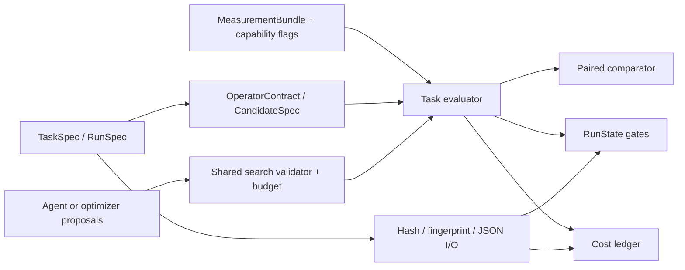
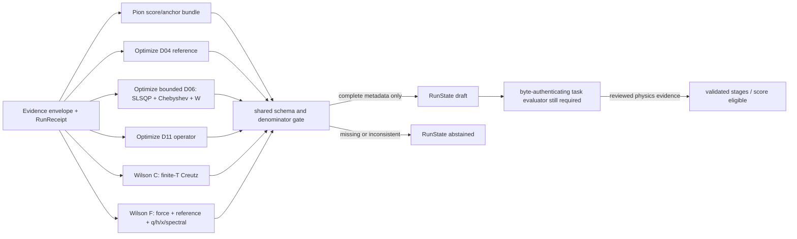

# LatticeArena framework: verified extension map

This note maps the extension points present in the current checkout and separates
working interfaces from integration work that a new task still needs. It is a
source review, not a claim that all modules already form one generic runtime.

## Current component map



The boxes are reusable components, while the arrows show a useful task-level
assembly. The Pion pipeline is the implemented end-to-end example. New task
folders still need to connect their own measurement and estimator to these
contracts; declaring a schema alone does not create an evaluator.

## Extension points confirmed in source

| Need | Existing hook | What a new task must add |
|---|---|---|
| Describe a scientific problem | [`core/specs.py`](../core/specs.py): `task_spec` includes observable, geometry, boundary, source, splits, reference, metric, budget, dependencies; it validates inclusive integer ranges and rejects overlap | Freeze units, operator conventions, split identity, reference and invalid-result rules; declared range disjointness still does not authenticate data IDs or prove statistical independence |
| Declare an operator/candidate | `operator_contract` and `candidate_spec` bind axes, dtype, transformation, support, parameters, builder and dependencies | Pion and Wilson retain their task schemas; Optimize registers `optimize-chebyshev-diagnostic-v1` through a task-owned validator. Its D11 adapter now maps the selected degree-4 Chebyshev operator contract into the shared metadata gate; production-link review, source authentication, full Optimize `TaskSpec`, and evaluator connection remain open |
| Add a measurement backend | [`core/measurement.py`](../core/measurement.py): arrays, manifest, dtype and declared `linear_response`, `cross_matrix`, `new_source` capabilities | Implement the task-owned CPU/GPU/MPI measurement route, bind inputs and software identity in the manifest, and reject unavailable capabilities before measurement. Current bundle validation checks finite nonempty arrays; it does not provide storage isolation or verify all provenance hashes by itself |
| Add a search method | [`core/search.py`](../core/search.py): common validate → budget → evaluate → record path | Adapt LLM, deterministic optimizer, evolutionary search or learned initializer to emit proposals; count invalid attempts according to the frozen budget and retain every rejection reason |
| Add a score or paired estimand | [`core/comparator.py`](../core/comparator.py): shared draw-length checks, optional unique draw IDs, positive paired risk ratio and a log lower bound | Implement the task estimand and failure policy; preserve common draw/configuration identity, planned denominators and multiplicity. A new formula must not silently inherit the current ratio's positivity or interval semantics |
| Plan diagnostics and retain denominators | [`core/receipts.py`](../core/receipts.py) adds versioned `ScenarioSpec`, stage-specific denominators and `RunReceipt` with source/output SHA-256 references and exact reason accounting. Optimize candidate-contract, Wilson lane-contract and Pion bounded-risk contract reports are consumers; a saved Pion known-graph coverage report also binds its cell, replicate, paired-block-event and family-score denominators without rerunning MC | Extend receipts to remaining task-specific statistical units (panel, replicate, block, optimizer fit, stencil or contract check). Keep cap-stop/non-success, failure, abstention and not-run counts distinct; receipt hashes identify bytes but do not prove provenance, independence or scientific validity |
| Convert numeric inputs without silent coercion | [`core/numerics.py`](../core/numerics.py) provides shared real-array and finite-real-scalar conversion. It rejects complex, boolean, text/object, and out-of-range integer values before task-specific evaluation; array NaN/Inf remain available for the task's declared failure-mask policy | Keep units, supports, finiteness rules, clipping, missing-value policy and physical meaning in the owning task. Shared conversion prevents Python/NumPy casting behavior from changing a score but does not validate measurements or their provenance |
| Track evidence readiness | [`core/state.py`](../core/state.py): operator, reference, numerical, statistical and comparison states; validation observation is permanent; a score is available only when all states have hash-bound validation; `abstained` is a terminal no-certificate state | PR #5 carries Pion's atomic score/anchor adapter. This PR binds Optimize D04, bounded D06 and D11 metadata and Wilson C/F lane metadata separately. These adapters stop at `draft` or `abstained`; task evaluators must still verify source bytes and physics before validation |
| Compare learned/iterative methods fairly | `core/ledger.py` has generic setup/solve/residual phases; the Optimize stress report keeps call cap, optimizer seconds, fit selection and postchecks separate | Add `BudgetSpec` fields for objective/gradient calls, setup, training, inference, I/O, recovery and amortization count. Enforce shared fit/heldout IDs, initialization policy and restart count; report call-budget and total-walltime estimands separately |
| Preserve artifacts | [`core/io.py`](../core/io.py): content digest, canonical fingerprint and JSON writing; [`core/receipts.py`](../core/receipts.py) binds declared source/output hash maps and reason-accounted denominators; [`core/source_integrity.py`](../core/source_integrity.py) hashes only explicitly mapped files beneath a caller-supplied root and returns planned/valid/failed/abstained counts | Include every local Python dependency that can change the recorded computation in the task dependency map and retain it in newly generated report snapshots; keep historical snapshots immutable. Extend receipts with environment and authorized input provenance only when a task defines those fields. Use no-clobber run directories and retain failure receipts. A matching digest proves only the bytes read at that moment; it does not prove provenance, immutability, scientific validity or input independence |

`agents/operator_search.py` illustrates repeated agent proposals against the
Pion development evaluator. `agents/optimization_benchmark.py` illustrates
paired synthetic episodes with development selection and a separate test draw.
These are task examples, not automatic plug-ins for every task family.

The generic split preflight is `split name + inclusive integer [start,end] -> valid endpoint order -> reject overlap`; it checks declared ranges only, not source data IDs or independence. The generic run-state transition for a missing gate is `not_run/draft -> abstained(reason) -> terminal`; abstention cannot be upgraded in place to a validated result, and `score_or_null()` remains null unless every state has hash-bound validation. This distinguishes insufficient evidence from a demonstrated failure. Optimize and Wilson route their metadata expectations through the shared state model and now use explicit-path byte wrappers at the task gates; Pion's task adapter is in PR #5. Production readers and physical evaluators remain incomplete.

## Task-specific opportunities

- **Pion:** retain the current `MeasurementBundle` and sink-builder boundary;
  add an independent dependence/anchor evidence contract before any physical
  score gate can validate. The accepted bounded block-risk calibration belongs
  behind a versioned score specification, not in the generic comparator. Its
  finite planned-block denominator, failure-as-worst rule, `alpha_s/alpha_A`
  split and graph-color/mixing assumptions should be explicit contract fields.
  `tasks/pion_projection/bounded_block_risk_score.py` implements the blockwise
  clipping, fixed failure denominator, and conditional lower-bound arithmetic
  as a pure CPU helper; it is not wired into the evaluator and always leaves
  `physical_score` null. The versioned draft at
  `tasks/pion_projection/bounded_block_risk_contract_v1.md` collects the
  estimand, transform, conditional bound and open decision fields while leaving
  the score-family threshold and conditional dependence assumptions explicit,
  while the actual score-chain/anchor-chain receipts and scalar anchor map remain
  absent. The synthetic coverage MCs compare a known finite-
  dependence graph with an IID misspecification and add an independent,
  known-variance anchor interval with explicit `alpha_score/alpha_anchor`
  allocation. A separate exact two-point enumeration contrasts the known-
  variance Gaussian z radius with a distribution-free Hoeffding radius when
  anchor support is known. An optional color-class empirical-Bernstein bound
  is compared with graph-color Hoeffding only under the known synthetic graph;
  it may help at low chromatic number but loses certificate rate as classes
  shrink, so it remains a sensitivity lane. These diagnostics show calibration choices and
  utility costs only under their declared models; they do not establish the
  real score graph, E-anchor coverage/support, common-bias bound, or conditional
  independence. The plots and reports retain separate paired-block,
  family-score, hypothetical anchor-observation, and exact-outcome denominators.
  A second dependence route is now explicit: Paulin's Markov-chain
  pseudo-spectral-gap Bernstein theorem can be applied conditionally to a
  stationary chain of predeclared block states. The selected Pion `F=3`
  planning surface has 245 formula cells (`140` mathematically valid and `105`
  abstained); at the assumed `N=4000`, `gamma_ps=0.20`, `TV=0.001` point its
  score radius is `0.386316`. A separate Markov-anchor sensitivity report
  treats the anchor chain with its own support, gap, TV and error budget; at its
  assumed planning point it lowers the best-case score LCB to `0.187605`.
  Neither report estimates a chain gap, a TV distance, the anchor-to-target map
  or physical coverage. The new core evidence envelope records dependence route,
  observable/block-map hash, method assumptions, support/units, confidence
  allocation, burn-in/TV, source hashes and reviewer receipt. Its identity
  comparison rejects reused anchor/score chain IDs but explicitly does not prove
  statistical independence. The Pion-owned adapter in PR #5 binds the selected
  anchor scalar map, target-chain score and common-bias receipt metadata before
  a statistical draft; actual receipt bytes and claims still need external
  verification. Its `TaskSpec` fingerprint now also includes the bounded-risk
  JSON contract, fixed score helper and transitive pseudo-gap implementation;
  this closes source-version identity, not the still-missing scalar map or
  anchor/reference evidence. Clipping changes the estimand and must be frozen
  before confirmation data.
- **Optimize Gaussian:** the versioned research contract now records selected
  method defaults: candidate-blind independent E-chain PP/A4P reference fit,
  `r_star=10/9`, and two contrasts (trainable-W versus same-budget SLSQP and
  trainable-W versus fixed degree-4 Chebyshev). Bounded block-risk is retained
  as a separate estimand alongside D04. The degree-4 Chebyshev polynomial uses
  monotone Bernstein controls and a fixed exact dyadic map. The
  candidate has a versioned diagnostic adapter in
  [candidate_contract.py](https://github.com/DianjunZhao/LatticeArena/blob/5d14b639bdb36f12c8b54ebf3abf96defdfc01c9/tasks/optimize_gaussian/candidate_contract.py)
  and a [hashed text-flow report](https://github.com/DianjunZhao/LatticeArena/blob/5d14b639bdb36f12c8b54ebf3abf96defdfc01c9/results/optimize_gaussian/framework_candidate_contract_20261125_v6/README.md).
  It validates the illustrative Bernstein controls against the generic candidate
  schema and a shared receipt with separate `schema_fixture=1/1/0/0` and
  `coefficient_fit=0/0/0/0` units. Receipt status `complete` means all planned
  units are accounted for, not that a fit or method succeeded. Its complete
  synthetic fixture only reaches
  `CONTRACT_COMPLETE_REQUIRES_HUMAN_REVIEW`; it does not create a complete
  Optimize `TaskSpec` or connect a measurement route/evaluator. The
  36-panel synthetic grid demonstrates how to retain a paired heldout-loss plot
  and separate solver stops from failed fits; a separate 12-train/12-eval pooled
  initialization replay separates train-only prior fitting, identical online
  SLSQP budgets, and heldout scoring. Its synthetic break-even count is call
  accounting, not a production timing claim. A separate Markov correction
  report adds a support-only bound for the paired macroblock chain and a
  known-gap two-state synthetic stress. These defaults and formula diagnostics
  do not supply the E-chain reference receipt, physical effect measurement,
  production dependence receipt, or independent review. The task adapter in
  `tasks/optimize_gaussian/evidence_adapter.py` now maps D04 fit checks, both
  bounded-block D06 contrasts plus their shared denominator, and D11 SU(3)
  operator metadata to the shared gate and requires an explicit-path byte check
  by default; it does not connect the real source reader or implement the
  training/evaluation runner. A separate D06 calibration snapshot entrypoint
  now parses the captured q-matrix, recomputes all three arm scores and the
  corrected Markov lower bounds, reconciles chain/gap/TV receipt bytes and
  denominators, then passes the same snapshots to the atomic evidence gate.
  Its positive and negative examples are synthetic; the production RunSpec,
  full D04 raw-reference gate evaluator, D11 production-link evaluator and
  training worker remain absent. A new D04 CPU diagnostic reader parses
  PP/A4P arrays from an immutable snapshot and executes the six joint-fit
  variants, but does not compute dependence-aware fit uncertainty, validate
  E-chain receipts, or emit the gate-ready D04 summary.
- **Wilson loop:** the selected method defaults now keep finite-`T` Creutz and
  ground-state discrete force as separate estimands. They can share paired IDs
  while using different inference and systematic-error gates. The fixed q/h/x
  toy and randomized positive-spectrum stress validate the four-point algebra
  and envelope propagation over declared synthetic ranges, but supply no
  physical contamination envelope. The versioned lane-contract inspector fixes
  the Creutz sign and candidate-minus-reference force direction, checks units
  and alpha allocation, and rejects malformed kernel lists and receipts. The
  current [v9 report](https://github.com/DianjunZhao/LatticeArena/blob/5d14b639bdb36f12c8b54ebf3abf96defdfc01c9/results/wilson_loop/lane_contract_diagnostic_20261125_v9/README.md)
  uses the shared receipt API: 16 structural checks have denominator
  `16/7/9/0`, and each failed check has a text reason. Complete status still
  means only that checks are accounted for; it neither authenticates evidence
  receipts nor provides physics evidence. The new Wilson adapter in
  `tasks/wilson_loop/evidence_adapter.py` binds C's finite-T interval and F's
  independent force/reference/spectral/thermal receipts to separate lane
  states. It checks selected denominators and force-unit budgets, then stops at
  `draft`; `RunState` itself does not infer spectral, thermal or mixed-sector
  bounds. The F spectral q reader now consumes a captured fit-support receipt
  through the `q_excited` route; the force-summary reader checks all eight q
  corners against the derived q(T=5,6) upper bounds before recalculating the
  q/h/x-to-force budget and passing the same snapshot bundle to the F gate.
  Its v2 JSON contract names the kernel-row order and each `(R,T)` column;
  reversed or missing order declarations abstain before the corner comparison.
  This still does not fit raw correlators or a 3x3 GEVP, establish upstream
  interval coverage, or derive thermal h and mixed x.

## Cross-task extension: typed dependence and physics evidence

The three task families now exercise related but non-interchangeable evidence
routes: Pion has a score-block chain and a distinct anchor chain; Optimize has a
joint paired macroblock chain for a positive denominator plus two contrasts;
Wilson C has four bounded loop means propagated through logs, while Wilson F
needs spectral and thermal contamination envelopes propagated through a
force stencil. A single `gamma_ps` field or generic `RunState` cannot represent
these claims safely. A repeated software defect also appeared across the three
task families: direct NumPy `float64` casts could erase complex score parts,
coerce text/bools, or throw on huge integers. `core/numerics.py` now provides a
shared conversion boundary while task modules retain their own support,
failure-mask, unit and estimator rules.

```text
frozen task estimand + observable-map hash
  -> typed evidence route (IID / dependency graph / Markov gap / spectral envelope)
  -> route-specific support, units, error allocation, burn-in and source receipts
  -> independent review + task evaluator
  -> reason-accounted receipt -> RunState abstain or validation (never by schema completeness alone)
```

Task-owned gate composition now has this shape:



Optimize and Wilson use separate receipts and stage states for their distinct
estimands. A successful bundle is not a physics result: source hashes are not
opened by these metadata adapters, reviewer and authorization fields are claims,
and no adapter marks a stage `validated` or sets `physical_score`.

The shared schema is implemented in [`core/evidence.py`](../core/evidence.py).
`evidence_envelope` records task and evidence kind; chain ID, split, state unit
and manifest hash; observable-map ID/hash and support with units; method/version
and assumptions; IID, finite-dependence, Markov, spectral or deterministic
route; confidence family/allocation; source hashes; and a hash-bound review
receipt. Review metadata includes `reviewer_role_claim`, a hash of the declared
independence claim, and the reviewed scope. These fields are assertions carried
by the envelope; they do not authenticate reviewer identity, conflicts or
independence. For Markov evidence it requires `gamma_ps_lower`, burn-in
unit/count, and a post-burn-in TV bound. A Wilson F-lane bound can carry the
propagated force unit such as `a_s*a_t*F`, rather than an upstream loop's
dimensionless unit.

`inspect_evidence_envelope` returns `SCHEMA_COMPLETE_NOT_CERTIFIED` only when
the envelope matches caller-frozen identity/unit/source expectations and a
review record claims an independent role with a hashed independence statement;
malformed, stale, mismatched, non-independent or unreviewed inputs return
`ABSTAIN`. This is a schema-v2 metadata check, not authentication of the
reviewer or the statement.
`inspect_distinct_chain_identities` rejects a reused chain ID or manifest while
always returning `independence_proven=false`: unique labels and hashes cannot
establish independent sampling. Consumers must still hash actual source bytes,
review theorem assumptions and connect the result to a task-specific gate; the
schema itself never sets a physical score. `apply_evidence_gate` revalidates a
shared `RunReceipt`: missing/unrun denominator units or envelope errors send the
requested `RunState` stage to `abstained`; a complete schema plus complete
planned denominator advances only to `draft`, never `validated`.
`apply_evidence_bundle_gate` checks multiple named envelopes and selected
chain-identity pairs before making one stage transition. Pion uses it for
separate anchor/score evidence; Optimize uses it for bounded D06's two
contrasts and common denominator. Wilson C and F each use a separate lane
bundle. Identity checks still report `independence_proven=false`.

`verify_source_bytes` accepts an explicit logical-name-to-relative-path map and
caller-supplied root; absolute, parent-traversal, unexpected and root-escaping
paths never reach file hashing. Missing paths/files count as abstentions and
digest mismatches/read failures as failures. The shared
`apply_evidence_gate_with_source_bytes` and bundle variant run this preflight
before the metadata gate; complete bytes still advance only to `draft`.
`capture_source_snapshot` adds a bounded in-memory option: it reads each mapped
file once, retains only digest-matching immutable `bytes`, and exposes them via
`SourceByteSnapshot.read_bytes`. `verify_source_snapshot` rechecks those same
bytes at the gate; route bundles are checked atomically. The default snapshot
budget is 64 MiB, so larger inputs need an explicitly sized or future streaming
reader. Pion, Optimize D04/D06/D11 and Wilson C/F adapters accept snapshots as
well as the older path-verification call. A task reader can now parse from the
snapshot and pass that exact object to its gate, avoiding a path reopen between
verification and computation.

The compressed source-byte budget does not constrain NPZ expansion. Snapshot
NPZ readers therefore call `core/npz_safety.py` before `numpy.load`; it checks
flat unique ZIP members, bounded NPY headers, array payload lengths and a 64 MiB
default total uncompressed budget. Inputs exceeding that expanded budget need a
separately reviewed streaming reader rather than a larger implicit allocation.
Snapshot-using reports should bind the reader, capture code and safety helper in
their TaskSpec/source dependency map, and copy relevant sources into the hashed
artifact bundle. The Pion development snapshot bundle does this and now emits a
development-only diagnostic that cross-checks source, decoded-array,
configuration-ID and output-artifact hashes; Optimize's no-launch draft binds
the D06 parser stack, and Wilson's retrospective C report stores its parser
sources.

Pion development fitting and the selected Optimize/Wilson snapshot diagnostics
can consume retained bytes, but no production solver/evaluator emits reviewed
physical receipts yet. The path-verification compatibility route still cannot
prove that a separate parser used the hashed bytes, and even a snapshot does not
authenticate expected-hash authority, reviewer identity, provenance,
independence or scientific claims. Synthetic fixtures opt out of byte checks
only when explicitly requested; source-complete fixtures stop at `draft`.

This PR's fixtures cover Optimize D04/D06/D11 and Wilson C/F metadata. They
exercise missing Markov gap, wrong chain, wrong force unit, stale source hash,
missing review, non-independent reviewer role, missing independence-claim hash,
incomplete bundle, chain collision, invalid fit summary, missing SU(3) receipt,
sealed split, excess TV, force-budget failure, and incomplete GEVP denominator;
invalid cases abstain. Default source-byte-required behavior is also tested;
synthetic positive metadata fixtures declare their opt-out. Optimize maps both bounded-risk contrasts plus the
shared positive denominator to one bundle, while D04 and D11 retain separate
stages. Wilson keeps C and F receipts in separate lane-specific states. The
adapters advance only to `draft`; byte matching does not authenticate receipt
authority or certify statistical/physical claims. An earlier PR #6 revision recorded **21 passed** for the Optimize D06
reader/adapter subset, **23 passed** for the Wilson force/q-reader subset,
**90 passed** for all Wilson tests and **317 passed** for the full CPU suite.
The Wilson force-summary v2 schema binds q/h/x row order to the canonical kernel
IDs and column order to `(R,T)=(2,5),(2,6),(3,5),(3,6)`; reversal tests fail
closed before q reconciliation.
An earlier PR #5 revision reported **201 passed** for its Pion-specific suite and **257 passed** for
its full CPU suite. Snapshot fixtures use synthetic files only. No production
receipt was supplied. Connecting real readers to snapshots, independent review
of task checks, and numerical/physics evaluators remain future work.

## Practical implementation order for a new task

1. Define its observable, units, geometry, boundary/source convention, splits,
   reference, budget and failure states in a versioned task protocol.
2. Add operator/candidate and measurement-capability contracts; reject malformed
   plans before opening data or initializing a device.
3. Implement a task evaluator that emits raw measurements, paired draws,
   planned/valid/failed/abstained denominators and source-bound receipts.
4. Connect candidate generators through the shared validator and explicit cost
   ledger; keep training, search, measurement and inference costs separable.
5. Add CPU contract tests and synthetic checks for mathematical/software
   behavior, then authorize and verify the actual backend separately. CPU tests
   do not certify GPU/MPI physics behavior.
6. Add task-specific comparison and reporting; verify formulas, interval
   assumptions, identities, plots, artifact hashes and negative results.

Each diagnostic or confirmation report should include either a figure or a
textual data-flow/decision diagram, plus planned/valid/failed/abstained
denominators at every relevant unit of analysis. Solver cap-stops, statistical
failures and protocol abstentions are distinct states and should stay visible.

## Extension point: semantic array axes and derived objects

The Wilson cross-correlator work exposed a reusable contract requirement that
is not yet a shared runtime abstraction: a numerical array needs ordered,
named semantic axes as well as a shape. For the F-lane matrix this is
`[block,R,t,sink_operator,source_operator]` plus the exact ordered basis IDs;
the q reducer separately declares which bare operator each kernel ID denotes.
A derived GEVP-composite operator has a different object identity and cannot be
copied into multiple bare-kernel cells just because it came from the same
matrix. The current protection lives in task-level readers, not a generic array
API. A future shared contract could validate axis IDs, object/estimator ID,
units, transformation lineage, and source snapshot together before a reducer
accepts values. This should be introduced only when at least two task readers
can use the same semantics without weakening their physics-specific checks.

## Current integration boundary

The current `main` has a Pion pilot, but these additions remain analytic,
synthetic or structural CPU work; none closes a production physics measurement
pipeline. Shared receipts cover several contract and diagnostic consumers, and
the task adapters consume the typed evidence validator plus either an
explicit-path byte check or a caller-provided immutable snapshot; neither
establishes source authority, independence, or scientific claims. Pion's selected
`F=3` Markov score sensitivity, separate Markov-anchor sensitivity, coverage
simulations and common-bias feasibility analysis are in the separate PR #5.
Optimize now has two
selected contrasts and a conditional Markov route for its distinct bounded
block-risk estimand; its real E-reference and solver receipts remain absent.
Wilson now has both selected lane defaults, a v9 structural mapping report,
force-budget propagation, C-lane Markov support sensitivity, lane-specific C/F
metadata adapters, a snapshot-derived q(T) to force-budget consistency check,
and an explicit kernel-to-bare-operator q object mapping; its production loop,
joint GEVP/overlap fit, thermal and contamination receipts remain absent. The
new mapping is a method default under independent review, while the reader
enforces its object ID and operator-axis mapping. Figures/text flows,
denominators and artifact hashes accompany
these method diagnostics, but they do not demonstrate chain assumptions or
physical coverage. The three TODOs stay open for independent review, verified
task-specific receipts and authorization. CPU checks establish software/algebra
behavior only, not GPU/MPI physics validation.

The current PR #6 follow-up adds two narrower reader patterns that expose
different extension needs: Optimize D04 now starts from raw PP/A4P arrays in an
immutable snapshot and executes a fixed joint-fit grid, while the Wilson F-lane
transfer-trace consumer starts from a caller-supplied fitted spectrum summary
and checks the proposed q/h/x algebra. The Optimize reader still lacks
authenticated dependence evidence and a gate-ready E-reference receipt. Its new
CPU pilot carries circular block indices through joint, PP-only, A4P-only and
window/model fits, so paired shifts retain same-draw covariance and fit
failures stay in their denominators. It demonstrates a further extension
point: resampling belongs beside the task estimator until order, stationarity,
wraparound and block-length semantics are shared and reviewed; a generic
bootstrap utility alone cannot certify them. Wilson already has a separate raw
`C_ij` snapshot reader, a forward static-sector joint-GLS candidate, and now a
proposed 2-vacuum × 2-static finite-`N_t` fit prototype exercised on synthetic
bytes. The prototype reaches a full-rank 45-parameter solution on its matching
generator, but has a Jacobian condition number near `1.2e5`, diagonal-only
weights and no interval coverage. The missing bridge is exporter-reviewed
time-origin/source-sink convention plus a covariance-aware, coverage-tested
fit from authorized production development bytes.
Together these show a reusable framework gap: the shared layer can preserve
exact input bytes and denominators, but each task must still own its
semantic-axis parser, estimator, fit diagnostics, uncertainty calibration and
physical receipt. A shared fit-output schema should be considered only after
the Wilson exporter and Optimize reference reader establish genuinely common
fields while retaining their channel, symmetry and boundary conventions.
The D04 MBB figure is regenerable from a frozen summary after prior artifact
hash verification, which separates costly fit execution from derived-only
presentation refresh; that pattern is reusable for other CPU reports.

## Extension point: bind typed claims and code to captured bytes

The Pion adapter now parses its common-bias claim from the same immutable anchor
snapshot later checked by the source-byte gate. It compares `C/R`, anchor map
ID/hash, the validated reference-stage evidence hash, review scope, quantity,
and support interval; duplicate JSON keys and non-finite values fail closed.
This closes a claim-to-input consistency gap while leaving reviewer identity,
hash authority and scientific validity unauthenticated. Its report keeps two
denominators separate: source-file byte integrity and semantic receipt
consistency. A semantically inconsistent claim can therefore have source-file
P/V/F/A=`16/16/0/0` and receipt-claim P/V/F/A=`1/0/1/0` without conflating the
two outcomes.

Optimize's no-launch draft uses the same provenance idea for code: one source
path map now supplies both TaskSpec dependency hashes and retained source
snapshots, and report generation checks captured bytes against the planned
digests before creating output. This makes missing snapshots and source changes
visible in the artifact audit. Wilson's finite-$N_t$ q/h/x algebra report now
also retains and hashes its reader, selected lane contract, snapshot-integrity
helper and regression test; its fixture outputs are still generated in the
test and remain diagnostic-only. Across these three patterns the reusable
shape is: typed parser, same immutable bytes, linked IDs/hashes, and separate
source and claim denominators.
Future adapters should add domain-specific parsers and review rules without
treating a matching hash as authenticated evidence. A
shared receipt-signature/trust-root layer could be considered after at least
two tasks define compatible signer, authority, revocation and scope semantics.

## Extension updates: 2026-11-28

The latest task work adds three useful extension patterns while leaving the
measurement and certification boundary task-owned:

1. **Pion: propagate a common target set through a dependence-aware score bound.**
   PR #5 adds an optional CPU helper that evaluates a finite target grid, applies
   the support-only Markov Eq. (3.26) bound to the family `candidate comparisons
   × grid points`, and subtracts an `h/R` cover penalty. The penalty follows
   because the clipped score has slope at most `2/R` when candidate and
   reference predictions lie in one frozen domain of width at most `R`.
   This composes target-set uncertainty and score-chain uncertainty in a
   conditional lower bound; it does not establish target-set coverage, chain
   assumptions, anchor-to-E-reference correspondence, or receipt authority. The
   helper remains outside Pion's frozen evaluator and TaskSpec dependency map.

2. **Wilson C: adapt a legacy producer transaction without reopening paths.**
   PR #6 adds a snapshot-only bridge from the archived NPZ, provenance, commit
   marker, and HMC input manifest into the current C reader's in-memory schema.
   It joins captured hashes, IDs, trajectories, gauge hashes, loop hashes,
   stencil, kernel, action, boundary, and explicit calibration opt-in. The old
   default producer protocol fails closed because its split, stencil, kernel,
   and metadata do not satisfy the selected C contract. A synthetic positive
   transaction demonstrates the conversion interface only; the adapter never
   certifies a physical score or writes a converted file.

3. **Optimize: keep estimator and solver family separate from the framework
   gate.** The selected comparison family remains trainable-W versus same-budget
   SLSQP and trainable-W versus fixed degree-4 Chebyshev. Existing snapshot
   readers can parse D04/D06 diagnostic arrays and pass the same captured bytes
   to their task gates, but the production RunSpec/evaluator and real paired
   solver receipts are still absent. The shared gate records route metadata and
   denominators; it does not launch or validate a solver.

Latest branch-specific software checks recorded in the corresponding PR
worktrees are **337 passed** for PR #5's full CPU suite and **532 passed** for
PR #6's full CPU suite. These are separate checkout results and establish
software behavior only. All task gates remain `NOT_READY/UNCERTIFIED`,
`physical_score=null`, and sealed inputs closed until the required evidence,
independent review, and authorization arrive.

## Extension note: keep producer semantics separate from consumer validation

The latest static reviews reinforce a reusable boundary: the task must freeze the observable formula and its semantic axes at the producer/reader seam, while the shared snapshot layer can only bind bytes and preserve failure denominators. Pion's source-root and pre-captured-snapshot paths converge on the same atomic evidence gate after byte capture; task-code fingerprints are checked before validation-array or GPU candidate work. Optimize D04 keeps fold signs, time support, covariance regularization, and paired resampling in its task reader because these depend on channel conventions and chain ordering. Wilson C and F remain separate estimands, and the F two-sector formula still needs a production exporter to validate endpoint/time-origin assumptions. A hash match can prove code/input identity only; it cannot certify the producer convention, authorization, independence, or interval coverage.

The Wilson two-sector reader also showed why code identity must include low-level parser guards: raw snapshot hashes alone do not bound NPZ expansion. Task source maps and report snapshots should bind every parser helper that affects allocation or interpretation, then run that helper before array loading. This is reusable across task readers without pretending the shared layer understands each array's physical axes.

The shared NPZ preflight also normalizes unsupported compression, encrypted members, and corrupt DEFLATE streams to `ValueError`. Task adapters can then preserve their own failed/abstained denominators for malformed artifacts instead of leaking codec-specific exceptions across task boundaries.

`SourceByteSnapshot` now sizes each chunk against the remaining aggregate byte budget and reads at most one extra byte to establish an over-limit condition; that extra byte is never retained. Versioned reports remain immutable snapshots: their integrity tests should validate the saved source and artifact hash chain, not require an old captured source to equal the current live file after later code changes.

Pion's path-based compatibility reader now uses the same discipline: capture bounded compressed bytes once, apply the NPZ expansion preflight, and parse that captured buffer. This removes a gap between snapshot-mode readers and legacy path-mode readers while keeping task split policy local to Pion.

## Extension note: close report source maps over shared readers

A source audit found two report generators that used the shared immutable-byte
reader without naming its implementation in their own code identity map:
Optimize D04 MBB and Wilson C-lane development. New D04 reports now hash
`core/source_integrity.py` and `core/npz_safety.py`; new Wilson C reports also retain those exact helper
bytes and include them in the artifact manifest. Other checked report paths
already bound the helper, including the Wilson two-sector/raw-matrix reports,
the transfer-trace snapshot, and Pion's frozen TaskSpec dependency map.

Reusable flow: `task report generator -> enumerate direct and shared parser
dependencies -> capture each dependency once before reading data -> hash and
retain the same bytes (where the report format supports snapshots) -> include source identities in
the report integrity manifest -> test hashes against the saved bytes`. Deriving
a hash and its archived source copy from separate file reads leaves a race in
which a report can claim different code from the code bytes it retains.
Historical report
packages remain immutable snapshots and should not be regenerated just to match
new source maps. This audit improves code provenance only; source hashes do not
establish data authority, independence, estimator validity, or calibration.
