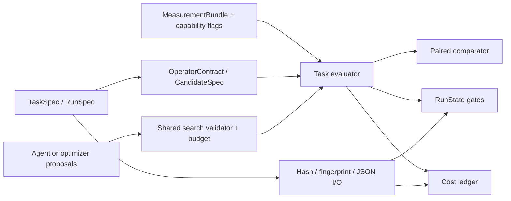

# LatticeArena framework: verified extension map

This note maps the extension points present in the current checkout and separates
working interfaces from integration work that a new task still needs. It is a
source review, not a claim that all modules already form one generic runtime.

## Current component map



The boxes are reusable components, while the arrows show a useful task-level
assembly. The Pion pipeline is the implemented end-to-end example. New task
folders still need to connect their own measurement and estimator to these
contracts; declaring a schema alone does not create an evaluator.

## Extension points confirmed in source

| Need | Existing hook | What a new task must add |
|---|---|---|
| Describe a scientific problem | [`core/specs.py`](../core/specs.py): `task_spec` includes observable, geometry, boundary, source, splits, reference, metric, budget, dependencies; it validates inclusive integer ranges and rejects overlap | Freeze units, operator conventions, split identity, reference and invalid-result rules; declared range disjointness still does not authenticate data IDs or prove statistical independence |
| Declare an operator/candidate | `operator_contract` and `candidate_spec` bind axes, dtype, transformation, support, parameters, builder and dependencies | Pion and Wilson retain their task schemas; Optimize registers `optimize-chebyshev-diagnostic-v1` through a task-owned validator. Its research contract records selected D11 method defaults, but the adapter remains diagnostic: independent production-link review, full Optimize `TaskSpec`, and evaluator connection remain open |
| Add a measurement backend | [`core/measurement.py`](../core/measurement.py): arrays, manifest, dtype and declared `linear_response`, `cross_matrix`, `new_source` capabilities | Implement the task-owned CPU/GPU/MPI measurement route, bind inputs and software identity in the manifest, and reject unavailable capabilities before measurement. Current bundle validation checks finite nonempty arrays; it does not provide storage isolation or verify all provenance hashes by itself |
| Add a search method | [`core/search.py`](../core/search.py): common validate → budget → evaluate → record path | Adapt LLM, deterministic optimizer, evolutionary search or learned initializer to emit proposals; count invalid attempts according to the frozen budget and retain every rejection reason |
| Add a score or paired estimand | [`core/comparator.py`](../core/comparator.py): shared draw-length checks, optional unique draw IDs, positive paired risk ratio and a log lower bound | Implement the task estimand and failure policy; preserve common draw/configuration identity, planned denominators and multiplicity. A new formula must not silently inherit the current ratio's positivity or interval semantics |
| Plan diagnostics and retain denominators | [`core/receipts.py`](../core/receipts.py) adds versioned `ScenarioSpec`, stage-specific denominators and `RunReceipt` with source/output SHA-256 references and exact reason accounting. Optimize candidate-contract, Wilson lane-contract and Pion bounded-risk contract reports are consumers; a saved Pion known-graph coverage report also binds its cell, replicate, paired-block-event and family-score denominators without rerunning MC | Extend receipts to remaining task-specific statistical units (panel, replicate, block, optimizer fit, stencil or contract check). Keep cap-stop/non-success, failure, abstention and not-run counts distinct; receipt hashes identify bytes but do not prove provenance, independence or scientific validity |
| Track evidence readiness | [`core/state.py`](../core/state.py): operator, reference, numerical, statistical and comparison states; validation observation is permanent; a score is available only when all states have hash-bound validation; `abstained` is a terminal no-certificate state | Bind task receipts and evidence hashes to these states. Keep diagnostic/physical labels explicit; Pion, Optimize and Wilson task evaluators still need to connect their task-specific abstention rules to this generic state |
| Compare learned/iterative methods fairly | `core/ledger.py` has generic setup/solve/residual phases; the Optimize stress report keeps call cap, optimizer seconds, fit selection and postchecks separate | Add `BudgetSpec` fields for objective/gradient calls, setup, training, inference, I/O, recovery and amortization count. Enforce shared fit/heldout IDs, initialization policy and restart count; report call-budget and total-walltime estimands separately |
| Preserve artifacts | [`core/io.py`](../core/io.py): content digest, canonical fingerprint and JSON writing; [`core/receipts.py`](../core/receipts.py) binds declared source/output hash maps and reason-accounted denominators; [`core/source_integrity.py`](../core/source_integrity.py) hashes only explicitly mapped files under a caller-supplied root | Extend receipts with environment and authorized input provenance only when a task defines those fields. Use no-clobber run directories and retain failure receipts. A matching digest proves only the bytes read in that call, not source authority, immutability, scientific validity or input independence |

`agents/operator_search.py` illustrates repeated agent proposals against the
Pion development evaluator. `agents/optimization_benchmark.py` illustrates
paired synthetic episodes with development selection and a separate test draw.
These are task examples, not automatic plug-ins for every task family.

The generic split preflight is `split name + inclusive integer [start,end] -> valid endpoint order -> reject overlap`; it checks declared ranges only, not source data IDs or independence. The generic run-state transition for a missing gate is `not_run/draft -> abstained(reason) -> terminal`; abstention cannot be upgraded in place to a validated result, and `score_or_null()` remains null unless every state has hash-bound validation. This distinguishes insufficient evidence from a demonstrated failure. The task-specific Pion, Optimize and Wilson evaluators do not yet route their contracts through this shared object.

## Task-specific opportunities

- **Pion:** retain the current `MeasurementBundle` and sink-builder boundary;
  add an independent dependence/anchor evidence contract before any physical
  score gate can validate. The accepted bounded block-risk calibration belongs
  behind a versioned score specification, not in the generic comparator. Its
  finite planned-block denominator, failure-as-worst rule, `alpha_s/alpha_A`
  split and graph-color/mixing assumptions should be explicit contract fields.
  `tasks/pion_projection/bounded_block_risk_score.py` implements the blockwise
  clipping, fixed failure denominator, and conditional lower-bound arithmetic
  as a pure CPU helper; it is not wired into the evaluator and always leaves
  `physical_score` null. The versioned draft at
  `tasks/pion_projection/bounded_block_risk_contract_v1.md` collects the
  estimand, transform, conditional bound and open decision fields while leaving
  the score-family threshold and conditional dependence assumptions explicit,
  while the actual score-chain/anchor-chain receipts and scalar anchor map remain
  absent. A candidate per-state folded-PP scalar map and snapshot reader now
  exist, but the map-to-target bias bridge and independently reviewed anchor
  receipts remain absent. The synthetic coverage MCs compare a known finite-
  dependence graph with an IID misspecification and add an independent,
  known-variance anchor interval with explicit `alpha_score/alpha_anchor`
  allocation. A separate exact two-point enumeration contrasts the known-
  variance Gaussian z radius with a distribution-free Hoeffding radius when
  anchor support is known. An optional color-class empirical-Bernstein bound
  is compared with graph-color Hoeffding only under the known synthetic graph;
  it may help at low chromatic number but loses certificate rate as classes
  shrink, so it remains a sensitivity lane. These diagnostics show calibration choices and
  utility costs only under their declared models; they do not establish the
  real score graph, E-anchor coverage/support, common-bias bound, or conditional
  independence. The plots and reports retain separate paired-block,
  family-score, hypothetical anchor-observation, and exact-outcome denominators.
  A second dependence route is now explicit: Paulin's Markov-chain
  pseudo-spectral-gap Bernstein theorem can be applied conditionally to a
  stationary chain of predeclared block states. The selected Pion `F=3`
  planning surface has 245 formula cells (`140` mathematically valid and `105`
  abstained); at the assumed `N=4000`, `gamma_ps=0.20`, `TV=0.001` point its
  score radius is `0.386316`. A separate Markov-anchor sensitivity report
  treats the anchor chain with its own support, gap, TV and error budget; at its
  assumed planning point it lowers the best-case score LCB to `0.187605`.
  Neither report estimates a chain gap, a TV distance, the anchor-to-target map
  or physical coverage. The new core evidence envelope records dependence route,
  observable/block-map hash, method assumptions, support/units, confidence
  allocation, burn-in/TV, source hashes and reviewer receipt. Its identity
  comparison rejects reused anchor/score chain IDs but explicitly does not prove
  statistical independence. The Pion-owned adapter now binds the frozen anchor
  scalar map, target-chain score and common-bias receipt; it can additionally
  verify explicitly mapped source bytes before a draft. Physical evaluation is
  still open. Clipping changes the estimand and must be frozen before
  confirmation data.
- **Optimize Gaussian:** the versioned research contract now records selected
  method defaults: candidate-blind independent E-chain PP/A4P reference fit,
  `r_star=10/9`, and two contrasts (trainable-W versus same-budget SLSQP and
  trainable-W versus fixed degree-4 Chebyshev). Bounded block-risk is retained
  as a separate estimand alongside D04. The degree-4 Bernstein/Chebyshev
  candidate has a versioned diagnostic adapter in
  [candidate_contract.py](https://github.com/DianjunZhao/LatticeArena/blob/5d14b639bdb36f12c8b54ebf3abf96defdfc01c9/tasks/optimize_gaussian/candidate_contract.py)
  and a [hashed text-flow report](https://github.com/DianjunZhao/LatticeArena/blob/5d14b639bdb36f12c8b54ebf3abf96defdfc01c9/results/optimize_gaussian/framework_candidate_contract_20261125_v6/README.md).
  It validates the illustrative Bernstein controls against the generic candidate
  schema and a shared receipt with separate `schema_fixture=1/1/0/0` and
  `coefficient_fit=0/0/0/0` units. Receipt status `complete` means all planned
  units are accounted for, not that a fit or method succeeded. Its complete
  synthetic fixture only reaches
  `CONTRACT_COMPLETE_REQUIRES_HUMAN_REVIEW`; it does not create a complete
  Optimize `TaskSpec` or connect a measurement route/evaluator. The
  36-panel synthetic grid demonstrates how to retain a paired heldout-loss plot
  and separate solver stops from failed fits; a separate 12-train/12-eval pooled
  initialization replay separates train-only prior fitting, identical online
  SLSQP budgets, and heldout scoring. Its synthetic break-even count is call
  accounting, not a production timing claim. A separate Markov correction
  report adds a support-only bound for the paired macroblock chain and a
  known-gap two-state synthetic stress. These defaults and formula diagnostics
  do not supply the E-chain reference receipt, physical effect measurement,
  production dependence receipt, or independent review. The generic optimizer
  hook does not define those evidence gates.
- **Wilson loop:** the selected method defaults now keep finite-`T` Creutz and
  ground-state discrete force as separate estimands. They can share paired IDs
  while using different inference and systematic-error gates. The fixed q/h/x
  toy and randomized positive-spectrum stress validate the four-point algebra
  and envelope propagation over declared synthetic ranges, but supply no
  physical contamination envelope. The versioned lane-contract inspector fixes
  the Creutz sign and candidate-minus-reference force direction, checks units
  and alpha allocation, and rejects malformed kernel lists and receipts. The
  current [v9 report](https://github.com/DianjunZhao/LatticeArena/blob/5d14b639bdb36f12c8b54ebf3abf96defdfc01c9/results/wilson_loop/lane_contract_diagnostic_20261125_v9/README.md)
  uses the shared receipt API: 16 structural checks have denominator
  `16/7/9/0`, and each failed check has a text reason. Complete status still
  means only that checks are accounted for; it neither authenticates evidence
  receipts nor provides physics evidence. The generic `RunState` does not infer
  spectral, thermal or mixed-sector bounds.

## Cross-task extension: typed dependence and physics evidence

The three task families now exercise related but non-interchangeable evidence
routes: Pion has a score-block chain and a distinct anchor chain; Optimize has a
joint paired macroblock chain for a positive denominator plus two contrasts;
Wilson C has four bounded loop means propagated through logs, while Wilson F
needs spectral and thermal contamination envelopes propagated through a
force stencil. A single `gamma_ps` field or generic `RunState` cannot represent
these claims safely.

```text
frozen task estimand + observable-map hash
  -> typed evidence route (IID / dependency graph / Markov gap / spectral envelope)
  -> route-specific support, units, error allocation, burn-in and source receipts
  -> independent review + task evaluator
  -> reason-accounted receipt -> RunState abstain or validation (never by schema completeness alone)
```

The shared schema is implemented in [`core/evidence.py`](../core/evidence.py).
`evidence_envelope` records task and evidence kind; chain ID, split, state unit
and manifest hash; observable-map ID/hash and support with units; method/version
and assumptions; IID, finite-dependence, Markov, spectral or deterministic
route; confidence family/allocation; source hashes; and a hash-bound review
receipt. Review metadata includes `reviewer_role_claim`, a hash of the declared
independence claim, and the reviewed scope. These fields are assertions carried
by the envelope; they do not authenticate reviewer identity, conflicts or
independence. For Markov evidence it requires `gamma_ps_lower`, burn-in
unit/count, and a post-burn-in TV bound. A Wilson F-lane bound can carry the
propagated force unit such as `a_s*a_t*F`, rather than an upstream loop's
dimensionless unit.

`inspect_evidence_envelope` returns `SCHEMA_COMPLETE_NOT_CERTIFIED` only when
the envelope matches caller-frozen identity/unit/source expectations and a
review record claims an independent role with a hashed independence statement;
malformed, stale, mismatched, non-independent or unreviewed inputs return
`ABSTAIN`. This is a schema-v2 metadata check, not authentication of the
reviewer or the statement.
`inspect_distinct_chain_identities` rejects a reused chain ID or manifest while
always returning `independence_proven=false`: unique labels and hashes cannot
establish independent sampling. Consumers must still review theorem assumptions
and connect results to task-specific gates; the schema itself never sets a
physical score. `verify_source_bytes` hashes only the declared files beneath a
caller-supplied root and accounts for missing/mismatched files. The
`apply_evidence_gate_with_source_bytes` and bundle variant run that check before
the metadata gate; a complete result still advances only to `draft`.
`capture_source_snapshot` additionally reads mapped files once, retains only
hash-matching immutable bytes (64 MiB default total cap), and allows a task
reader to parse and pass the same snapshot to the gate. Snapshot verification
re-hashes those retained bytes and identifies `read_mode=immutable_snapshot`;
larger measurement arrays need a streaming design. Because an NPZ compressed
size does not bound its expanded arrays, `core/npz_safety.py` preflights ZIP
members, NPY headers and total uncompressed size (64 MiB default) before a
snapshot reader calls `numpy.load`; Pion's `common.load_data` uses this check
before loading its captured development NPZ. Snapshot-based TaskSpecs and
bundle manifests should also bind the parser, capture and safety-helper source
hashes; Pion's development bundle and frozen submission now record that code
identity, and the candidate path checks it before importing GPU/MPI/QUDA.
The development fit can use a retained snapshot, while legacy and later
validation/evaluation call sites still include path-based routes and do not
share one snapshot end-to-end. Neither route authenticates digest authority or
physics.
`apply_evidence_gate` revalidates a
shared `RunReceipt`: missing/unrun denominator units or envelope errors send the
requested `RunState` stage to `abstained`; a complete schema plus complete
planned denominator advances only to `draft`, never `validated`.
`apply_evidence_bundle_gate` checks multiple named envelopes and selected
chain-identity pairs before making one stage transition. This supports Pion's
separate anchor/score evidence without allowing a partial draft transition;
its identity check still reports `independence_proven=false`.

Fixtures cover Pion anchor/dependence, Optimize bounded-risk, and Wilson
force-bound metadata. They explicitly exercise missing Markov gap, wrong chain,
wrong force unit, stale source hash, missing review, a non-independent reviewer
role claim, a missing independence-claim hash, bundle-member mismatch, chain
collision and null required-hash mapping; all invalid cases abstain. The Pion
task metadata adapter now maps its selected F=3 score and bounded-IID anchor
defaults, exact planned denominators, common-bias cap, required source hashes
and chain identity into the bundle gate. Production use requires explicit
source-root/path maps or captured per-route snapshots; all mapped bytes must
match before the adapter can reach `draft`, and no result becomes validated.
Temporary byte fixtures are not production receipts. Optimize and Wilson task
adapters are described in PR #6; all production source readers still need
authorized file maps and independent review before any validation.

## Practical implementation order for a new task

1. Define its observable, units, geometry, boundary/source convention, splits,
   reference, budget and failure states in a versioned task protocol.
2. Add operator/candidate and measurement-capability contracts; reject malformed
   plans before opening data or initializing a device.
3. Implement a task evaluator that emits raw measurements, paired draws,
   planned/valid/failed/abstained denominators and source-bound receipts.
4. Connect candidate generators through the shared validator and explicit cost
   ledger; keep training, search, measurement and inference costs separable.
5. Add CPU contract tests and synthetic checks for mathematical/software
   behavior, then authorize and verify the actual backend separately. CPU tests
   do not certify GPU/MPI physics behavior.
6. Add task-specific comparison and reporting; verify formulas, interval
   assumptions, identities, plots, artifact hashes and negative results.

Each diagnostic or confirmation report should include either a figure or a
textual data-flow/decision diagram, plus planned/valid/failed/abstained
denominators at every relevant unit of analysis. Solver cap-stops, statistical
failures and protocol abstentions are distinct states and should stay visible.

## Current integration boundary

The current `main` has a Pion pilot, but these task additions remain analytic,
synthetic or structural CPU work; none closes a production physics measurement
pipeline. Shared receipts cover several contract and diagnostic consumers.
The Pion metadata adapter now consumes the typed evidence and source-byte gates,
but does not authenticate the authority of expected hashes or physical claims;
its estimator/evaluator remains incomplete.
Pion's current evidence set includes the selected `F=3` Markov score sensitivity,
a separate Markov-anchor sensitivity, known-graph and anchor coverage
simulations, and the common-bias feasibility analysis. Optimize now has two
selected contrasts and a conditional Markov route for its distinct bounded
block-risk estimand; its real E-reference and solver receipts remain absent.
Wilson now has both selected lane defaults, a v9 structural mapping report,
force-budget propagation and C-lane Markov support sensitivity; its production
loop, spectrum and contamination receipts remain absent. Figures/text flows,
denominators and artifact hashes accompany these method diagnostics, but they
do not demonstrate chain assumptions or physical coverage. The three TODOs stay
open for independent review, task-specific receipts and authorization. CPU
checks establish software/algebra behavior only, not GPU/MPI physics validation.
