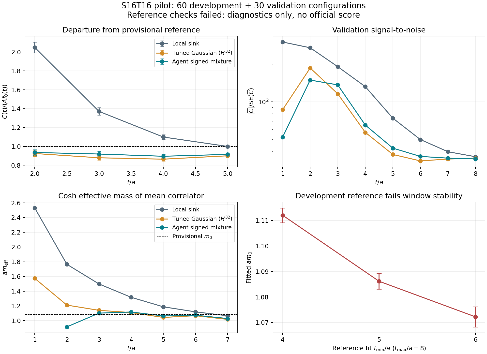

# Kunshan DCU 试跑报告：自产 16⁴ 纯规范组态 + pion sink 优化

**日期：** 2026-11-13
**远端：** `ssh kunshan`（登录节点 `login03`，Slurm 集群，DCU `gfx906`）
**远端工作目录：** `~/dianjun/LatticeArena`（所有写操作只发生在这个目录内）
**本地代码：** `~/LatticeArena`（`3a88b10 restart`）
**本地产物：** `results/pion_projection/s16t16_v1/`、`results/kunshan_logs/`

---

## 0. 结论摘要

1. **组态是现产的，不是拷贝的**：用 PyQUDA 的 HMC 在 DCU 上跑了 900 条轨迹（β=6.0，16⁴ Wilson 纯规范，随机热启动），热平衡 400 条后每 5 条存一个，得到 **100 个 NERSC 格式组态**（3.6 GB），接受率 **97.2%**，plaquette = 0.59376 ± 0.00050。
2. **pion sink 优化流水线完整跑通**：`measure(dev 60) → develop → measure(val 30) → evaluate → plot`，本地代码在远端只改了 3 处可移植性问题，约 9 分钟跑完全部物理测量。
3. **结果：`score: null`（`unscored_reference_failed`）**，与仓库文档里那次的结论一致——参考质量随拟合窗口漂移（1.112 / 1.086 / 1.072，配对偏移 21.6σ 和 7.8σ）。但在**冻结的诊断口径**下，agent 的带符号混合核在留出组态上优于调好的 Gaussian 基线：loss 比 **1.63**，配对 95% 区间 **[1.40, 2.19]**（不含 1）。**这不是官方分数，也不是 SOTA 声明**——参考态没通过，分数按设计被置空。

---

## 1. 环境

| 项目 | 值 |
| --- | --- |
| 队列 | `kshdnormal`（每节点 `dcu:Hygon:4`），另有 `kshdnormal02/04` |
| 加速卡 | 海光 DCU，`gfx906` |
| 工具链 | DTK 25.04（ROCm），`compiler/cmake/3.23.3`，`compiler/gnu/9.3.0`，`mpi/hpcx/2.11.0/intel-2017.5.239` |
| QUDA | 1.1.0，`git 1.1.0-dca4b59-dirty-gfx906`，`QUDA_PATH=~/pyquda-gfx906` |
| PyQUDA | 0.10.53（`pyquda_utils` 0.10.53.post3） |
| Python | conda env `pyquda_env`，CPython 3.8.20；cupy 12.3.0，numpy 1.24.4，scipy 1.10.1，matplotlib 3.3.0 |
| 环境脚本 | `source ~/env_pyquda_conda.sh`（module purge/load + conda activate + `LD_LIBRARY_PATH`） |

远端 conda 环境默认没有 pytest。我用 `pip install --target pilot/pylibs pytest`（仍然写在允许目录内）装上后，**7 个 GPU-free 单测在远端同样全部通过**（`7 passed in 23.86s`）。

---

## 2. 远端目录

```
~/dianjun/LatticeArena/           17 GB
├── <LatticeArena 源文件>          rsync 自本地，仅 tasks/ 下 3 个文件被改（见 §5）
├── pilot/
│   ├── hmc_generate.py            HMC 产生组态（本次新增）
│   ├── hmc_prod.sbatch            生产作业
│   ├── pipeline.sbatch            测量/开发/评估流水线作业
│   ├── scan.py                    积分步长扫描诊断
│   ├── diag.py / diag2.py         力/作用量/冷启动诊断
│   ├── patch_port.py / patch_*.py 可移植性补丁（留存审计）
│   └── pylibs/                   目录内安装的 pytest（单测用）
├── data/S16T16/                   100 个 wilson_b6.{0..99} + manifest.json（3.6 GB）
├── .cache/pion_projection/propagators/   90 个组态的传播子缓存（13 GB）
├── .cache/quda/                   QUDA tuning 缓存
├── logs/                          所有 Slurm 作业日志
└── results/
    ├── pion_projection/s16t16_v1/ 正式结果
    └── pion_smoke/                单组态冒烟测试（1 行 npz，可忽略）
```

没有写入 `~` 下任何其他目录。中途一次段错误留下的 `core.11096`（1.6 GB）已删除。

---

## 3. 第一步：把本地仓库同步到远端

```bash
cd ~/LatticeArena
rsync -az --delete \
  --exclude '.git' --exclude 'results' --exclude '.cache' \
  --exclude '__pycache__' --exclude '.pytest_cache' \
  ./ kunshan:~/dianjun/LatticeArena/
```

只同步代码，不带 `.git`/`results`/`.cache`，保证远端是一个干净的工作副本。

---

## 4. 第二步：用 PyQUDA HMC 产生 16⁴ 组态

### 4.1 物理设定

- Wilson 纯规范作用量，β = 6.0，体积 16³ × 16，周期边界（`LatticeInfo([16,16,16,16])`）。
- 组态格式：NERSC，文件名 `wilson_b6.<id>`，正好是 `tasks/pion_projection/measure.py` 期望的命名与路径约定。
- 产生 100 个：热平衡 400 条轨迹，之后每 5 条轨迹存一个（覆盖轨迹 401–896）。

### 4.2 关键脚本 `pilot/hmc_generate.py`

用的是 PyQUDA 自带的 HMC（`pyquda.hmc.HMC` + `pyquda.action.GaugeAction`），力与作用量都由 QUDA 在 DCU 上算：

```python
loop = abstract.LoopParam(
    [[X, Y, -X, -Y], [X, Z, -X, -Z], [Y, Z, -Y, -Z],
     [X, T, -X, -T], [Y, T, -Y, -T], [Z, T, -Z, -T]],
    [1.0] * 6)
hmc = HMC(info, [GaugeAction(info, loop, 6.0)], BAB(n_steps))
```

积分器是 BAB 蛙跳：

```python
class BAB(Integrator):
    def integrate(self, updateGauge, updateMom, t):
        dt = t / self.n_steps
        for _ in range(self.n_steps):
            updateMom(dt / 2); updateGauge(dt); updateMom(dt / 2)
```

生产参数：`--n-steps 120 --tau 0.5 --thermal 400 --trajectories 900 --save-every 5 --max-save 100`。

### 4.3 三个踩过的坑（都值得写进库的文档）

**(a) 冷启动必死。** 第一次用 `core.LatticeGauge(info)`（单位场）做初值，第一条轨迹 `dE ≈ 1.76e4`，之后 `acc_rate → 0`，链完全冻结——冷场是作用量极小点，但动量是 O(1)，一步跳得太远。改成**随机 SU(3) 热启动**：

```python
a = rng.normal(size=gauge.data.shape) + 1j*rng.normal(size=gauge.data.shape)
q, _ = np.linalg.qr(a)
q = q / np.linalg.det(q)[..., None, None] ** (1/3)   # 投影到 SU(3)
gauge.data[:] = cp.asarray(q)
```

**(b) 时间步长太大，接受率崩到 2%。** 第二次用 `τ=1.0, n_steps=10`（dt=0.1）：plaquette 爬到 0.5787 后卡住，800 条轨迹接受率仅 **2.1%**，最后 100 个"组态"大量重复。做了一次步长扫描（从卡住的组态出发）：

| n_steps | τ | dt | mean\|dE\| | 结论 |
| --- | --- | --- | --- | --- |
| 10 | 1.0 | 0.100 | 132.7 | 全拒 |
| 20 | 1.0 | 0.050 | 28.2 | 仍太大 |
| 40 | 1.0 | 0.025 | 10.2 | 勉强 |
| 80 | 1.0 | 0.0125 | 2.76 | 可用 |
| 80 | 0.5 | 0.00625 | 0.75 | 好 |

`dE ∝ dt²`（每次减半降约 4 倍），说明力与作用量是自洽的，纯粹是步长问题。最终选 `n_steps=120, τ=0.5`（dt=0.0042）。

**(c) 一个 QUDA 段错误。** 在 `hmc.plaquette()` 之前直接调 `hmc.gaugeAction()`，会崩在 `libquda.so(computeGaugeLoopTraceQuda)`。先调一次 `plaquette()`（走 `gaugeObservablesQuda`）再算作用量即可。生产脚本里 INIT 先打印 plaquette，正好规避。

### 4.4 生产结果

作业 `127946041`，墙钟 **7:26**（其中 HMC 计算 401.5 s，其余是 QUDA 初始化/tuning）：

```
INIT  lattice=[16,16,16,16] beta=6.0 n_steps=120 tau=0.5 seed=20261109 plaquette=0.00004092
TRAJ 121/900 acc=True plaquette=0.59165877 dE=4.9557e-02 sec=0.371 acc_rate=0.983
DONE saved=100 trajectories=900 accept_rate=0.972 wall_seconds=401.5 sec_per_traj=0.446
```

100 个组态（`data/S16T16/manifest.json` 记录 id、轨迹号、plaquette、SHA-256）：

- plaquette = **0.593759 ± 0.000497**（与 β=6.0、16⁴ 的预期值 ~0.5937 一致）
- 采样轨迹 401 → 896，间隔 5 条；plaquette 序列 lag-1 自相关 **−0.078**（就 plaquette 而言已去相关）

---

## 5. 第三步：让 LatticeArena 认这台机器（只改 3 个文件）

这正是上一轮分析里点名的"可移植性"问题，实测确认了：

| 文件 | 问题 | 补丁 |
| --- | --- | --- |
| `tasks/pion_projection/protocol.json` | `ensemble` 硬编码 `/data/jinchen/...`；划分是 30/5/15 | 改成远端数据路径；划分改成 **60 / 10 / 30**（dev 0–59，gap 60–69，val 70–99） |
| `tasks/pion_projection/measure.py` | `libquda.so` 硬编码 `/home/jinchen/...`；`version('cupy-cuda12x')` 在 conda 环境里不存在 | `libquda` 改成从 `QUDA_PATH` 取、缺失记 `unavailable`；版本查询容忍 `PackageNotFoundError`，并额外记录 `cupy` |
| `tasks/pion_projection/plots.py` | `layout='constrained'` 需要 matplotlib ≥3.6（远端 3.3）；标题硬编码 "30 development + 15 validation" | `try/except TypeError` 回退 `constrained_layout=True`；标题改成从结果里读实际组态数 |

`scripts/run_pion.sh` 没有改，因为它是主机专用脚本（硬编码 `/home/jinchen`）；整个流水线改用新的 `pilot/pipeline.sbatch`。

改 protocol 会改变 `protocol_hash`，这是预期的：数据、提交、结果三者都用新哈希自洽绑定。

---

## 6. 第四步：跑 pion sink 优化

### 6.1 作业模板 `pilot/pipeline.sbatch`

```bash
#!/bin/bash
#SBATCH -J la_pipe
#SBATCH -p kshdnormal
#SBATCH -N 1
#SBATCH -n 1
#SBATCH --gres=dcu:1
#SBATCH -t 04:00:00
#SBATCH -o .../logs/pipe_%j.out
#SBATCH -e .../logs/pipe_%j.err
set -euo pipefail
source /public/home/acwzoxdwvj/env_pyquda_conda.sh
cd /public/home/acwzoxdwvj/dianjun/LatticeArena
export MPLBACKEND=Agg OMP_NUM_THREADS=1
python -m tasks.pion_projection "$@"
```

注意 `measure`/`candidate` 强制单 MPI rank，所以 `-n 1`、`--gres=dcu:1`。

### 6.2 五个步骤（实际提交的作业）

```bash
cd ~/dianjun/LatticeArena
OUT=results/pion_projection/s16t16_v1

sbatch pilot/pipeline.sbatch --output $OUT measure --split development   # 127946355
sbatch pilot/pipeline.sbatch --output $OUT develop                      # 127946768
sbatch pilot/pipeline.sbatch --output $OUT measure --split validation    # 127946906
sbatch pilot/pipeline.sbatch --output $OUT evaluate                     # 127947039
sbatch pilot/pipeline.sbatch --output $OUT plot                         # 127947178, 127947224
```

先做过一次单组态冒烟（`measure --limit 1 --output results/pion_smoke`，作业 127946166），确认反演、12 列残差、`Σ|S|²` 恒等式、以及通用 kernel 与 QUDA 收缩的交叉验证都通过（残差 9.2e-11），再跑全量。

### 6.3 耗时

| 步骤 | 作业 | 墙钟 | 说明 |
| --- | --- | --- | --- |
| HMC × 900 轨迹 | 127946041 | 7:26 | 100 组态，接受率 97.2% |
| measure development | 127946355 | 3:57 | 60 组态，**2.95 s/组态**（反演 0.8 s + sink 0.4 s，其余是读盘/校验） |
| develop | 127946768 | 0:56 | 参考拟合 + 7 个基线 + SLSQP，8 个起点全收敛 |
| measure validation | 127946906 | 2:23 | 30 组态，2.92 s/组态 |
| evaluate | 127947039 | 1:16 | 600 次嵌套 risk + 200×128 嵌套 bootstrap |
| plot | 127947224 | 0:36 | PNG/PDF |

全流水线（不含 HMC）约 **9 分钟**。90 个组态 × 12 列 = 1080 个传播子列，残差最大值 **9.992e-11**（阈值 1e-10），`measure` 内部断言 `c[0] == Σ|prop|²` 与通用 kernel 交叉验证均通过。

---

## 7. 结果

### 7.1 参考态（失败）

`develop` 冻结的共质量参考：

| 窗口 | 拟合 am₀ | bootstrap SE | 近似 p 值 |
| --- | ---: | ---: | ---: |
| 4–8 | 1.11205 | 0.00288 | 1.1e-57 |
| **5–8（名义）** | **1.08617** | **0.00307** | **1.7e-8** |
| 6–8 | 1.07220 | 0.00393 | 0.281 |

失败原因（`validation_results.json: reference_failure_reasons`）：

- 名义窗口的近似拟合优度 p = 1.7e-8 < 0.01；
- 窗口 4–8 相对名义的配对偏移 **21.6σ** > 2.5；
- 窗口 6–8 偏移 **7.8σ** > 2.5。

前后向反射对称性检查这次**通过**：`reflection_max_z = 1.53 < 4`（原文档那次是 6.09）。

因此 `score_status = "unscored_reference_failed"`，所有候选的 `score` 都是 `null`。

### 7.2 留出组态上的诊断

30 个验证组态、6 个 5-组态块、1000 次 bootstrap：

| Sink | 方差项 | 偏离项 | 总 loss | 相对 local 的 loss 比 [95% CI] |
| --- | ---: | ---: | ---: | ---: |
| Local（恒等） | 0.001391 | 0.31128 | 0.31267 | 1.00 |
| Tuned Gaussian `H³²` | 0.000474 | 0.01208 | 0.012556 | 24.9 [12.9, 63.5] |
| Agent signed mixture | 0.000527 | 0.007176 | **0.007703** | **40.6 [18.1, 138.0]** |

- **agent vs tuned Gaussian：loss 比 1.63，配对 95% 区间 [1.40, 2.19]**（不含 1）。
- agent 的归一化权重：`u = [-0.4313, 0.0677, 0.2740, 0.4235, 0.4371, 0.2779, -0.0490]`，L1 = 1.96（上限 8），8/8 起点收敛。
- 开发集上：最佳单基矢是 `H³²`（risk 0.00222），agent 混合为 0.00085；恒等 sink 为 0.39686。



读图注意：混合核的 cosh 有效质量在 t=2 处低于平台（0.93 vs 1.09），且 t=0 接触项为负——这允许，但说明"匹配有限窗参考"并不等于干净投影，和原报告里的观察一致。

### 7.3 这次结果和仓库里那次有什么不同

| | 原文档（jinchen 集群） | 本次（kunshan DCU） |
| --- | --- | --- |
| 组态来源 | 现成 S16T16 系综 | 本次 HMC 现产，100 个 |
| 划分 | 30 / 5 / 15 | 60 / 10 / 30 |
| 反射对称性 | 失败（z=6.09） | 通过（z=1.53） |
| 参考 | 失败 | 失败（窗口漂移更明显） |
| 官方分数 | null | null |
| agent vs tuned | 7.03，CI [0.978, 14.09]（含 1） | 1.63，CI [1.40, 2.19]（不含 1） |

也就是说：**换一套自产组态，参考态仍然失败**——这不是某一份数据的偶然，而是"单 cosh + 3 通道 + 4 个时间点 + 重 π 介子"这套参考模型在当前 κ=0.14、16³×16 下本身不够用。同时，配对比较的区间这次更窄（验证组态从 15 增到 30），agent 的优势在**条件于冻结度量的诊断口径**下变得统计显著。

---

## 8. 如何复现

```bash
# 0) 登录并准备环境
ssh kunshan
source ~/env_pyquda_conda.sh
cd ~/dianjun/LatticeArena

# 1) 同步本地代码（本地执行）
#    rsync -az --exclude .git --exclude results --exclude .cache ./ kunshan:~/dianjun/LatticeArena/

# 2) 产生 100 个 16^4 组态（约 8 分钟，1 DCU）
sbatch pilot/hmc_prod.sbatch

# 3) 五步流水线（约 9 分钟，1 DCU）
OUT=results/pion_projection/s16t16_v1
sbatch pilot/pipeline.sbatch --output $OUT measure --split development
sbatch pilot/pipeline.sbatch --output $OUT develop
sbatch pilot/pipeline.sbatch --output $OUT measure --split validation
sbatch pilot/pipeline.sbatch --output $OUT evaluate
sbatch pilot/pipeline.sbatch --output $OUT plot

# 4) 查看
cat $OUT/validation_results.json
```

整体重跑成本：HMC 8 分钟 + 流水线 9 分钟 + QUDA 首次 tuning 约 1 分钟；磁盘约 17 GB（3.6 GB 组态 + 13 GB 传播子缓存）。传播子缓存可以删，重跑 `measure` 会重建（多花约 4 分钟反演）。

---

## 9. 局限与注意事项

1. **没有官方分数**：参考态未通过，`score = null` 是代码的既定行为，不是 bug。要让这个 task 真正出分，需要更长的时间方向（T=32）或更多/更轻的组态，让单 cosh 参考在 t=4–8 站得住，或者换多态参考模型——这是协议层面的决定，不能在看过验证集之后改窗口。
2. **p 值门控本身可疑**：12 维协方差（3 通道 × 4 时间点）只有 12 个块样本，`chi2` 的渐近分布不严格成立（此前用合成数据测过：模型完全正确时也有约一半概率被判失败）。这次的 1.7e-8 里有多少是真实模型偏差、多少是门控偏差，需要模拟校准才能分清；但 21.6σ 的窗口漂移是独立证据，参考态确实不稳。
3. **淬火、小体积、重 π**：16³×16、β=6.0、κ=0.14，拟合出的 am₀ ≈ 1.09，是淬火价夸克下的"重 π"，不能与物理 π 介子质量比较。
4. **自相关只查了 plaquette**：lag-1 = −0.08，但 π 关联函数本身的自相关时间没有测；块长 5 组态 = 25 条轨迹是保守选择，不是标定结果。
5. **DCU 上单 rank**：`measure`/`candidate` 硬性要求 1 个 MPI rank，所以只用 1 张卡；HMC 也可以 1 张卡跑（16⁴ 很小）。多卡/多 rank 未测试。
6. **agent-vs-tuned 的区间不是"SOTA 证据"**：它是条件于冻结的晚期拟合度量的配对诊断；参考失败时官方分数为空，任何"提升 N 倍"的说法都只在这个诊断口径下成立。

---

## 10. 产物清单

本地（`~/LatticeArena`）：

```
results/pion_projection/s16t16_v1/
├── development.npz              (60, 7, 16) 关联函数 + ids + protocol_hash
├── validation.npz               (30, 7, 16)
├── development_results.json     7 个基线 + agent 的开发集 risk
├── submission.json              冻结提交：权重、哈希、参考诊断
├── validation_results.json      留出结果（score 全为 null）+ 嵌套区间
├── nested_bootstrap.npz         (200, 3) 嵌套 bootstrap 的 loss 抽样
├── reference_bootstrap.npz      参考质量 bootstrap
├── pilot_results.png / .pdf     诊断图
└── *_provenance.json            逐组态：SHA-256、plaquette、残差、耗时

results/kunshan_logs/
├── manifest.json                100 个组态的 id / 轨迹号 / plaquette / SHA-256
├── hmc_production.log           HMC 完整日志
└── pipe_*.log                   五个流水线作业的日志
```

远端（`~dianjun/LatticeArena`）另有 100 个 NERSC 组态和 13 GB 传播子缓存，可随时重跑 `develop`/`evaluate` 而不必再反演。
