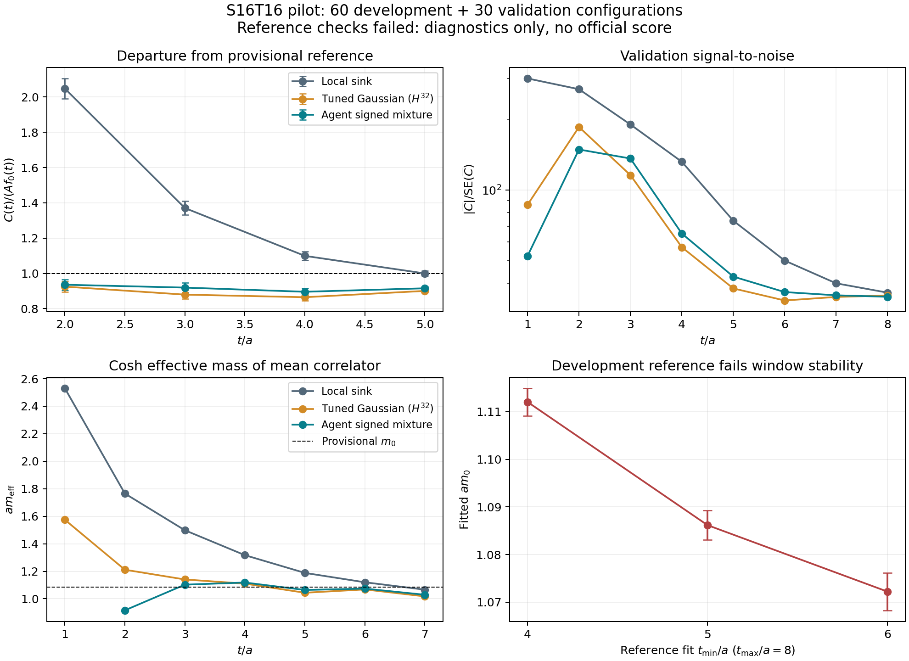

# S16T16 pion projection: first agent attempt

**2026-11-09. Diagnostic pilot; no official score and no SOTA claim.**

The task now runs on real unfixed S16T16 configurations. A development-selected
signed multiscale sink has a lower provisional loss on the held-out configurations
than the tuned Gaussian baseline. However, the common ground-state reference
fails the predeclared checks, and the improvement interval relative to that
baseline includes no improvement. The result motivates another controlled
experiment; it does not establish suppressed true excited-state overlap.

## What was run

- Fixed origin point source, Wilson valence kappa 0.14, 12 spin-color inversions,
  antiperiodic time boundaries, residual target 1e-10.
- Development configurations 0–29; configurations 30–34 unused as a separation
  gap; validation configurations 35–49 first evaluated after freezing the proposal.
- Seven gauge-covariant kernels `H^n`, with n = 0, 2, 4, 8, 16, 32, 64 and
  `H = (I + 0.2 * spatial_hopping)/2.2`.
- Contiguous five-configuration blocks; 1000 bootstrap draws and a 200 x 128
  nested bootstrap for conditional loss-ratio intervals.

All 45 gauge files passed the default NERSC checks. All 540 propagator columns
passed an explicit residual check; the maximum was `9.964e-11`. The recorded
configuration-loop time totaled about 46.3 seconds on the RTX 3060, including
about 14.7 seconds for inversion/cache loading plus residual checks and 15.7
seconds for sink work. These are local warm-cache/QUDA-tuning-dependent timings,
not a hardware-independent performance result. The CuPy pool reservation reached
about 492 MiB; this excludes QUDA's separate memory allocations.

Seven automated tests passed. As an end-to-end regression, the identity operator
was separately submitted through the generic API on all 45 measured configurations:
its correlators matched the fixed local baseline within `1e-12` relative tolerance,
and its diagnostic loss ratio was one to floating-point precision. The failed
reference correctly kept its official score null as well.

## The proposed operator

Development selected `H^32` as the best single diffusion/Gaussian kernel. The agent
then optimized a signed sum of all seven scales, including a negative local
counterterm. Its kernel is `K = sum_n u_n H^n / A_n`, where `A_n` are fixed
development amplitudes. The normalized coefficients were:

| n | u_n |
| --- | ---: |
| 0 | -0.373289 |
| 2 | 0.0190495 |
| 4 | 0.192788 |
| 8 | 0.335503 |
| 16 | 0.385543 |
| 32 | 0.311827 |
| 64 | 0.128578 |

The coefficients sum to one and have L1 norm 1.747, below the fixed limit of 8.
All eight optimization starts converged. The raw, directly applicable kernel
coefficients are preserved in the [candidate definition](../results/pion_projection/s16t16_v1/agent/llm_candidate.json),
and all calibration and search choices are in the
[frozen submission](../results/pion_projection/s16t16_v1/submission.json).
The negative local term can cancel part of the short-distance contribution;
this interpretation is a hypothesis, not a measured spectral decomposition.

The submitted kernel was also applied directly to the cached propagators on
configurations 0 and 35 through the generic time-slice API. Its full 16-time
correlators agreed with the QUDA-basis linear combination to relative differences
below `3.83e-15`. This checks that the reported candidate is an actual operator,
not only a postprocessed fit curve. The unoptimized generic path took about
33 seconds per configuration; the QUDA fast path is much faster for this family.

## Held-out diagnostics

The following use the provisional common reference `am0 = 1.07671(534)` and the
fixed scoring window t = 2–5. “Departure” means the RMS of `q(t)-1`, with
`q = C/(A f0)`, and must not be read as a physical excited-state fraction.

| Sink | Variance term | RMS departure | Total diagnostic loss | SNR at t=2 | SNR at t=5 |
| --- | ---: | ---: | ---: | ---: | ---: |
| Local | 0.001784 | 70.34% | 0.49662 | 111.98 | 36.86 |
| Tuned Gaussian, H^32 | 0.0005189 | 5.92% | 0.0040183 | 50.94 | 29.62 |
| Agent signed mixture | 0.0004336 | 1.18% | 0.00057190 | 46.46 | 29.91 |

The Gaussian-to-agent loss ratio is **7.03**, with a conditional paired 95%
bootstrap percentile interval **[0.978, 14.09]**. The interval includes one.
Only three validation blocks are available, so the interval is coarse. It also
does not include uncertainty from an inadequate reference model or the unknown
long-distance Markov-chain autocorrelation.

Most of the improvement is in the departure term. It is not a simultaneous SNR
win: relative to the tuned Gaussian, the agent's SNR at t=2 drops by about 9%,
and relative to the local sink early-time SNR is substantially lower. The total
loss trades raw SNR against the ground-state-normalized departure and uncertainty.

The effective-mass panel plots the effective mass of the mean correlator, without
error bars; missing points are undefined cosh effective masses, not clipped values.
The signed candidate has a negative t=0 contact correlator and an unusually low
t=2 effective mass. These are allowed for the mixed point/signed-sink correlator
but illustrate why matching a finite reference window does not prove a clean
spectral projection. The q-panel error bars are one bootstrap standard deviation.

## Why scores remain null

The predeclared common reference fit uses the local, H^8, and H^16 channels:

| Reference window | Fitted am0 | Bootstrap SE | Approximate fit p |
| --- | ---: | ---: | ---: |
| 4–8 | 1.10337 | 0.00656 | 1.33e-32 |
| 5–8, nominal | 1.07671 | 0.00534 | 3.38e-6 |
| 6–8 | 1.06009 | 0.00424 | 0.310 |

Relative to the nominal window, the paired shifts are 10.66 and 9.45 standard
errors, exceeding the fixed 2.5 threshold. The nominal reference also fails its
approximate goodness-of-fit threshold. Selecting only the last window because
it has a favorable p-value would violate the already frozen protocol.

The maximum development forward/backward z statistic is 6.09, at t=2 in H^4,
above the threshold of 4. This is a diagnostic flag rather than proof that the
ensemble violates reflection symmetry: the point-source sampling, only six
blocks, and unknown autocorrelations require further investigation. Folded
curves remain descriptive, and this failure is another reason to withhold scores.

The evaluator records `unscored_reference_failed` and `score: null` for every
candidate. The large loss ratios against the local sink are **not** leaderboard
scores. The data cannot establish a well-controlled true ground-state target
for the proposed scoring rule under the fixed v1 protocol.

## Artifacts and next research step

See the [executable protocol and commands](../tasks/pion_projection/README.md),
[validation results](../results/pion_projection/s16t16_v1/validation_results.json),
[development results](../results/pion_projection/s16t16_v1/development_results.json),
and [exportable PDF figure](../results/pion_projection/s16t16_v1/pilot_results.pdf).
Per-configuration correlators, checksums, solver diagnostics, reference bootstrap
draws, and nested loss draws accompany them in the same result directory.

The next priority is to establish a controlled reference, not to continue tuning
on these 15 validation configurations. A follow-up protocol should investigate
autocorrelation and forward/backward sampling, test a shared multi-state analysis
on development data, and validate against more configurations and/or a longer
temporal lattice at matched physics. It should compare the frozen signed
candidate and Gaussian baseline on independent data, with new scoring calibration
fixed before evaluation. The current attempt has not covered the full arbitrary
kernel search space or a comprehensive set of literature SOTA methods.

## 后续对照：learned A1+ smear（2026-11）

在同一份 60/10/30 数据上，用 `tasks/optimize_gaussian` 的 A1+ 学习核（9 个参数，$G^8$ 基座 +
三明治式厄米修正）走完了 `candidate` 冻结流程：

- 留出 risk：learned 0.00960 vs SLSQP 混合 0.00770 vs local 0.31267；
- 配对比 $\mathrm{risk}_{SLSQP}/\mathrm{risk}_{learned}=0.803$，95% 区间 $[0.636, 0.944]$；
- 官方 `score` 仍为 `null`（参考 gate 未通过）。

结论（v8，旧特征）：学习核比 Gaussian 基座好（约 1.5 倍），但**没有**超过 7 参数的 SLSQP 混合。

> **更新（v9，2026-11-18 晚些）**：修复特征（plaquette 闭合、link 中心锚点、A1+ 认证）后重训，
> 学习核测试 risk 0.009236（相对 $G^8$ **2.12 倍**），候选 risk **0.007721**，与 SLSQP 0.007703
> 的配对比 $0.998\ [0.78,1.18]$——**统计上打平**。官方 `score` 仍为 `null`（参考 gate 未过）。
> 详见 [tasks/optimize_gaussian/README.md](../tasks/optimize_gaussian/README.md)。

## 参考 p 值的模拟校准（2026-11）

用参数化 bootstrap 校准参考拟合的 p 值（`tasks/pion_projection/calibration.py`）：

| 窗口 | 渐近 p | 校准 p | 零假设中位数 |
| --- | ---: | ---: | ---: |
| 4–8 | $1.1\times10^{-57}$ | 0 | 10.4 |
| 5–8（名义） | $1.7\times10^{-8}$ | 0 | 7.6 |
| 6–8 | 0.281 | 0.267 | 4.2 |

校准本身是对的（合成零假设下的误判率 0%），但**名义参考仍然失败**：$\chi^2=52.0$ 远高于
零假设中位数 7.6，说明单 cosh + 共质量模型在 5–8 上本身不成立，不是 p 值阈值的问题。
这直接指向“更长的时间方向（T=32）或更好的参考模型”，而不是继续调阈值。

## 更长的时间方向：T=32 尝试（2026-11）

为检验“参考失败是不是因为周期回绕/时间太短”，在 kunshan 上用同一套 HMC 生成 100 个
$16^3\times32$、$\beta=6.0$ 的组态（接受率 96.7%，$0.77$ s/轨迹），测了 60 个开发组态，
参考窗口随 $T$ 调整为 $4\text{–}8$ / $5\text{–}9$ / $6\text{–}10$：

| 量 | T=16（原 pilot） | T=32 |
| --- | ---: | ---: |
| 名义窗口 $\chi^2/\mathrm{dof}$ | 52.0 / 8 | 120.2 / 11 |
| 名义 p 值 | $1.7\times10^{-8}$ | $1.6\times10^{-20}$ |
| 窗口偏移 | 21.6σ / 7.8σ | 20.3σ / 16.3σ |
| 反射对称 z | 1.53（通过） | 归档 274.27 → 按真实 $C(t)-C(T-t)$ 修正后 **2.40（通过）** |

**结论：加长时间方向没有让参考站住。** 回绕项不是问题，问题在“共质量 + 单 cosh”这个参考模型
本身——三个通道（$H^0,H^8,H^{16}$）在 $t=4\text{–}9$ 的有效质量形状并不共享同一个 $m_0$。
下一步应当换参考模型（两态拟合、或分通道质量 + 渐近共质量），而不是继续加组态、加 $T$ 或调阈值。

## 两态参考模型（2026-11）

实现 `TwoStateFit`：每个通道 $\mu_k(t)=A_k f(t;m_0)+B_k f(t;m_1)$，共质量、分通道幅度；
用变投影（给定 $m_0,m_1$ 时幅度线性求解）+ 粗网格 + 局部细化拟合。在 T=16 的 60/10/30 数据上重跑：

| 窗口 | $m_0$ | SE | $\chi^2/\mathrm{dof}$ | $p$ |
| --- | ---: | ---: | ---: | ---: |
| 4–8 | 1.0500 | 0.0095 | 0.15 / 7 | $\approx1$ |
| 5–8 | 1.0570 | 0.0098 | 0.06 / 4 | 0.9996 |
| 6–8 | 1.0500 | 0.0285 | 0.001 / 1 | 0.975 |

窗口偏移 1.4σ / 0.25σ，**gate 通过**，并给出该任务第一个非空分数：

| 候选 | risk | score | 比值 95% 区间 |
| --- | ---: | ---: | ---: |
| local | 0.5592 | 100 | — |
| tuned Gaussian | 0.01381 | 4050 | [19.4, 384] |
| SLSQP 混合 | 0.00926 | 6040 | [25.5, 431] |

**但这不能当作可信的分数**：

- $m_0$ 从单 cosh 的 1.086 变成 1.057（3%），local 的 risk 从 0.312 涨到 0.559，分数随之放大近 2 倍；
- 两态拟合 $\chi^2=0.06/\mathrm{dof}=4$（$p\approx1$），是**过拟合**：8 个参数对 12–15 个点、
  25% 收缩协方差，几乎能拟合任何数据，p 值门槛因此失去意义；
- $m_0$ 的模型误差没有传播进分数（参考 SE 只有约 1%）。

结论：**gate 通过 ≠ 分数可信**。参考模型的系统误差（$m_0$ 的模型依赖）大于统计误差；要么把它
边缘化进分数，要么换一个参考更稳的可观测量。第二个任务（静态势）已经给出 $V(R)$ 且参考通过，
是更可信的下一步。

## 参考模型系统误差（2026-11）

固定同一批候选权重（来自单 cosh 冻结的 `submission.json`），只更换参考模型：

| 参考模型 | $m_0$ | local | tuned | SLSQP | score(tuned) | score(SLSQP) |
| --- | ---: | ---: | ---: | ---: | ---: | ---: |
| 单 cosh（gate 未过） | 1.0862 | 0.3127 | 0.01256 | 0.00770 | 2490\* | 4059\* |
| 两态（gate 通过） | 1.0570 | 0.5592 | 0.00470 | 0.00484 | 11899 | 11554 |

\* 单 cosh 的 gate 未通过，分数按设计为 `null`；这里列出“若给分”的数值只为比较尺度。

- 尺度变化：local $\times1.79$，tuned $\times0.37$，SLSQP $\times0.63$；
- 排序甚至会翻转：单 cosh 下 SLSQP 明显优于 tuned（0.0077 vs 0.0126），两态下几乎持平（0.00484 vs 0.00470）。

**结论**：参考模型的系统误差与要测量的效应同量级。绝对分数、甚至 tuned 与 SLSQP 的排序，
都不能在两种参考模型下同时成立。这个 pilot 在 16⁴、60 组态、$\kappa=0.14$ 上无法给出可信分数；
要救它，必须把参考模型的系统误差边缘化（模型平均 / 对 $m_0$ 给系统误差），而不是挑一个能过 gate 的模型。
