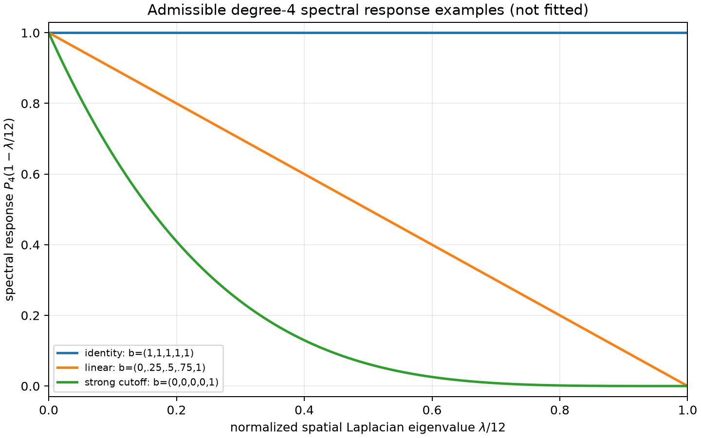

# Optimize D11: selected constrained degree-4 spectral baseline

**Status: `METHOD_DEFAULTS_SELECTED_EVIDENCE_NOT_READY`; CPU algebra only; production receipts/review/authorization are open. `physical_score=null`; sealed data remain closed.**

## Scope

- Goal: make the user's chosen trainable-W vs strong spectral baseline contrast executable at the operator-contract level.
- Inputs: the current `tasks/optimize_gaussian/kernels.py` hopping kernel, interpreted under the explicitly stated periodic three-dimensional operator contract, and the user-selected F=2 comparison family.
- Deliverable: a mathematically constrained degree-at-most-4 spectral family, dense and matrix-free CPU candidates including the unnormalized Gaussian sandwich, a bounded-call SLSQP coefficient-fitting helper, tests, and response plot.
- Acceptance: D04/D06/D11 method defaults are recorded; this report checks the CPU algebra and leaves independent measurements, production review, and authorization open.

## Operator and spectrum map

For unitary 3x3 links and periodic spatial boundaries, use `H psi(x)=sum_i[U_i(x)psi(x+i)+U_i(x-i)^dagger psi(x-i)-2psi(x)]`. U(3) unitarity is sufficient for this mathematical bound; physical QCD production still requires SU(3) link provenance, which the CPU helper does not check. The quadratic form obeys `0 <= -H <= 12 I`: `-H` is the sum over directions of link-covariant nearest-neighbor differences, and each difference norm is bounded by twice the two endpoint norms. Thus `H` is Hermitian with spectrum in `[-12,0]`; `X=I+H/6` lies in `[-1,1]`; and `y=I+H/12` lies in `[0,1]`.

## Constrained degree-4 polynomial

Define `P4(y)=sum_{i=0}^4 b_i * binom(4,i) * y^i * (1-y)^(4-i)`, with `0<=b0<=b1<=b2<=b3<=b4=1`. Since Bernstein basis functions are nonnegative and sum to one, `P4` is in `[0,1]`; since `b_i` are nondecreasing, `P4'(y)=4*sum_{i=0}^3 (b_{i+1}-b_i) B_{i,3}(y)>=0`. At the upper spectral endpoint `y=1`, `P4(1)=b4=1`; this does not assert that every gauge field has a zero eigenmode. In `x=2y-1=I+H/6`, the same unique polynomial is `sum_{k=0}^4 a_k T_k(x)`. The exact symbolic basis transform has dyadic rational entries; its final matrix-vector product is evaluated in float64 and applied by Clenshaw.



The identity, linear, and fourth-power cutoff curves are hand-chosen valid control vectors to show the allowed response shape. They are not fit results or selected physics kernels. A degree cap of four is fixed; it is not changed after development or blind inspection. The response plot's horizontal axis is the normalized Laplacian spectral coordinate: endpoint zero maps to y=1 and response one, but a general gauge field need not have an H=0 eigenmode; endpoint one is the maximum eigenvalue where suppression is strongest.

The three illustrative curves are the only planned items in this report: planned/valid/failed/abstained = `3/3/0/0`. These counts do not represent optimizer fits, ensemble measurements, or physical samples.

## Bounded-call coefficient fitting helper

fit_control_points_slsqp accepts a fixed deterministic scalar objective callback and optimizes only b0..b3 with box and monotonicity constraints while fixing b4=1. It counts objective evaluations and stops before exceeding the caller-supplied cap, returning the best feasible point evaluated with OBJECTIVE_CALL_BUDGET_EXHAUSTED. Nonfinite or nonscalar objectives fail closed. No reference or physics objective is supplied or evaluated, so fitted-run denominator = 0/0/0/0.

Text flow: fixed objective callback and fit IDs -> bounded SLSQP over four controls -> objective-call cap, status and feasibility residual -> retain fit failure or abstention -> later paired confirmation only after D04/D06 approval.

## Proposed comparison plumbing

```text
same frozen spatial links / source / outer Gaussian sandwich
  ├─ learned arm: train W,v,c on fit IDs
  └─ spectral arm: fit b0..b3 with 0<=b0<=...<=b3<=1; fix b4=1
       both use the same frozen reference/objective, fit/development split, precision and paired test IDs
       both report solver success/residual, all planned failures and abstentions
       account separately for operator construction, each matvec, setup, fitting, inference, solve and total walltime
       apply the same objective-call cap and a separate matched total walltime cap
```

The spectral arm has four free controls, while the current hidden-width-2 trainable-W prototype has seven W/v/c scalars. They are different function classes, so equal parameter count is not required; both contrasts use a common objective and report parameter count, range, and full cost. The matrix-free helper is checked against an explicitly assembled small periodic lattice operator, including the uniform Gaussian-step affine identity, Hermiticity, and dense-versus-matrix-free Gaussian-sandwich action. Since `G=1.6I+0.1H`, `G` and `P4(H)` commute and the unnormalized sandwich has eigenresponse `(1.6+0.1lambda)^4 P4(1+lambda/12)`. Its `6.5536=1.6^4` value applies at `lambda=0` only if `H` actually has a zero eigenmode; it is not a general gauge-field normalization. The polynomial's positivity and monotonicity follow from its Bernstein constraints under the stated H spectrum; this is not evidence of physical superiority or a rounding-level PSD certificate for production links.

This implements the selected D11 method defaults, not a certified strongest production baseline. The current heat-kernel operator toy used unconstrained least-squares Chebyshev coefficients and cannot validate this constrained family. Do not reuse its performance numbers as baseline evidence. `train.main` remains fixed-W; this module is not integrated into production training. D04 E-chain measurements/receipts, D06 empirical risk and cost receipts, independent D11 production-link review, and data/GPU authorization remain open. Keep both selected F=2 contrasts, `NOT_READY/UNCERTIFIED`, `physical_score=null`, and all sealed data closed.

This CPU helper is not wired into `train.main` and has no GPU/CuPy path. The report includes snapshots of this helper and the periodic hopping kernel; both are SHA-256 listed in its manifest. Rebuild the deterministic response artifact into a fresh directory with `python3 -B -m tasks.optimize_gaussian.chebyshev_baseline --output NEW_DIRECTORY`.
