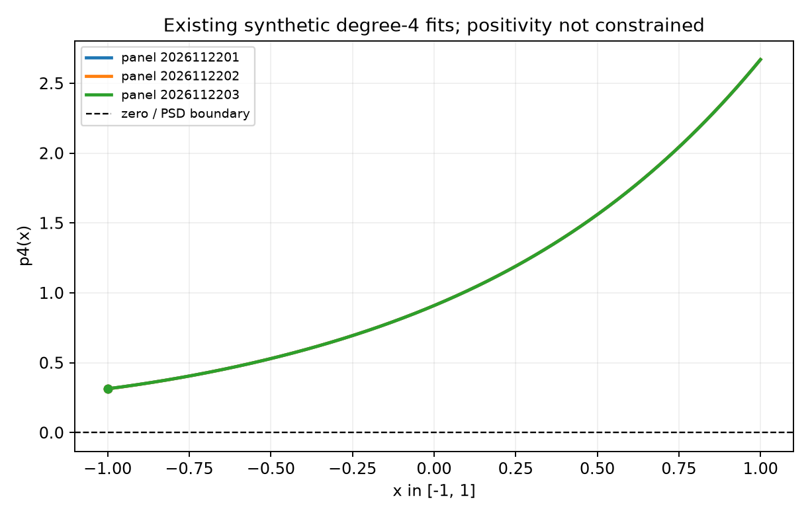

# Degree-4 Chebyshev interval-positivity diagnostic

Status: **SYNTHETIC-ONLY CPU DIAGNOSTIC**. `physical_score=null`; no measurements, sealed splits, GPU, or QUDA inputs were accessed.

## Question and method

The existing source-closed operator replay fits an unconstrained real degree-4 Chebyshev polynomial. This diagnostic reuses those three fit coefficient vectors and checks their minimum on the complete interval [-1, 1]. For a real polynomial on a closed interval, every minimum is at an endpoint or a real root of its derivative; the code evaluates both endpoints and every numerically real derivative root in the interval. Root solving and evaluation use double precision, so this is not an interval-arithmetic proof.

If H is Hermitian and spec(H/6) is a subset of [-1, 1], nonnegative p4 on the entire interval implies p4(H/6) is positive semidefinite by the spectral theorem. The bound and coefficient positivity are separate conditions.

## Panel results

| panel seed | status | minimum | argmin | p4(-1) | p4(1) | detail |
|---:|---|---:|---:|---:|---:|---|
| 2026112201 | valid | 0.313406899943 | -1 | 0.313406899943 | 2.669528094588 | |
| 2026112202 | valid | 0.313027858941 | -1 | 0.313027858941 | 2.670170688984 | |
| 2026112203 | valid | 0.313506535758 | -1 | 0.313506535758 | 2.670263798375 | |

Panel denominator planned/valid/failed/abstained = 3/3/0/0. A valid row means the interval minimum calculation completed, not that a physical contract is certified.

## Interpretation and limits

All three existing fitted polynomials have positive minima near 0.313 at x=-1. Thus these three synthetic operators are positive semidefinite under the stated Hermiticity and spectral-interval assumptions. The original least-squares fit did not impose this property; three heat-kernel panels cannot establish positivity for other configurations, production links, or future refits. This result does not freeze D11 or select the production normalization, coefficient strategy, tolerance, or failure rule.

Text flow: existing fit coefficients -> derivative roots plus interval endpoints -> complete-interval numerical minimum -> conditional PSD statement -> retain the human D11 gate.

Rebuild with `python -B -m tasks.optimize_gaussian.chebyshev_positivity_diagnostic`. The input JSON path, SHA-256, commit, tolerances, source snapshots, and artifact hashes are recorded alongside this report.
