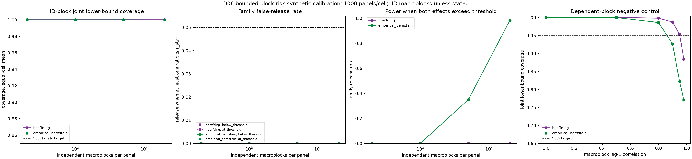

# D06 bounded block-risk: CPU calibration proposal (v4)

**Synthetic method diagnostic only.** No gauge, propagator, reference-fit, sealed split, GPU, or QUDA input was read. `physical_score=null` and the selected D04/D06 rule remains `UNCALIBRATED/NOT_READY`.

## Alternative estimand

For each independent paired macroblock `b`, arm `a`, and four prespecified times, define

`X[b,a] = (1/4) sum_{t=2..5} min((q[b,a,t] - 1)^2, 1)`, with `0 <= X <= 1`.

The target is `mu[a]=E[X[b,a]]` and the contrast is `rho[a]=mu[a]/mu[trainable-W]`. This changes D04: it is a clipped block-risk, not the nested-bootstrap `mean_t(Var(q)+bias(q)^2)` risk. The cap reduces the effect of extreme q values while losing information about their magnitude; all arms use the same frozen map.

## Finite-sample decision rule

The threshold remains `r_star=10/9` with F=2. For each comparator we form the paired block contrast `D[b]=X[b,comparator]-r_star*X[b,W]`, which lies in `[-r_star,1]`. We require a positive one-sided lower bound for each contrast and a positive lower bound for `mu[W]`. Bonferroni splits total alpha `0.05` equally across these three events (`delta=0.01666667`), so both comparisons and a defined denominator are covered together. A nonpositive lower bound on `mu[W]` yields `ABSTAIN`.

The Hoeffding bound is the bounded, variance-insensitive reference. The candidate tighter method uses the empirical-Bernstein bound of Maurer and Pontil, Theorem 4: on independent bounded blocks, the one-sided radius on `[0,1]` is `sqrt(2 s^2 log(2/delta)/n) + 7 log(2/delta)/(3(n-1))`; for other support widths it scales linearly. The source theorem explicitly assumes independent observations; it does not authorize treating correlated HMC blocks as independent. [Original paper](https://arxiv.org/abs/0907.3740).

## Findings

Across the three declared IID macroblock generators, empirical-Bernstein joint lower-bound coverage by block count is:
- `n=200`: minimum cell coverage `1.0000`; minimum Wilson 95% lower endpoint `0.9962`.
- `n=1000`: minimum cell coverage `1.0000`; minimum Wilson 95% lower endpoint `0.9962`.
- `n=5000`: minimum cell coverage `1.0000`; minimum Wilson 95% lower endpoint `0.9962`.
- `n=20000`: minimum cell coverage `0.9990`; minimum Wilson 95% lower endpoint `0.9944`.

At or below the effect threshold:
- `hoeffding`: `0/24000` null/boundary panels released both effects.
- `empirical_bernstein`: `0/24000` null/boundary panels released both effects.

Above the effect threshold, equal-cell family release by block count is:
- `n=200`: family release mean `0.0000`, range `0.0000–0.0000`; Hoeffding mean `0.0000`.
- `n=1000`: family release mean `0.0000`, range `0.0000–0.0000`; Hoeffding mean `0.0000`.
- `n=5000`: family release mean `0.3503`, range `0.0150–1.0000`; Hoeffding mean `0.0000`.
- `n=20000`: family release mean `0.9840`, range `0.9520–1.0000`; Hoeffding mean `0.0000`.

The IID-grid planned/valid/failed/abstained totals per method are:
- `hoeffding`: `36000/26371/0/9629`.
- `empirical_bernstein`: `36000/27000/0/9000`.
An abstention means the lower confidence bound did not establish positive trainable-W bounded risk, so a ratio decision was withheld.

The dependent negative control has `10000` panels at each lag-one correlation. Joint lower-bound coverage and Wilson intervals are:
- `rho=0`: empirical-Bernstein `1.0000 [0.9996, 1.0000]`; Hoeffding `1.0000 [0.9996, 1.0000]`.
- `rho=0.5`: empirical-Bernstein `1.0000 [0.9996, 1.0000]`; Hoeffding `1.0000 [0.9996, 1.0000]`.
- `rho=0.8`: empirical-Bernstein `0.9861 [0.9836, 0.9882]`; Hoeffding `0.9982 [0.9972, 0.9989]`.
- `rho=0.9`: empirical-Bernstein `0.9266 [0.9213, 0.9315]`; Hoeffding `0.9874 [0.9850, 0.9894]`.
- `rho=0.95`: empirical-Bernstein `0.8222 [0.8146, 0.8296]`; Hoeffding `0.9536 [0.9493, 0.9576]`.
- `rho=0.98`: empirical-Bernstein `0.7709 [0.7626, 0.7790]`; Hoeffding `0.8847 [0.8783, 0.8908]`.
This shows why the independent-block condition needs evidence; neither method acquires a dependence correction from this negative control.

## Synthetic stress and denominator

`calibration_summary.csv` contains each method, DGP, true-effect scenario and block count. The IID grid uses `1000` independent synthetic panels per cell across three bounded distributions, ratios below / at / above threshold, and `n=[200, 1000, 5000, 20000]` blocks. At each panel the same paired blocks feed both contrasts. Macroblock counts, panel counts, failures, denominator abstentions, joint lower-bound coverage, Wilson Monte Carlo intervals and release rates are recorded. The protocol binds RNG seed `20261125` and batch size `32`.

The separate negative control uses stationary binary Markov dependence across nominal blocks (`rho=[0.0, 0.5, 0.8, 0.9, 0.95, 0.98]`). At the largest correlations, the empirical-Bernstein lower-bound coverage falls below target; this is a direct warning that an IID theorem cannot be applied to autocorrelated HMC blocks without a separate dependence correction. The dependent rows are stress evidence, not a valid calibration claim for either theorem.

Text flow: `freeze bounded loss and candidate arms -> form one score per paired independent block -> estimate two fixed-threshold contrasts plus positive denominator -> simultaneous lower bounds -> release both or abstain/no release; a dependence receipt is a precondition, not inferred from the plot`.

## Interpretation and next gate

This is a decision-equivalent test for `rho > r_star`; it does not produce the original D06 ratio interval or replace its 10,000-draw rule. It can be adopted only after independent review freezes the clipped estimand and block-independence/chain dependence evidence. If blocks are not independently sampled or a valid mixing/dependency correction is absent, the bound is not applicable. D04 reference uncertainty, held-out candidate selection, production macroblock construction, and real operator measurements remain open.
