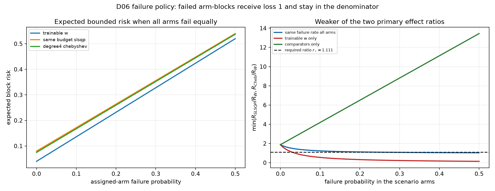

# D06 assigned-arm failure penalty: exact sensitivity (v1)

**Analytic sensitivity only.** The successful bounded-risk means `0.040`, `0.080`, `0.075` and the failure probabilities are illustrative inputs, not measured optimizer outcomes. No gauge, reference-fit, sealed split, GPU, or QUDA input was read; `physical_score=null`.

## Proposed failure semantics

For one preassigned arm inside one paired macroblock:

```text
accepted finite optimizer result -> average the four clipped q losses
optimizer failure / budget exhaustion / failed residual gate -> set that arm's whole block score to 1; retain the block
missing or corrupt input without a declared optimizer failure -> do not impute; the run abstains
```

The first failure rule makes algorithm reliability part of the arm's risk estimand. If successful runs have mean block risk `mu_success` and the assigned-arm failure probability is `p_fail`, the exact mixture mean is `mu = p_fail + (1-p_fail)*mu_success`. Keeping failed assignments at score 1 preserves `[0,1]` support; under independent paired macroblocks, the bounded-mean theorem still applies to the composite outcome. It does not turn correlated HMC blocks into independent observations.



At the illustrative `p_fail=0.05`, expected risks in the `same_failure_rate_all_arms` case are `0.0880`, `0.1260`, `0.1212` and the SLSQP/trainable-W and Chebyshev/trainable-W ratios are `1.4318` and `1.3778`. If only trainable-W fails at 5%, the ratios become `0.9091` and `0.8523`. If only the comparators fail at 5%, they become `3.1500` and `3.0312`. The direction and size of a comparison can therefore change substantially when failures are dropped; the proposed score rule prevents that exclusion.

The 303 rows in `failure_sensitivity.csv` are exact formula scenarios (`planned/valid/failed/abstained=303/303/0/0`), not Monte Carlo panels. The method helper now accepts a boolean arm-failure mask, permits absent `q` only for a declared failed arm, assigns that arm score 1, and reports failures separately while keeping all blocks scored. Unknown, malformed, or nonfinite inputs outside the declared failure mask are rejected.

## Next gate

The rule is a proposed method default, not independent review or production authorization. Before evaluator use, freeze what constitutes an optimizer failure (including residual and hard-timeout receipts), ensure one q-to-score map per arm, and verify that missing measurement/reference inputs abstain rather than become solver failures. Then calibrate the complete pipeline with its actual failure process and dependence contract. Current D04 remains unchanged; same-budget SLSQP and degree-4 Chebyshev remain both primary comparators.
