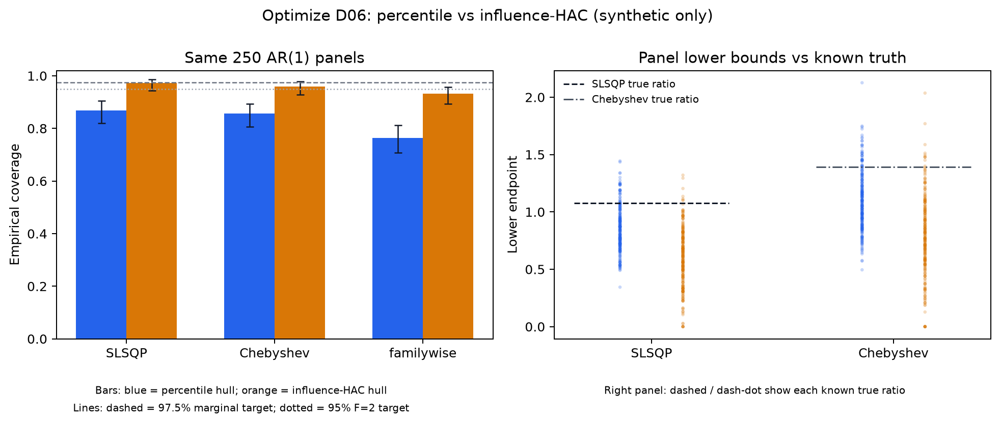

# Optimize D06 influence-HAC interval comparison

**Evidence class:** a synthetic stationary Gaussian AR(1) calibration candidate using the same 250 `n=60, phi=0.8` panels and seeds as the archived 10,000-draw percentile-hull report. No lattice data, fits, GPU/QUDA, or sealed split was accessed. This does not calibrate production coverage.

## Text flow

```text
the 250 open synthetic panel seeds from percentile report v8
  -> regenerate the same paired q(t) panels and verify the known risk ratios
  -> for each D04 L=2,5,10, compute exact empirical circular-bootstrap risk and analytic influence series
  -> paired risk-ratio influence -> Newey-West Bartlett HAC variance, bandwidth 2/5/10/20/30
  -> one-sided normal lower endpoint at alpha=0.025; take the minimum across L x bandwidth
  -> compare with the existing percentile hull on the identical panels and known generating truth
```

For each time `t`, the finite-`L` empirical D04 risk is
`(mean(q_t)-1)^2 + (L/n) mean_s[(blockmean_(s,L,t)-mean(q_t))^2]`.
The code differentiates this quantity with respect to each configuration, averages over `t=2..5`, and forms the paired ratio influence
`(IF_comparator - ratio_hat * IF_trainableW) / risk_trainableW`. Newey-West uses the Bartlett kernel. The one-sided lower endpoint is truncated at zero using the known positive parameter space; no epsilon is added.

## Coverage and denominator



| method | unit | coverage | Wilson 95% Monte Carlo interval | planned/valid/failed/abstained |
| --- | --- | ---: | --- | --- |
| percentile | SLSQP | 0.868 | [0.820, 0.904] | 250/250/0/0 |
| percentile | Chebyshev | 0.856 | [0.807, 0.894] | 250/250/0/0 |
| percentile | familywise | 0.764 | [0.708, 0.812] | 250/250/0/0 |
| hac | SLSQP | 0.972 | [0.943, 0.986] | 250/250/0/0 |
| hac | Chebyshev | 0.960 | [0.928, 0.978] | 250/250/0/0 |
| hac | familywise | 0.932 | [0.894, 0.957] | 250/250/0/0 |

The familywise rows give the rate that both contrasts cover simultaneously. For this finite-dependence stress point the percentile familywise coverage is `0.764` and the HAC-hull coverage is `0.932`. See `coverage_and_bounds.png` for Wilson Monte Carlo intervals and panel-level lower endpoints against the known truth.

The marginal target is 97.5% per comparison; the Bonferroni familywise target is at least 95%. A paired resampling of the same Monte Carlo panels gives HAC-minus-percentile coverage changes: SLSQP +10.4 pp (95% paired-panel interval +6.4 to +14.4 pp), Chebyshev +10.4 pp (95% paired-panel interval +6.8 to +14.4 pp), familywise +16.8 pp (95% paired-panel interval +12.0 to +21.6 pp). These paired intervals quantify Monte Carlo panel variation for this declared DGP only.

## Interpretation boundary

This is a candidate comparison, not an endorsement of HAC as the D06 production interval. Newey-West requires an asymptotic linear approximation and suitable weak-dependence/moment conditions; the observed 250-panel Monte Carlo rate only checks this one Gaussian AR(1) point. The HAC bandwidth hull is deliberately conservative, but taking a minimum cannot repair a violated CLT or an unrepresented chain. It does not include independent D04 fit/reference uncertainty or optimizer failure modes. The percentile baseline separately undercovered in this same declared synthetic family. Neither method is certified; retain `UNCALIBRATED/NOT_READY`, `physical_score=null`, and the sealed-data boundary.
