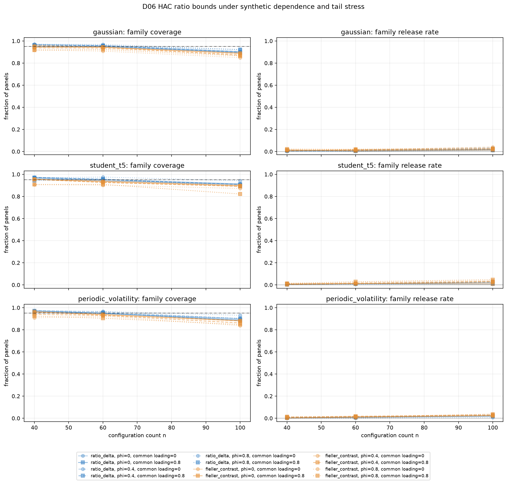

# D06 HAC ratio interval stress: delta method vs contrast inversion

**CPU-only synthetic method stress.** It does not use gauge data, a production reference fit, sealed split, GPU, or QUDA. The physical D06 rule remains `UNCALIBRATED/NOT_READY`, with `physical_score=null`.

## Question and methods

Both methods form one-sided lower confidence bounds for `rho=R_comparator/R_trainableW` with per-comparison alpha `0.025` and family size 2. `ratio_delta` applies HAC to the plug-in ratio influence. `fieller_contrast` directly inverts the HAC-studentized contrasts `R_comparator - r*R_trainableW`; it is a Fieller-style lower endpoint and avoids treating the denominator as fixed. Both take the minimum across block lengths `[2, 5, 10]` and Bartlett bandwidths `[2, 5, 10, 20, 30]`. Release additionally requires both family lower bounds to exceed `r_star=1.111111`.

We used known finite-`n` D04 risk truth for Gaussian AR(1), finite-variance Student-t5 AR(1), and period-2 heteroskedastic AR(1) innovations. Each family spans `n=[40, 60, 100]`, `phi=[0.0, 0.4, 0.8]`, and common-noise loading `[0.0, 0.8]` (arm correlation is loading squared), with `1000` independent panels per cell. Expected D04 risk is computed from the exact declared mean and covariance, not an estimated Monte Carlo truth. The nominal-coverage MC standard error at 95% is `0.0069`.



## Findings and boundaries

`coverage_summary.csv` provides every cell and Wilson interval, and `replicates.csv` keeps paired panel outcomes.
Across all 54 cells, ratio-delta's familywise Wilson lower endpoint reaches 0.95 in 15/54 cells; contrast inversion does so in 1/54. Equal-cell averages below are descriptive summaries of this declared grid, not estimates for a lattice ensemble:

|DGP|method|mean family coverage|mean family release rate|cells with Wilson lower >=0.95|
|---|---|---:|---:|---:|
|gaussian|ratio_delta|0.9424|0.0103|4/18|
|gaussian|fieller_contrast|0.9143|0.0173|0/18|
|periodic_volatility|ratio_delta|0.9409|0.0099|5/18|
|periodic_volatility|fieller_contrast|0.9119|0.0154|1/18|
|student_t5|ratio_delta|0.9447|0.0110|6/18|
|student_t5|fieller_contrast|0.9138|0.0175|0/18|

Worst-cell minima and the full denominator by DGP/method are recorded in `protocol.json`:

```text
{
  "gaussian:fieller_contrast": {
    "all_cell_wilson_lower_ge_0.95": false,
    "minimum_family_coverage": 0.849,
    "minimum_family_release_rate": 0.006
  },
  "gaussian:ratio_delta": {
    "all_cell_wilson_lower_ge_0.95": false,
    "minimum_family_coverage": 0.894,
    "minimum_family_release_rate": 0.002
  },
  "periodic_volatility:fieller_contrast": {
    "all_cell_wilson_lower_ge_0.95": false,
    "minimum_family_coverage": 0.838,
    "minimum_family_release_rate": 0.001
  },
  "periodic_volatility:ratio_delta": {
    "all_cell_wilson_lower_ge_0.95": false,
    "minimum_family_coverage": 0.882,
    "minimum_family_release_rate": 0.0
  },
  "student_t5:fieller_contrast": {
    "all_cell_wilson_lower_ge_0.95": false,
    "minimum_family_coverage": 0.822,
    "minimum_family_release_rate": 0.003
  },
  "student_t5:ratio_delta": {
    "all_cell_wilson_lower_ge_0.95": false,
    "minimum_family_coverage": 0.891,
    "minimum_family_release_rate": 0.003
  }
}
```

The experimental unit denominator is planned/valid/failed/abstained = `54000/54000/0/0` independent synthetic panels. Numeric coverage is not calibration evidence for a lattice chain. HAC remains an asymptotic candidate; no method is promoted from this sweep. The stress does not include uncertainty in D04 reference fitting, nonstationary mean drift, optimizer failures, or the production candidate-generation process.

Text flow: `declared DGP and exact risk truth -> paired three-arm panel -> D04 risk/influence at L=2/5/10 -> delta-HAC vs inverted-HAC contrast lower bounds over fixed bandwidth hull -> family coverage and r_star release rate -> record undercoverage or conservative abstention; no physical score`.
