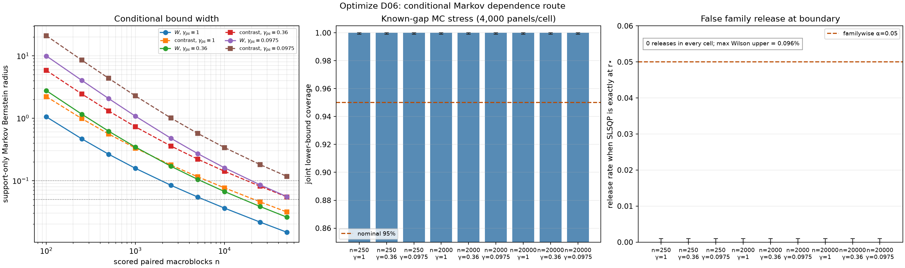

# D06 Markov dependence correction: CPU feasibility and coverage diagnostic (v1)

**Conditional method diagnostic only.** No gauge, propagator, reference, held-out, sealed, GPU, or QUDA inputs were read. `physical_score=null`; the bounded block-risk estimand remains an alternative to D04 and is not a production result.

## Method

For each of three simultaneous events (trainable-W positive denominator and its paired contrasts against same-budget SLSQP and degree-4 Chebyshev), the script applies the corrected non-reversible Markov Bernstein inequality with a support-only variance bound. For a function supported on an interval of width `w`, it uses `Var_pi(f) <= w^2/4` and `|f-E_pi f| <= w`. The supports are `[0,1]` for arm risk and `[-r_star,1]` for `X_comparator-r_star X_W`. The two-sided tail is conservatively inverted for each lower bound.

The stationary family budget is `(alpha_total-TV)/3`. The supplied TV term is paid once for the union event: by the total-variation event inequality, this is valid only when the *joint scored-chain initial law after burn-in* is within that TV distance of stationarity. TV is not estimated from the data here. The gap and TV values in the tables are assumptions varied for feasibility, not observed properties.

The primary source is Paulin, corrected arXiv v5, Theorem 3.11, Eq. (3.25): [paper](https://arxiv.org/html/1212.2015v5). It states the bound for a stationary homogeneous Markov chain and a fixed summand function using its pseudo-spectral gap. This diagnostic does not establish those conditions for any LatticeArena chain.

## What the figure shows

- **Left:** support-only radius for the denominator and paired contrast over scored macroblock count, under three assumed pseudo-gaps. A contrast can pass only if its observed mean exceeds the contrast radius, while the trainable-W sample mean must separately exceed its own radius. At stricter gaps these necessary margins remain large.
- **Middle:** joint lower-bound coverage in 4,000 independent simulated panels per cell. The exact stationary two-state driver has the listed pseudo-gap; SLSQP is exactly at `r_star`, while Chebyshev is given a strong positive contrast. Wilson intervals show Monte Carlo uncertainty, not a production coverage guarantee.
- **Right:** family release rate when SLSQP is exactly at the threshold. Any release is a false family release for this synthetic boundary case; Wilson upper endpoints remain visible even when the observed count is zero.

| Scored blocks | Assumed `gamma_ps` | Joint coverage [MC Wilson 95%] | Boundary family release [MC Wilson 95%] |
|---:|---:|---:|---:|
| 250 | 1.0000 | 1.0000 [0.9990, 1.0000] | 0.0000 [0.0000, 0.0010] |
| 250 | 0.3600 | 1.0000 [0.9990, 1.0000] | 0.0000 [0.0000, 0.0010] |
| 250 | 0.0975 | 1.0000 [0.9990, 1.0000] | 0.0000 [0.0000, 0.0010] |
| 2000 | 1.0000 | 1.0000 [0.9990, 1.0000] | 0.0000 [0.0000, 0.0010] |
| 2000 | 0.3600 | 1.0000 [0.9990, 1.0000] | 0.0000 [0.0000, 0.0010] |
| 2000 | 0.0975 | 1.0000 [0.9990, 1.0000] | 0.0000 [0.0000, 0.0010] |
| 20000 | 1.0000 | 1.0000 [0.9990, 1.0000] | 0.0000 [0.0000, 0.0010] |
| 20000 | 0.3600 | 1.0000 [0.9990, 1.0000] | 0.0000 [0.0000, 0.0010] |
| 20000 | 0.0975 | 1.0000 [0.9990, 1.0000] | 0.0000 [0.0000, 0.0010] |

Coverage cells are `planned/valid/failed/abstained = 36000/36000/0/0`. There are 144 analytic scenarios (`planned/valid/failed/abstained = 144/144/0/0`); valid means the formula evaluated, not that its assumptions hold. The best-case support-feasibility marker is true in 69/144 formula rows. The paired-contrast radius needed for margins from 0.01 to 0.10 ranges from 6,290 to 24,732,070 scored blocks over the declared gap/TV grid; see `required_blocks.csv` for the exact conditional scenarios.

## Interpretation and next gate

This supplies a conservative, finite-sample dependence route for the **bounded block-risk estimand** if an independent reviewer can justify a homogeneous chain of the exact paired macroblock states, a pseudo-spectral-gap lower bound, the post-burn-in TV receipt, and a fixed score map. If block scores have stochastic solver noise, that randomness must be included in the state or otherwise justified. The toy chain confirms the implementation's behavior only for its known two-state model; it cannot infer a gauge-chain gap from trajectory spacing, empirical autocorrelation, or synthetic coverage.

The method is deliberately support-only and may require many blocks. A future comparison with tighter variance receipts is useful only if real, independent receipts can reduce the worst-case bounds. D04 reference-fit uncertainty, blind candidate selection, real trainable-W training, both comparators, and physical authorization remain open. Do not connect this helper to a confirmation evaluator until those contracts are reviewed.

Text flow: `freeze arms + clipped block score -> score paired macroblock chain -> verify homogeneous/stationary-or-TV + gamma_ps receipts -> simultaneous denominator and two contrast bounds -> both pass or ABSTAIN/no release`. A missing dependence receipt forces `ABSTAIN`; numeric sensitivity values never fill that receipt.
