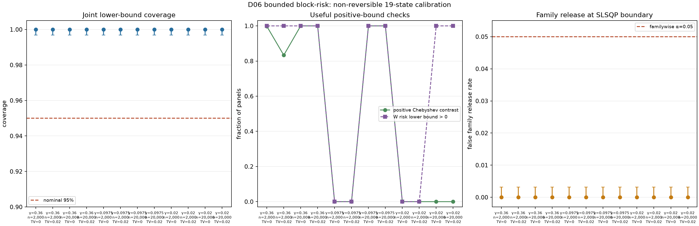

# D06 bounded block-risk: non-reversible multi-state Markov calibration

**Conditional synthetic method diagnostic only.** `physical_score=null`; the bounded block-risk estimand remains separate from D04. No gauge, propagator, E-reference, validation, embargo, shared holdout, confirmation, GPU or QUDA input was read.

## Generator and exact calibration target

The paired macroblock state follows a 19-state directed cycle with a uniform refresh: `P=(1-eta) C + eta J`. The uniform law is stationary, the chain is irreducible and aperiodic, and detailed balance fails. On the mean-zero subspace, `P` is a scaled unitary shift, so the nontrivial eigenvalues of `(P*)^k P^k` are `(1-eta)^(2k)` and `gamma_ps=max_k [1-(1-eta)^(2k)]/k=1-(1-eta)^2`. The runner verifies stationarity and this gap numerically from the transition matrix for every grid value.

The score map spans the full `[0,1]` support: trainable-W risk is one on 9 states and zero on 10; SLSQP reverses those values, giving exact risk ratio `10/9=r_star` and paired contrast zero. Chebyshev risk is one on every state, giving a positive control contrast `9/19`. Hence one contrast is exactly at the null boundary while the other is genuinely positive; all arms share the same chain state.

For the nonstationary rows, the initial law is `nu=(1-rho)pi+rho*delta_0` with `rho=TV/(1-1/19)`, so its total-variation distance from stationarity is exactly the declared 0.02. The radius uses `(alpha_total-TV)/3`, matching the helper's one-time familywise TV correction. These are exact synthetic facts, not inferred project-chain receipts.

## Figure and flow

Text flow: `19-state paired chain -> exact uniform stationary law and pseudo-gap -> fixed bounded three-arm score map -> simultaneous denominator + two contrast lower bounds -> coverage / false-release accounting`.

The three panels show simultaneous lower-bound coverage with Wilson Monte Carlo intervals; the fraction with positive trainable-W denominator and Chebyshev control bounds; and family release frequency when SLSQP is exactly at `r_star`. A positive Chebyshev bound is a useful power-side check, while a family release at the SLSQP boundary is a false release.

All 12 planned cells completed: per cell planned/valid/failed/abstained panels = `1200/1200/0/0`; pooled panels = `14400/14400/0/0`. Across all panels, the experiment scored `158,400,000` paired macroblocks. No chain or panel was dropped. The public decision helper was cross-checked against the vectorized calculation on one additional deterministic realized path per cell.

|gamma_ps|blocks|TV|joint coverage [Wilson 95%]|W denominator lower bound positive|Chebyshev control lower bound positive|family release at SLSQP boundary [Wilson 95%]|
|---:|---:|---:|---:|---:|---:|---:|
|0.36|2,000|0|1.0000 [0.9968, 1.0000]|1.0000|0.9975|0.0000 [0.0000, 0.0032]|
|0.36|2,000|0.02|1.0000 [0.9968, 1.0000]|1.0000|0.8333|0.0000 [0.0000, 0.0032]|
|0.36|20,000|0|1.0000 [0.9968, 1.0000]|1.0000|1.0000|0.0000 [0.0000, 0.0032]|
|0.36|20,000|0.02|1.0000 [0.9968, 1.0000]|1.0000|1.0000|0.0000 [0.0000, 0.0032]|
|0.0975|2,000|0|1.0000 [0.9968, 1.0000]|0.0000|0.0000|0.0000 [0.0000, 0.0032]|
|0.0975|2,000|0.02|1.0000 [0.9968, 1.0000]|0.0000|0.0000|0.0000 [0.0000, 0.0032]|
|0.0975|20,000|0|1.0000 [0.9968, 1.0000]|1.0000|1.0000|0.0000 [0.0000, 0.0032]|
|0.0975|20,000|0.02|1.0000 [0.9968, 1.0000]|1.0000|1.0000|0.0000 [0.0000, 0.0032]|
|0.02|2,000|0|1.0000 [0.9968, 1.0000]|0.0000|0.0000|0.0000 [0.0000, 0.0032]|
|0.02|2,000|0.02|1.0000 [0.9968, 1.0000]|0.0000|0.0000|0.0000 [0.0000, 0.0032]|
|0.02|20,000|0|1.0000 [0.9968, 1.0000]|1.0000|0.0000|0.0000 [0.0000, 0.0032]|
|0.02|20,000|0.02|1.0000 [0.9968, 1.0000]|1.0000|0.0000|0.0000 [0.0000, 0.0032]|

Observed minimum joint coverage was `1.0000`; the largest observed family release rate at the SLSQP boundary was `0.0000` (largest Wilson upper endpoint `0.0032`). Monte Carlo intervals only quantify simulation uncertainty for this finite-state generator.

## Interpretation and limit

This extends the earlier two-state reversible calibration with a non-reversible, 19-state chain, a full-support score map, exact threshold-boundary contrast, a positive-control contrast, and an exact nonstationary initial-TV case. It is a distinct DGP and does not repeat the earlier two-state generator. The experiment checks that the support-only Markov bounds remain conservative for these known-chain cases; it does not establish coverage for HMC or infer a production `gamma_ps` / TV receipt. Because the method uses worst-case support bounds, high coverage can coexist with low release power.

D04 reference-fit uncertainty, candidate-selection uncertainty, actual trainable-W training, authorized production receipts, independent statistical review and all sealed splits remain open. Keep `NOT_READY/UNCERTIFIED`, `physical_score=null`, and the sealed data closed.

Sources: Paulin, corrected arXiv v5, Theorem 3.11 / Eq. (3.25), for the pseudo-spectral-gap Bernstein inequality: [paper](https://arxiv.org/html/1212.2015v5). The stationary-law and pseudo-gap values here are derived from the stated finite transition matrix, not taken from that paper as empirical facts.
