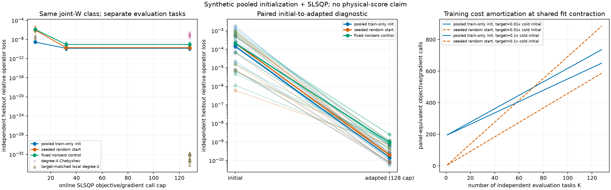

# Trainable-W cross-task pooled initialization stress

**SYNTHETIC CPU DIAGNOSTIC ONLY. `physical_score=null`.** No physical links, sealed split, GPU, or QUDA data are read.

## Question and split

This tests a mechanism missing from the previous per-panel stress: a shared width-2 trainable-W parameter vector is fitted on 12 independent training panels and then used only as a warm start on 12 independent evaluation panels. Each panel draws a six-coefficient local-environment teacher around the frozen base vector with relative SD 0.2; each training task supplies 2 fit links, and each evaluation task supplies 2 fit plus 2 untouched heldout links. The target family is intentionally synthetic and narrow.

Training flow: `training seeds -> fit links only -> one pooled SLSQP prior -> freeze seven parameters`. Evaluation flow: `independent evaluation fit links -> learned/cold/fixed initialization -> same joint-W SLSQP caps -> heldout links scored once`. The degree-4 Chebyshev family is fitted on each evaluation fit split and scored on the same heldout links.



## Cost and failure accounting

The pooled prior used 15 pooled optimizer objective/gradient calls over 24 training link cases, or 180 single-panel-equivalent optimizer calls. One additional initial-loss diagnostic is reported separately (192 total panel-equivalent objective evaluations including it). Every pooled evaluation visits all training fit cases; it is not counted as one ordinary task call. The initializer is a copied seven-parameter vector (no learned inference model). Optimizer and baseline fit seconds are saved separately; synthetic input/target generation is excluded and not timed, so no production walltime comparison is claimed. Online SLSQP caps are `[8, 32, 128]` for all three initialization arms.

Two shared training-fit targets are fixed at fractions `(0.1, 0.01)` of each panel's seeded cold-start initial fit loss. They require substantial synthetic fit-loss contraction but are not D06 physical `r_star`; heldout loss does not choose or stop training. A minimum amortizing task count is estimated only if every panel reaches the same target for both pooled and cold starts and pooled initialization uses fewer online calls. It is the first integer K where observed cold-start call savings strictly exceed the 192 panel-equivalent training/initial-diagnostic cost. If all arms already start below a target, or a target is missed on any panel, no break-even value is estimated for that target.

|fraction of cold initial fit loss|arm|total calls to target|mean calls per panel|minimum K where pooled cost is strictly lower|
|---:|---|---:|---:|---:|
|0.10|pooled_learned_init|43|3.5833333333333335|193|
|0.10|random_cold_start|55|4.583333333333333|None|
|0.10|fixed_nonzero_control|61|5.083333333333333|None|
|0.01|pooled_learned_init|51|4.25|73|
|0.01|random_cold_start|83|6.916666666666667|None|
|0.01|fixed_nonzero_control|78|6.5|None|


`denominator_summary.csv` retains training/evaluation panels, fit/heldout links, solver runs, strong-baseline fits, and per-arm tolerance hits as planned/valid/failed/abstained. Solver cap stops and non-success outcomes remain in the raw trace and are not excluded.

## Results and limitations

At the largest online cap, median heldout losses are pooled learned init `1.44057e-10`, random cold start `1.96137e-10`, fixed nonzero control `9.12881e-10`, degree-4 Chebyshev `7.29758e-08`, and target-matched fixed local degree-2 `3.1675e-33`. These descriptive medians over 12 synthetic tasks are not population estimates or physical claims.

A pooled initialization is a *hybrid* with SLSQP, not a competing optimizer guarantee. Chebyshev is the requested fixed spectral comparator, but this diagnostic's local-environment teacher is deliberately non-spectral; the fixed degree-2 local baseline is a target-matched synthetic family control. Neither synthetic baseline selects the physical D11 operator. The experiment can support a finite-budget warm-start effect only under this declared synthetic task distribution. It does not resolve D04 physical reference, D06 minimum effect, D11 operator/positivity contract, GPU timing, or sealed confirmation. Keep the Optimize task `NOT_READY/UNCERTIFIED` and `physical_score=null`.

## Rebuild

Use a new output directory; existing artifacts are never overwritten:

```text
python -B -m tasks.optimize_gaussian.trainable_w_meta_init_diagnostic --output NEW_DIRECTORY
```
