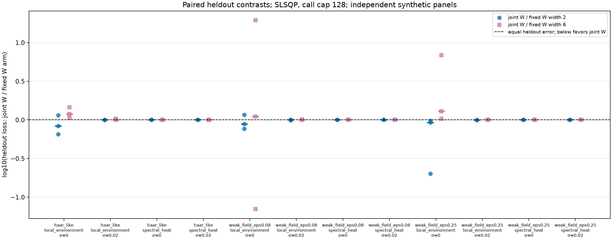
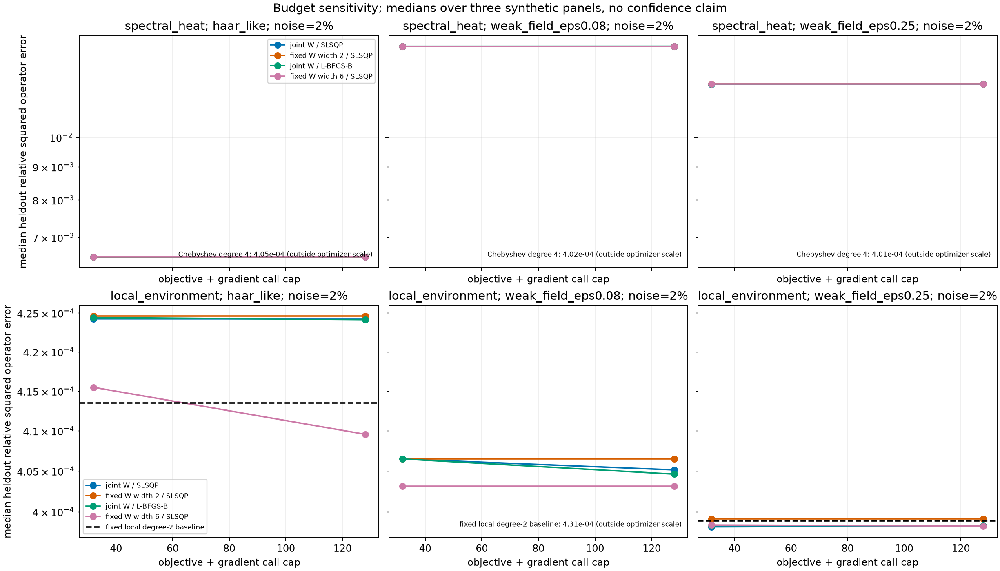
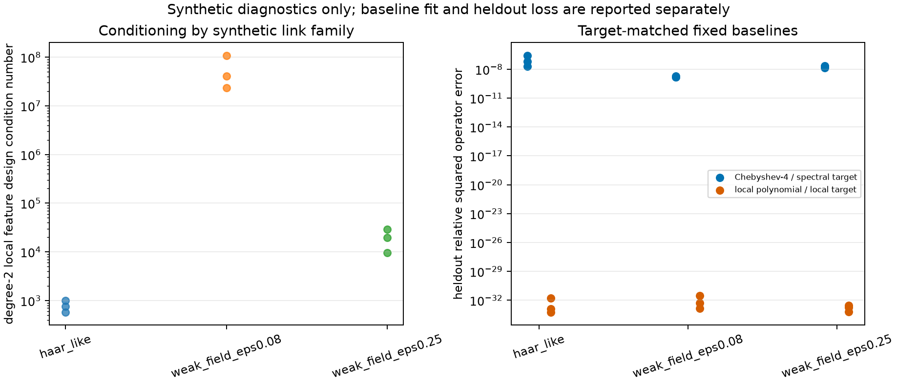

# Trainable-W synthetic generator/noise/conditioning stress diagnostic

**SYNTHETIC ALGORITHM DIAGNOSTIC ONLY. `physical_score=null`.** No production gauge ensemble, sealed IDs, GPU, or QUDA data were accessed. Three panels per cell support descriptive stress testing only; no confidence or significance claim is made.

## Design

The fixed grid crosses three independent link generators (`haar_like`, and weak-field links with `epsilon=0.08` or `0.25`), two independently defined targets (`spectral_heat`, and a gauge-covariant local-environment polynomial that varies over links), two relative operator-noise levels (`0`, `0.02`), and three seeds per cell. Each panel has two fit and two independently generated heldout links. Noise is a Hermitian link-hopping operator perturbation scaled to the requested fraction of target Frobenius norm.

Every panel pairs the same fit/heldout inputs, initial parameters, and bounds across joint trainable-W SLSQP, joint trainable-W L-BFGS-B, fixed-W width-2 SLSQP, and fixed-W width-6 SLSQP at call caps 32 and 128. Width-6 fixed W matches the seven fitted scalar count of joint width-2, though it changes the feature realization. Objective/gradient calls are capped per solver fit; optimizer seconds exclude data/target construction and postchecks. All traces, status, calls, projected-gradient residuals, target diagnostics, and raw inputs are retained.

For spectral targets, degree-1/degree-4 Chebyshev fixed spectral baselines are fitted on the same fit links and evaluated on heldout links. For local-environment targets, a fixed degree-2 centered local operator basis is fit by weighted linear least squares as a target-matched capacity diagnostic; it is not substituted for the selected physical strong spectral baseline. The local target's commutator with the uniform hopping operator is reported as a direct check that this family is not a function of that one global hopping matrix.

## Paired results

Each point is one independent synthetic panel at the 128-call cap. Blue circles compare joint-W SLSQP with fixed-W width 2 (three fitted scalars); pink squares compare with fixed-W width 6 (seven fitted scalars, matching joint width 2). Values below zero favor joint W. The second comparison controls parameter count but changes the random feature realization. Median ticks are descriptive only. See `paired_summary.csv` for both contrasts, ranges, calls, fit times, and projected-gradient residuals; ranges are not confidence intervals.

Panels show median heldout loss at call caps 32 and 128 for the 2%-noise cases. The target-matched fixed baseline is shown as a dashed line when it lies within the optimizer scale; otherwise its median is annotated in the panel. The budget curves compare observed finite-budget fits, not equal walltime including setup, baseline construction, or amortized training.

The local-basis feature design condition number varies with the synthetic link family. Target-matched baselines are expected controls: degree-4 Chebyshev is aligned with the spectral target; the fixed local polynomial oracle is aligned with the local target. Neither is a physical ranking.

## Denominators and interpretation

Planned/valid/failed/abstained synthetic panels: `36/36/0/0`. Planned/returned solver fits: `288/288`; budget stops: `93`; solver non-success: `93`; excluded samples: `0`. Link counts and solver counts are separate denominators in `raw.json`.

A small panel count cannot determine a population effect or select a physical loss. Synthetic noise and feature conditioning only probe robustness of this implementation and objective. The selected F=2 comparisons remain trainable-W against same-budget SLSQP and against the fixed strong spectral baseline; these data do not satisfy D04 reference, D06 `r_star`, D11 operator contract, or production GPU authorization.

## Rebuild

Generate a fresh output directory with `python -B -m tasks.optimize_gaussian.trainable_w_stress_diagnostic --output NEW_DIRECTORY`.
