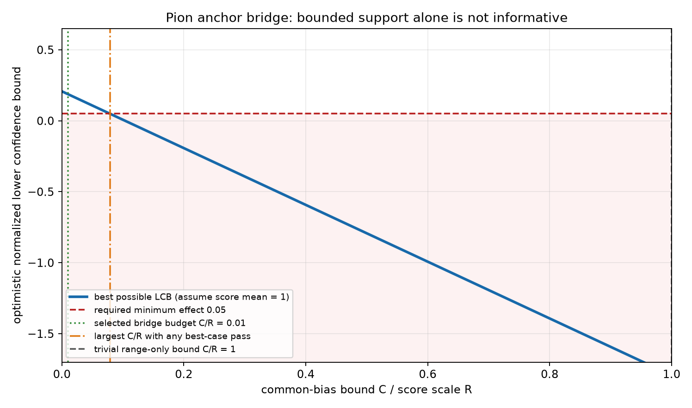

# Pion common-bias feasibility under the selected bounded block-risk plan

**Analytic planning diagnostic only.** It uses the selected contract defaults and corrected Markov concentration helper. No correlators, receipts, cached propagators, sealed splits, GPU, or QUDA data were read. The score remains `NOT_READY/UNCERTIFIED`, `physical_score=null`.

## Calculation

The optimistic best-case normalized LCB sets the unknown score mean to its mathematical maximum 1:

```text
LCB_max = 1 - score_radius - 2*TV
             - 2*(anchor_random_radius/R + C/R).
```

The selected plan gives score radius `0.386315696`, `2*TV_score=0.002000`, and conditional Markov-anchor random radius/R `0.202039616` from `n_A=4000`, `gamma_A=0.2`, `TV_A=0.001`, burn-in `8`, and `alpha_A=0.01`. The anchor TV allowance is spent from `alpha_A`, leaving stationary tail level `0.009000`; it is not added as a score-mean shift. Even under this best possible score mean, the threshold `delta_star/R^2=0.050` can only be reached if `C/R < 0.078803`. This is a necessary feasibility ceiling, not a sufficient certificate or a recommended estimate of `C`.

The selected design budget `C/R=0.010` gives best-case LCB `0.187605`. If one uses only the trivial range fact that both the clipped anchor scalar and `m*` lie in `[0.1, 3.0]`, then `C<=R=2.900` and `C/R=1`; the best-case LCB becomes `-1.792395`. Thus clipping or bounded support alone cannot support the chosen score. The required `C/R<=0.01` is a separate bridge that needs a physical estimator/bias argument and an independent receipt.



## Denominators and decision flow

- Formula sensitivity: planned/valid/failed/abstained = `101/101/0/0`.
- Physical evidence gate: `1/0/0/1`; anchor map, `C` coverage, independence, and chain/reference receipts are absent.

```text
declared support [0.1,3.0] + Markov receipts (n_A=4000, gamma_A>=0.20, burn-in=8, TV_A<=0.001)
  -> conditional random radius/R from corrected Markov Bernstein
  -> trivial support-only C/R <= 1 still gives best-case LCB below threshold
  -> need an estimator-specific common-bias bridge C/R <= 0.01 with receipt
  -> independently review scalar map, target correspondence, and score/anchor conditional independence
  -> only then consider a fresh authorized confirmation; otherwise ABSTAIN
```

The computation does not change `m*`, any selected alpha/sample-size defaults, or the status. The existing selected C budget is not inferred from D development data; this calculation shows why its proof is essential.
