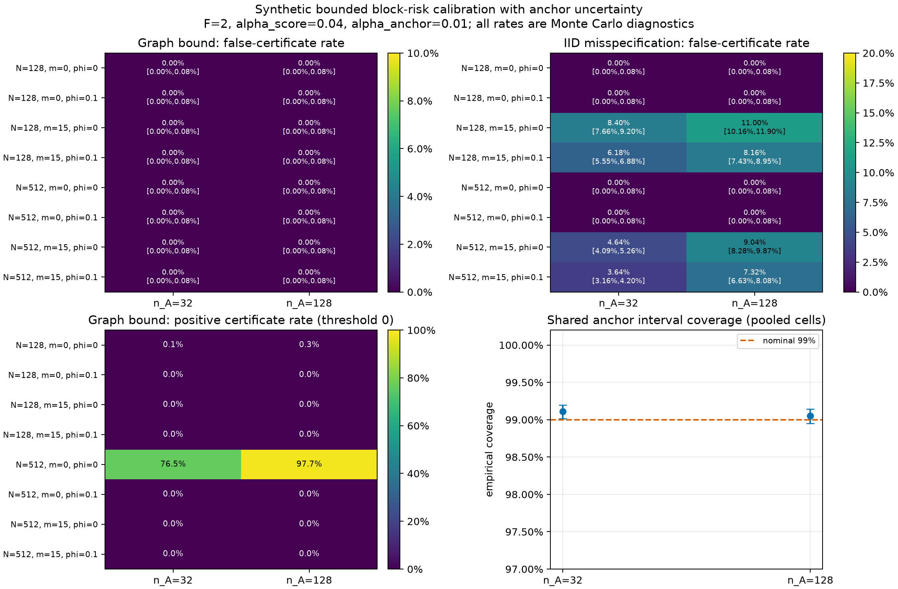

# Bounded block-risk coverage with shared anchor uncertainty

**SYNTHETIC METHOD DIAGNOSTIC ONLY. `physical_score=null`.** No project measurement, correlator, E anchor, sealed split, GPU, or QUDA data are read.

## Model and prespecified calibration

The grid has `N=[128, 512]`, known dependence range `m=[0, 15]`, hypothetical failures `[0.0, 0.1]`, independent anchor sample sizes `[32, 128]`, and `5000` replicates per cell. There are `F=2` paired families with `alpha_score=0.04`, `alpha_anchor=0.01`, and `alpha_total=0.05`.

For each family, the true-anchor valid score is `q_i=0.2+0.8*tanh(mean of m+1 iid Gaussian innovations)`; it is bounded in `[-1,1]` and has mean 0.2. Innovation windows overlap for at most `m` positions, so residue classes modulo `m+1` are jointly independent. A shared Bernoulli failure mask is used for both families; failures remain in planned `N` and receive `-1`, giving true mean `(1-phi)*0.2-phi`.

The synthetic anchor target is `A*=0`. Each replicate obtains `n_A` independent normal observations with known `sigma=0.05` and estimates `A_hat` by their mean. The two-sided exact-normal radius is `B=z_(1-alpha_anchor/2)*sigma/sqrt(n_A)`, so its nominal coverage is `99%`. The model fixes `y_candidate-y_reference=R` with `R=1.0` and constructs `D(A*)=R^2*q`; hence `D(A_hat)/R^2=q+2*(A_hat-A*)/R`. On the event `|A_hat-A*|<=B`, clipping is 1-Lipschitz and the anchor correction `2B/R` covers the score shift.

The graph-color LCB uses `chi=m+1`; the comparator deliberately assumes `chi=1`. The two one-sided events are budgeted by a union bound: graph-score failure at most `alpha_score`, plus anchor interval failure at most `alpha_anchor`. This theoretical statement is conditional on the fully specified generator, independence of anchor and score innovations, and the exact known-sigma normal model.

## Figure and reading guide



The top-left heatmap shows the planned-run probability that an issued graph LCB exceeds the true mean (false certificate); its cells include Monte Carlo Wilson intervals. The top-right repeats the diagnostic with the intentionally wrong IID graph. The lower-left reports the illustrative positive-bound rate at threshold zero, which is power/utility rather than a physical threshold. The lower-right checks the anchor interval coverage against its 99% nominal line. Numeric LCB coverage conditional on issuing a bound is also tabulated, but conditioning on non-abstention is descriptive and is not the unconditional theorem.

## Denominators and limitations

`cell_summary.csv` and `denominator_summary.csv` separate planned/valid/failed/abstained MC replicates, paired block events, family-block scores, anchor estimates, and anchor observations. `replicate_summary.npz` stores each anchor error, failure count, interval-coverage indicator, bound/abstention result, and certificate event. An all-failed score replicate abstains and cannot issue a bound. Monte Carlo Wilson intervals quantify only simulation error.

This simulation closes the software/method question of how a shared anchor interval can enter the bounded block-risk correction under a known independent normal anchor and known score graph. It does not estimate the project's `B`, `chi`, anchor distribution, or score; it cannot establish independence of actual E and D measurements or repair the failed reference/model-identification gate. The task stays `NOT_READY/UNCERTIFIED` with `physical_score=null`.

## Rebuild

Use a fresh output directory; existing artifacts are never overwritten:

```text
python -B -m tasks.pion_projection.bounded_block_risk_anchor_coverage_mc --output NEW_DIRECTORY
```
