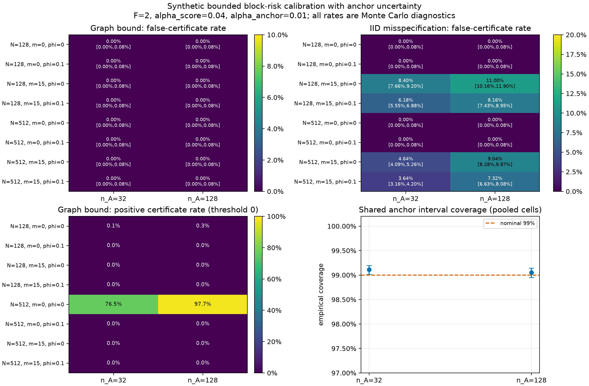

# Pion joint score/anchor coverage with shared receipt

**SAVED SYNTHETIC DIAGNOSTIC ONLY. `physical_score=null`. This report copies the verified v1 artifacts; 80,000 Monte Carlo replicates were not rerun.**

The original report and its manifest are preserved under `source_report/`. The overlay records 16 scenario cells and retains all 80 cell-by-analysis-unit denominator rows; it does not combine score blocks, anchor observations, or comparisons into one sample count.

## Text data flow

```text
verified saved joint score/anchor report + nested SHA-256 manifest
  -> 16 prespecified scenario cells -> 80 cell-by-unit denominator rows
  -> separate replicate / paired block / family score / anchor estimate / anchor observation counts
  -> reason rows for each hypothetical failed score event -> hashed receipt
  -> complete means all planned units are accounted for, not scientific success
  -> physical_score remains null; dependence/anchor/reference and authorization gates remain open
```

## Aggregate denominator summary

|unit|planned|valid|failed|abstained|
|---|---:|---:|---:|---:|
|MC replicate|80000|80000|0|0|
|paired block event|25600000|24321134|1278866|0|
|family block score|51200000|48642268|2557732|0|
|anchor estimate|80000|80000|0|0|
|anchor observation|6400000|6400000|0|0|

The aggregate table is a convenience summary; `run_receipt.json` retains one entry for every cell/unit pair. Paired block and family-score failures are synthetic Bernoulli events retained in planned `N` and coded `-1`, not observed measurement failures.

## Saved figure and interpretation



The verified source summary reports graph-color false-certificate rate max `0` with Monte Carlo upper limit `0.000767702`; the deliberately misspecified IID route reaches `0.11`. Anchor interval coverage ranges from `0.9892` to `0.9922`. These results are conditional on the synthetic generator and known iid anchor model; they do not establish project anchor support, independence, common-bias coverage, or Pion dependence.

The source report's `source_report/artifact_hashes.json` verifies its 11 payloads. The outer manifest covers all copied source files, receipt payloads, and `run_receipt.json`; the receipt binds every nonrecursive payload hash.

## Rebuild the receipt overlay

This command copies and verifies the saved report; it does not rerun Monte Carlo:

```text
python -B -m tasks.pion_projection.bounded_block_risk_anchor_coverage_receipt --source results/pion_projection/bounded_block_risk_anchor_coverage_mc_20261123_v1 --output NEW_DIRECTORY
```
