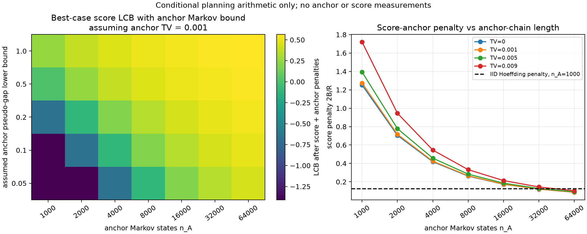

# Markov-aware anchor coverage: conditional planning diagnostic

This report adds a dependent-anchor route for the case where 1000 IID stationary anchor units cannot be justified. It is an optional fallback; it does not replace the selected IID Hoeffding route or certify its assumptions.

## Bound and scope

For a stationary anchor chain and one fixed scalar map `f(X_i) in [L,U]`, use Paulin corrected arXiv v5 Theorem 3.11 / Eq. (3.25), with worst-case `Var(f)<= (U-L)^2/4` and centered bound `C=U-L`. Solve the two-sided tail bound for the sample-mean radius. If the scored chain starts within TV `delta_A` after burn-in, Proposition 3.15 / Eq. (3.29) adds `delta_A` to the event probability; therefore the stationary theorem receives `alpha_A-delta_A`. The anchor interval is shared once across the three comparisons, so its interval uses family size one. Total anchor error is `B = random_radius + common_bias_C`, and its paired squared-error score penalty is `2B/R`.

The scalar map requirement is substantive. A global multi-channel fit to ensemble-averaged PP/A4P correlators is not automatically a per-state function `f(X_i)`. It needs a separately reviewed bounded state map and a target/bias argument; otherwise this theorem route cannot be applied to that fit.

## Selected planning point (assumptions only)

At `n_A=4000`, assumed anchor `gamma_ps>=0.20`, assumed post-burn-in `TV<=0.001`, `alpha_anchor=0.01`, support `[0.1,3.0]`, and `C/R=0.01`, the formula gives `random radius/R=0.202040`, `B/R=0.212040`, and `2B/R=0.424079`. With the separate score plan's assumed `N=4000`, `gamma_ps=0.20`, and `TV=0.001`, even a score mean of one yields best-case LCB `0.187605`. These are assumptions and arithmetic only; neither chain has these receipts.

For comparison, the selected IID-Hoeffding `n_A=1000` route has planning penalty `2B/R=0.122940` under its much stronger IID assumption. The Markov route does not claim to be narrower; it provides a conditional option when dependence is explicit.



## Text flow

```text
predeclared bounded scalar per independent anchor-chain state -> require its target map, separate anchor gamma_ps and post-burn-in TV receipts -> spend delta_TV from alpha_anchor for one shared anchor interval -> corrected Bernstein radius + common-bias C -> subtract 2B/R from the score LCB -> missing map/receipt means NOT_READY; physical_score=null
```

Analytic assumption cells planned/valid/failed/abstained = 175/140/0/35. This is not a Monte Carlo count or measured sample denominator. Physical anchor and score denominators are 0/0.

## Required before use

- Define a fixed bounded scalar emitted by each anchor-chain state and explain how its stationary mean estimates the selected `m_star`.
- Obtain a separate anchor-chain receipt, a valid `gamma_ps` lower bound, and a post-burn-in TV receipt (or prove stationarity). Do not reuse score-chain receipts.
- Bound common bias `C`, establish independence from the score chain, and have the target mapping independently reviewed.
- Keep the global candidate-blind multi-channel fit as the physical reference gate; a scalar-map route needs a quantitative bridge to it.
- No sealed input, confirmation split, GPU/QUDA data, or measurement was accessed; status remains `NOT_READY/UNCERTIFIED`, `certified=false`, `physical_score=null`.

## Source

Paulin, *Concentration inequalities for Markov chains by Marton couplings and spectral methods*, corrected arXiv v5, Theorem 3.11 Eq. (3.25), Proposition 3.15 Eq. (3.29): https://arxiv.org/html/1212.2015v5
