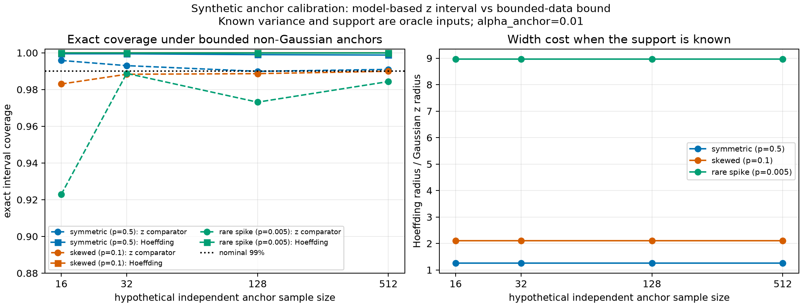

# Robust anchor interval calibration: exact bounded-data stress test

**SYNTHETIC EXACT ENUMERATION ONLY. `physical_score=null`.** No project anchor, correlator, ensemble, sealed split, GPU, or QUDA input is read.

## Question and methods

The previous joint calibration diagnostic used an iid known-variance normal anchor model. This report tests the remaining model-sensitivity boundary: how the corresponding Gaussian z radius behaves under bounded, non-Gaussian anchor errors, and what width a distribution-free bounded-data alternative pays.

Each synthetic anchor error is a two-point variable with mean zero and variance `sigma^2=0.05^2`. The rare upper point has probability `p` and the lower point probability `1-p`; the three cases use `p=0.5`, `0.1`, and `0.005`. For each `n_A={list(ANCHOR_SAMPLE_SIZES)}`, all `n_A+1` possible counts of upper-point observations are enumerated exactly with their Binomial probability mass.

The model-based comparator is `B_z=z_(1-alpha_A/2)*sigma/sqrt(n_A)`. It uses an oracle-known variance but a Gaussian critical value; under these non-Gaussian generators it has no finite-sample 99% guarantee. The distribution-free alternative is `B_H=(U-L)*sqrt(log(2/alpha_A)/(2*n_A))`, where `[L,U]` is the exact support. Hoeffding guarantees at least `1-alpha_A` coverage for iid bounded observations. Both formulae are two-sided.



## Results

The rare-spike case (`p=0.005`) has exact Gaussian-z coverage `92.2931%` at `n_A=16`, below the nominal 99%; the worst Gaussian-z coverage in the grid is `92.2931%`. Exact Hoeffding coverage is at least `99.8767%` in every grid cell, consistent with its finite-sample guarantee. The largest Hoeffding/Gaussian radius ratio is `8.959` (rare-spike support). This width directly enlarges the Pion correction `2B/R` if the required independent and support assumptions can be established.

`coverage_summary.csv` reports exact coverage, both radii, support and variance for every cell. `denominator_summary.csv` separates hypothetical anchor observations from the exact count states; the latter sum to probability mass one and are not Monte Carlo replicates or measured data.

## Scope and next boundary

This shows a real calibration choice: the Gaussian interval can be much narrower but relies on a distributional model; the Hoeffding interval is valid for any iid distribution within a proven support but may be too wide to certify a useful bounded block-risk lower bound. It does not show that project anchor errors are iid, bounded by these synthetic endpoints, or independent of score samples. If measurements are dependent, an independence or mixing bound is still required; if support is unknown, the Hoeffding radius is unavailable. The E-anchor receipt, common-bias bound, physical reference gate, and sealed-data authorization remain unresolved, so the task remains `NOT_READY/UNCERTIFIED` with `physical_score=null`.

## Source note

The known-variance Gaussian z interval is exact under the normal-population model stated by [NIST's confidence-interval reference](https://www.itl.nist.gov/div898/handbook/prc/section1/prc14.htm). The bounded independent-summand premise is from [Hoeffding (1963), *Probability Inequalities for Sums of Bounded Random Variables*](https://www.cs.rpi.edu/academics/courses/spring06/random/hoefding.pdf). The two-sided radius used here follows by applying the one-sided bounded-sum inequality to both tails and allocating `alpha_anchor/2` to each.

## Rebuild

Use a new output directory; existing artifacts are never overwritten:

```text
python -B -m tasks.pion_projection.bounded_block_risk_anchor_robustness_exact --output NEW_DIRECTORY
```
