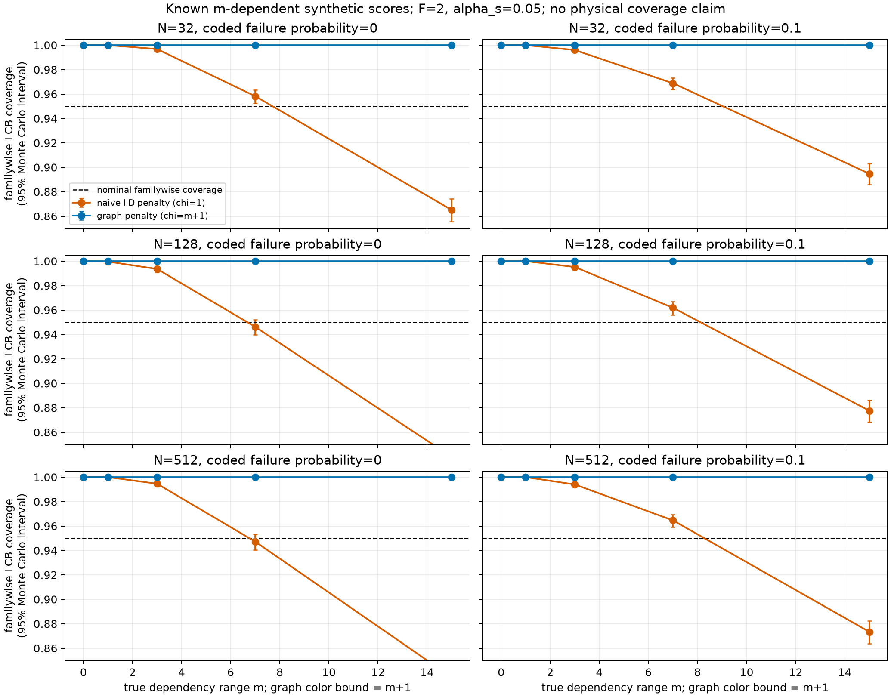
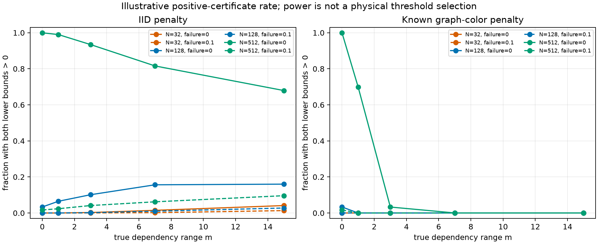

# Bounded block-risk conditional coverage Monte Carlo

**SYNTHETIC METHOD DIAGNOSTIC ONLY. `physical_score=null`.** The generator has a known finite dependency graph and known score mean. This study does not estimate LatticeArena/Pion dependence, anchor coverage, effect size, or physical risk.

## Prespecified generator and estimand

The grid crosses `N=[32, 128, 512]`, dependence ranges `m=[0, 1, 3, 7, 15]`, and hypothetical failure probabilities `[0.0, 0.1]` with `5000` Monte Carlo replicates per cell. There are `F=2` candidate score families and `alpha_s=0.05`. Each valid score is `mu + 0.8*tanh(mean of m+1 iid Gaussian innovations)` with `mu=0.2`; this lies in `[-1,1]` and has expectation `mu` by symmetry. Blocks at distance greater than `m` use disjoint innovations, so the graph with edges up to range `m` is valid and its residue coloring uses `chi=m+1` jointly independent classes.

A Bernoulli failure mask is shared across the paired candidate families. Failed planned blocks are retained and assigned score `-1`, so the target mean is `(1-phi)*mu - phi`. No anchor error is included (`alpha_A=0`). The study compares the lower bound using the correct graph color count with the same formula incorrectly assuming IID (`chi=1`). The two arms share block-failure indicators; Bonferroni `F=2` is used regardless of cross-family dependence.

## Figures



Points are simulated familywise coverage for both one-sided lower bounds; whiskers are 95% Monte Carlo Wilson intervals, not physics confidence intervals. The dashed line is the nominal 95% familywise level. The graph-color result tests the formula under the constructed m-dependent process. The IID curve is a deliberate misspecification control; any undercoverage is conditional on this synthetic generator.



This plot shows how often both lower bounds exceed zero. It is only the power/utility tradeoff for the arbitrary synthetic mean and zero threshold: a valid graph bound can retain coverage while abstaining from a positive conclusion. Zero is not a chosen Pion effect threshold.

## Denominators and limits

`cell_summary.csv` reports every cell, both coverage rates and Monte Carlo intervals, positive-certificate rate, and planned/valid/failed/abstained counts at replicate, paired-block, and family-score units. `mc_replicate_summary.npz` retains each replicate's block failure count and lower-bound/coverage outcomes. All-failure replicates are operational abstentions; the algebraic coded-score bound is separately retained for coverage auditing.

The coverage claim is conditional on a correct dependency graph and score bound. This simulated graph is known by construction; real trajectory spacing, block bootstrap or observed autocorrelation does not establish it. The shared-anchor bias correction is omitted here and still requires its independent coverage receipt. Clipping and coding failures define the simulated estimand; neither operation restores the original unbounded ensemble-risk.

The CSV also reports empirical valid-score means, failure-coded means, and the coded-mean deviation from its known target. These are generator diagnostics; they do not calibrate any project-specific score distribution.

## Rebuild

Use a fresh output directory; existing paths are never overwritten:

```text
python -B -m tasks.pion_projection.bounded_block_risk_coverage_mc --output NEW_DIRECTORY
```
