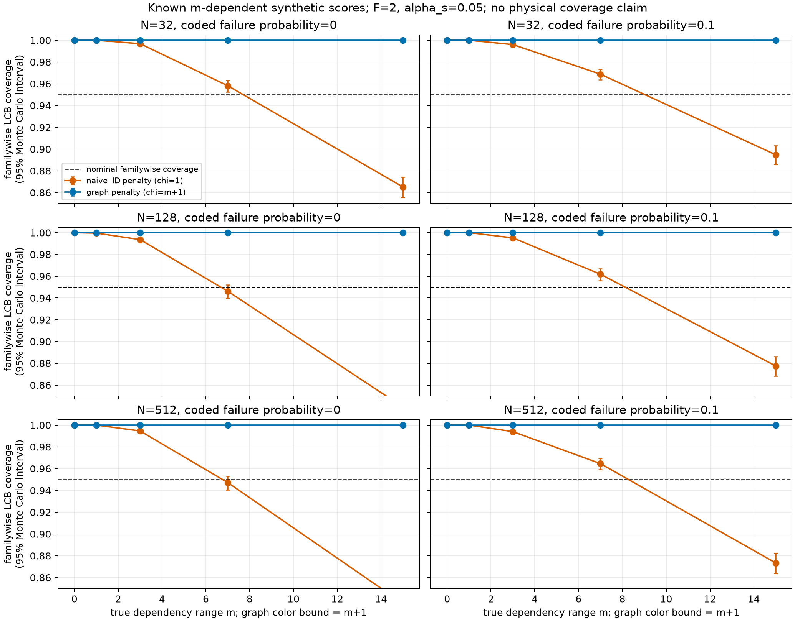
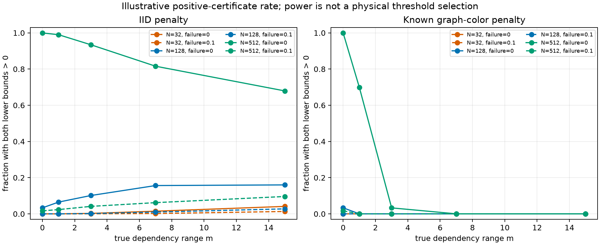

# Pion known-graph coverage report with shared receipt

**SAVED SYNTHETIC DIAGNOSTIC ONLY. `physical_score=null`. This report copies the verified v2 output; the 150,000-replicate Monte Carlo was not rerun.**

The original report and its artifact manifest are preserved under `source_report/`. The overlay adds a versioned `ScenarioSpec` and `RunReceipt` for the existing scenario-cell, replicate, paired-block-event, and candidate-family-score denominators. It does not infer project dependence or anchor coverage.

## Text data flow

```text
verified saved v2 report + nested SHA-256 manifest
  -> read the four existing denominator rows (no calls to the simulation generator)
  -> retain separate scenario cell / replicate / paired block event / family score units
  -> attach exact failure-reason counts and source/output hashes
  -> complete means all planned units are accounted for, not scientific success
  -> physical_score remains null; project evidence and authorization gates remain open
```

## Denominator summary

|unit|planned|valid|failed|abstained|not_run|interpretation|
|---|---:|---:|---:|---:|---:|---|
|synthetic Monte Carlo cell|30|30|0|0|0|All prespecified simulation cells completed.|
|Monte Carlo replicate|150000|150000|0|0|0|An all-failure replicate is operationally abstained; its coded-score algebraic bound remains in replicate arrays.|
|paired planned block event|33600000|31920007|1679993|0|0|Failures are hypothetical Bernoulli events, not observed measurement failures; all remain in N and are scored -1.|
|candidate-family block score|67200000|63840014|3359986|0|0|F=2 scores share paired failure events; this denominator is not a physical block count.|

The paired block-event and family-score failures are synthetic Bernoulli failures that are retained in the planned denominator and coded as `-1`; they are not measurement failures. The Monte Carlo replicate row has zero all-block-failed abstentions. Reasons in `run_receipt.json` account exactly for the failed block-event and family-score counts.

## Saved figures and interpretation



The saved v2 summary reports minimum familywise coverage 1.0000 under the constructed graph-color bound and 0.8362 under the deliberately misspecified IID penalty. These are finite synthetic Monte Carlo results only, not coverage evidence for LatticeArena data.



The original source report, all its raw replicate summaries, and its 10-entry manifest remain intact in `source_report/`. The outer `artifact_hashes.json` covers every copied source file, receipt payload and `run_receipt.json`; the receipt itself lists the hashes of all nonrecursive payloads.

## Rebuild the receipt overlay

This command copies and verifies the saved report; it does not rerun Monte Carlo:

```text
python -B -m tasks.pion_projection.bounded_block_risk_coverage_receipt --source results/pion_projection/bounded_block_risk_coverage_mc_20261123_v2 --output NEW_DIRECTORY
```
