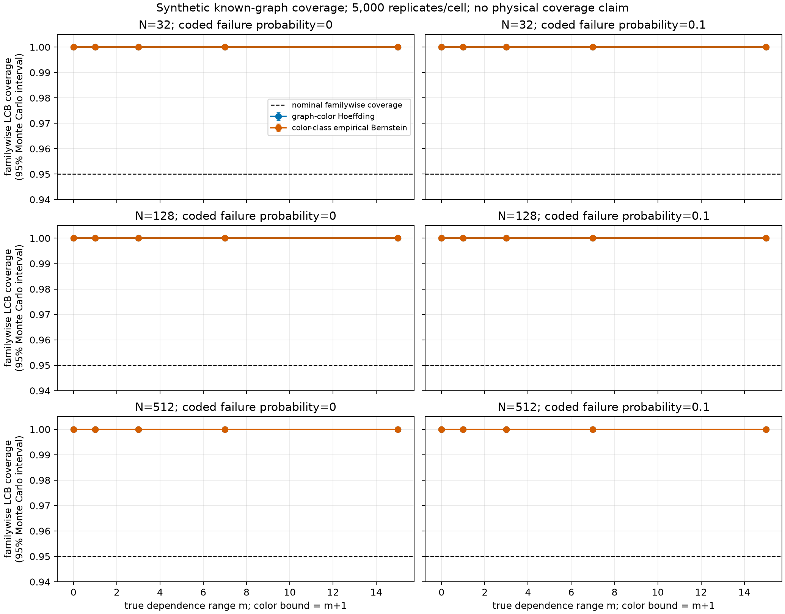
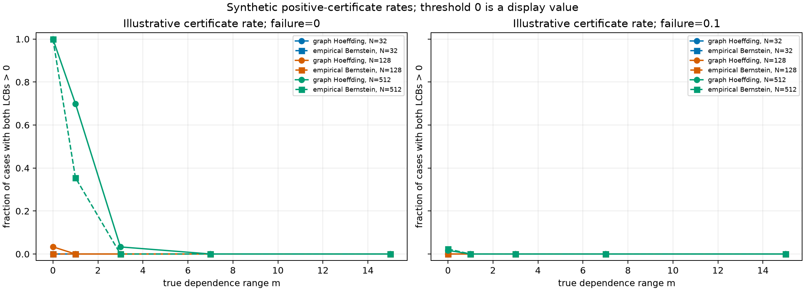
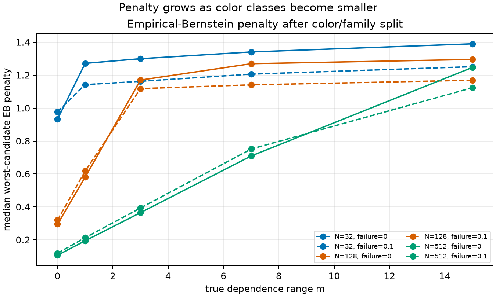

# Color-class empirical-Bernstein calibration diagnostic

**SYNTHETIC CONDITIONAL DIAGNOSTIC ONLY. `physical_score=null`.** No Pion correlators, anchor, sealed split, GPU, or QUDA inputs were accessed.

The simulation compares the existing graph-color Hoeffding penalty with a color-class empirical-Bernstein LCB over 30 cells and 5000 paired replicates per cell. The m-dependent score generator has a known proper coloring `c(i)=i mod (m+1)`, so blocks within each color class use disjoint Gaussian innovations. The two methods see identical seeded scores and paired failure masks.







## Bound and assumptions

For each fixed candidate and graph color class, the sample is bounded in `[-1,1]`. After mapping to `[0,1]`, Maurer–Pontil's empirical-Bernstein bound is applied with per-class `delta=alpha_s/(F*chi)`, then the color-class lower bounds are averaged with weights `n_c/N`. A singleton color class uses a Hoeffding fallback. This yields a familywise score bound only when every color class is jointly independent and the candidate family was frozen. The primary paper states the bound for independent, not necessarily identically distributed, variables (Theorem 11); this does not establish such independence for project blocks. [Maurer & Pontil, “Empirical Bernstein Bounds and Sample Variance Penalization”](https://www.cs.mcgill.ca/~colt2009/papers/012.pdf).

Empirical variance can tighten the class-wise radius when color classes are large and their observed variance is small. Its additive finite-sample term grows as classes shrink; splitting a high-dependence graph into many colors can make this method looser than the existing Hoeffding graph bound. A variance estimate does not estimate dependence or fix an invalid coloring.

## Coverage and accounting

Across the generated grid, graph-color Hoeffding minimum empirical coverage was 1.0000; empirical-Bernstein minimum empirical coverage was 1.0000, with minimum per-cell Monte Carlo 95% Wilson lower limit 0.9992. Coverage is measured against the known failure-augmented mean `(1-phi)*0.2-phi`; a Monte Carlo lower limit below the nominal 0.95 is finite replicate uncertainty, not a demonstrated bound failure.

Replicate denominators are planned/valid/failed/abstained = `150000/150000/0/0`. Failed block events remain in the planned denominator and receive score `-1`; no replicate is dropped. `cell_summary.csv` separately reports block-event and family-block-score denominators.

At `N=512`, all shown graph and empirical-Bernstein cells observed familywise coverage 1.0/1.0, while the positive-certificate rates show a clear efficiency tradeoff:

|N|m|failure probability|Hoeffding positive rate|empirical-Bernstein positive rate|median EB penalty|
|---:|---:|---:|---:|---:|---:|
|512|0|0.0|0.9996|1.0000|0.1064|
|512|0|0.1|0.0168|0.0232|0.1188|
|512|1|0.0|0.6994|0.3550|0.1941|
|512|1|0.1|0.0000|0.0000|0.2128|
|512|3|0.0|0.0330|0.0000|0.3650|
|512|3|0.1|0.0000|0.0000|0.3933|
|512|7|0.0|0.0002|0.0000|0.7089|
|512|7|0.1|0.0000|0.0000|0.7512|
|512|15|0.0|0.0000|0.0000|1.2469|
|512|15|0.1|0.0000|0.0000|1.1236|

At `m=0`, empirical Bernstein is slightly more useful in this fixture. At `m=1`, it cuts the no-failure certificate rate from 0.6994 to 0.3550; at `m≥3`, both methods are near zero power, with empirical Bernstein no better. The larger additive term after color splitting explains why this alternative is not a general improvement.

## Interpretation and next boundary

This is a candidate method for a future sensitivity lane, not a replacement selected by these synthetic results. Retain graph-color Hoeffding as the conservative reference until its assumptions are established. Empirical Bernstein is worth comparing only if a defensible score-specific coloring exists and color classes are large enough to avoid a dominant additive term. If project dependence is unknown, both bounds abstain; a low sample variance cannot make them valid.

The score remains `bounded_block_risk`, a clipped planned-block estimand. This report does not change the clipping range, target mass, `R`, candidate family, `alpha_total`, anchor distribution, or common-bias contract. The project remains `NOT_READY/UNCERTIFIED`, sealed data stay closed, and `physical_score=null`.

## Rebuild

Use a new output directory; existing artifacts are never overwritten:

```text
python -B -m tasks.pion_projection.bounded_block_risk_empirical_bernstein_mc --output NEW_DIRECTORY
```
