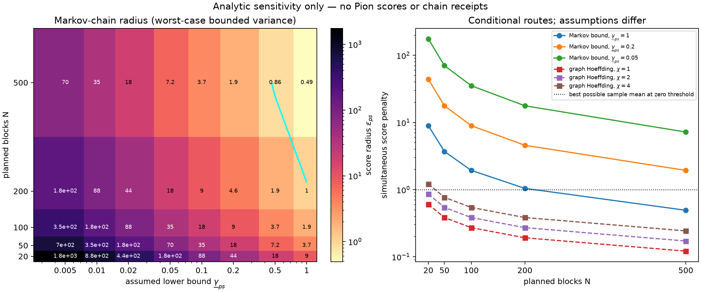

# Pion bounded-risk Markov gap sensitivity

> **Source correction (2026-11-24):** This legacy report originally cited Paulin (2015), Theorem 3.10. The author’s current [arXiv v5](https://arxiv.org/html/1212.2015v5) labels the corrected non-reversible Bernstein bound Theorem 3.11, Eq. (3.25), and notes that the general-state Bernstein proof argument in previous versions, including the published version, was incomplete. The numeric bound used here matches the corrected Eq. (3.25), but use [the v3 report](../bounded_block_risk_markov_gap_20261124_v3/README.md) for the corrected citation, explicit initial-law TV correction, and current interpretation. The source snapshot below remains the original historical generator.


**SYNTHETIC ANALYTIC SENSITIVITY ONLY. `physical_score=null`.** The script evaluates a published Markov-chain concentration inequality on hypothetical block counts and pseudo-spectral-gap lower bounds. It samples no scores and reads no ensemble, anchor, gap, validation, holdout, GPU, or QUDA input.

## Conditional route

If each planned score `Z_i` is a fixed bounded function of a predeclared, non-overlapping block state and the resulting block process is a stationary, homogeneous, `phi`-irreducible, aperiodic Markov chain on a Polish space with unique stationary law, Paulin's Theorem 3.10 gives, for `S=sum_i Z_i`,

```text
P(|S-E S| >= t) <= 2 exp[-t^2 gamma_ps / (8 (N + 1/gamma_ps) V_f + 20 t C)]
```

For `Z_i in [-1,1]`, the worst-case choices are `C=2` and `V_f<=1`. With a simultaneous family of `F` comparisons and score error budget `alpha_s`, set `L=log(2F/alpha_s)`. Solving the exponent for `t` gives the normalized score radius

```text
epsilon_ps = [20 C L + sqrt((20 C L)^2 + 32 gamma_ps L (N+1/gamma_ps) V_f)] / (2 gamma_ps N).
```

The grid uses `V_f=1`, `F=2`, `alpha_s=0.05`, no failures, zero target, and zero anchor correction. These inputs deliberately give the most favorable possible decision threshold while retaining the theorem's bounded-range term. They are not frozen protocol values. For certification, `gamma_ps` must be replaced with an auditable positive lower bound for the **block chain itself**. If initialization is not stationary, a separately justified burn-in or initial-law correction is required. The score bound is conditional on a fixed anchor; if the anchor shares trajectory dependence, it must be included in a proved joint process or handled with a valid joint bound. Shared-anchor coverage and the `2B/R` bias term remain separate from this score penalty. All failures continue to map to `-1` and remain in planned `N`; the existing all-failed panel policy still abstains.

The source states that Theorem 3.10 assumes a stationary Markov chain and defines the non-reversible pseudo-spectral gap; the paper's Section 3 also states the chain regularity conditions used here. See [Paulin (2015), Theorem 3.10](https://arxiv.org/abs/1212.2015).

## Figure and denominators



The left panel spans `N=[20, 50, 100, 200, 500]` and assumed `gamma_ps` lower bounds `[0.005, 0.01, 0.02, 0.05, 0.1, 0.2, 0.5, 1.0]`; cyan marks the optimistic zero-threshold attainability boundary `epsilon_ps=1`. The right panel overlays the graph-color Hoeffding formula for `chi=(1, 2, 4)` as conditional context. They require different dependence assumptions and are not an empirical head-to-head test.

The scenario denominator is planned/valid/failed/abstained = `40/2/0/38`. “Valid” means only that the hypothetical LCB could exceed zero if every score were at its maximum value of one; it does not indicate data availability. Physical block-score outcomes are `0/0/0/0`, because none were sampled. The scenario-weighted planning grid contains `6960` hypothetical block slots.

At the candidate planning count `N=20`, even the hypothetical `gamma_ps=1` case has radius `8.969`, so no zero-threshold certificate is attainable with this worst-case version. At `N=500, gamma_ps=1`, the radius is `0.493`; only `2/40` grid cases are mathematically reachable. This quantifies conservatism under the declared theorem/variance bound, not the project's actual mixing rate or future utility.

## Synthetic helper integration

`markov_lcb_demo.json` exercises the implemented `conditional_block_risk_markov_lcb` with a fixed four-block example and an all-failed example. The first maps normalized scores to `[1, -1, 0.5, -1]`, retains the failed fourth block in `N=4`, and returns only `CONDITIONAL_MARKOV_PSEUDOGAP_BOUND_ONLY`; the all-failed case returns `ABSTAIN_NO_VALID_BLOCKS` and no lower bound. Across these two fixed software fixtures, comparison denominators are planned/valid/failed/abstained=`2/1/0/1`; block-slot denominators are `6/3/3/0`. These counts are deterministic fixture cases, not sampled observations. Alpha allocation, the assumed block-chain gap, and `B/R` are illustrative only; the helper marks `certified=false`, leaves `physical_score=null`, and cannot verify any theorem receipt.

## Text flow

```text
freeze non-overlapping score blocks and failure map
  -> establish stationary Markov assumptions for the block process
  -> obtain a reviewed lower bound on block-chain gamma_ps
  -> compute simultaneous epsilon_ps from Theorem 3.10
  -> subtract separate anchor-bias correction and compare with delta_star/R^2
  -> also pass the independent physical reference gate
  -> if any input/bound is absent: ABSTAIN / NOT_READY; physical_score stays null
```

This route supplies explicit constants for the TODO's alternative-theorem option. It does not supply the required block-chain pseudo-gap receipt or anchor/reference evidence. The Pion task therefore remains `NOT_READY/UNCERTIFIED`, with sealed data closed.

## Rebuild

```text
python -B -m tasks.pion_projection.bounded_block_risk_markov_gap --output NEW_DIRECTORY
```
