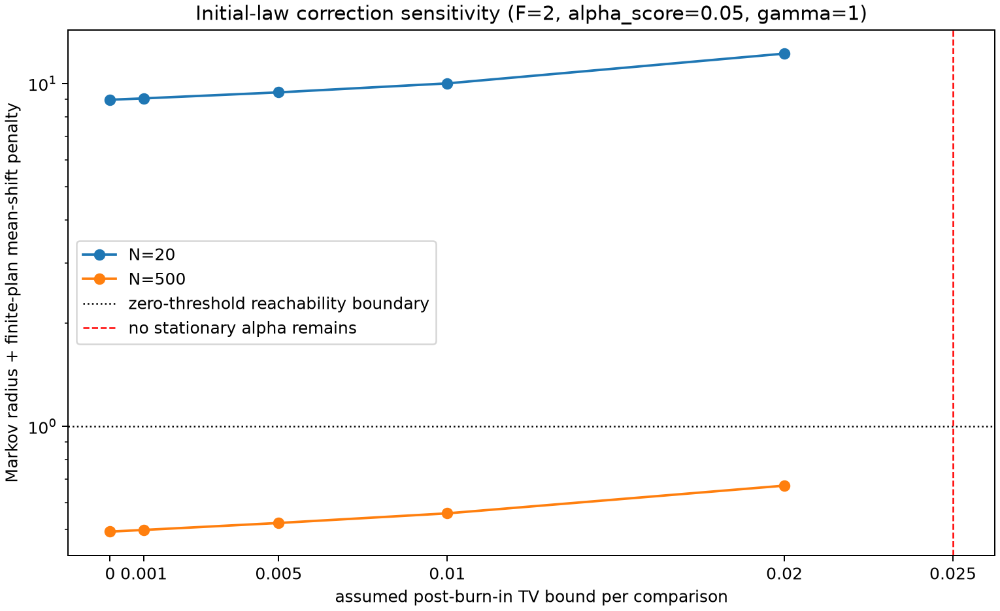
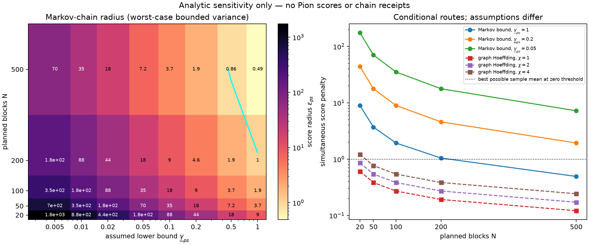

# Pion bounded-risk Markov gap sensitivity

**SYNTHETIC ANALYTIC SENSITIVITY ONLY. `physical_score=null`.** This report evaluates a published Markov-chain concentration inequality on hypothetical block counts, pseudo-spectral-gap lower bounds, and initial-law TV bounds. It samples no scores and reads no ensemble, anchor, gap, validation, holdout, GPU, or QUDA input.

## Corrected theorem source

This report follows Paulin's corrected arXiv v5 statement: Theorem 3.11 / Eq. (3.25) for the stationary non-reversible Bernstein bound and Proposition 3.15 / Eq. (3.29) for a non-stationary initial law. The author notes that the proof argument for general-state Bernstein inequalities in earlier versions, including the published version, was incomplete and is corrected in v5. The v1/v2 outputs used the older 2015 / Theorem 3.10 citation; their displayed concentration constants match the corrected statement, but cite this corrected source note going forward. See [Paulin, arXiv:1212.2015v5](https://arxiv.org/html/1212.2015v5).

## Conditional stationary bound

If each planned score `Z_i` is the same fixed bounded function `f` of a predeclared, non-overlapping block state, and the reference block process is a homogeneous, `phi`-irreducible, aperiodic Markov chain on a Polish space with a unique stationary law, then the corrected Theorem 3.11 gives, for `S=sum_i f(X_i)`,

```text
P_pi(|S-E_pi S| >= t) <= 2 exp[-t^2 gamma_ps / (8 (N + 1/gamma_ps) V_f + 20 t C)]
```

For `Z_i in [-1,1]`, `C=2` and `V_f<=1`. With a family of `F` comparisons and family-wise score error budget `alpha_s`, set `L=log(2F/alpha_s)`. Solving the exponent gives

```text
epsilon_ps = [20 C L + sqrt((20 C L)^2 + 32 gamma_ps L (N+1/gamma_ps) V_f)] / (2 gamma_ps N).
```

`gamma_ps_lower` must be an auditable lower bound for the **block chain itself**. The score bound must be valid conditional on a frozen anchor, or a valid joint argument must account for score-anchor dependence. An anchor estimated from the same trajectory does not become independent merely because the code conditions on it.

The v1 helper deliberately accepts only this fixed-score route. Paulin's Eq. (3.26) also gives a stationary bound for `sum_i f_i(X_i)` with time-varying functions, using the variance sum `V_sum=sum_i Var_pi(f_i)` and an additional `M/k_ps` range factor. Supporting that route would require new reviewed inputs and validation for `k_ps`, variance-sum upper bounds, per-index centered ranges, and a finite justified upper bound on `M`; no such values are inferred here. Until that contract and implementation exist, block-dependent score maps must use another established bound or abstain.

## Non-stationary initial-law correction

Suppose the first scored block state, after discarding `burn_in_blocks`, has law `q_t` with an externally justified bound `delta >= d_TV(q_t, pi)`. Proposition 3.15 / Eq. (3.29) adds `delta` to the stationary event probability for each comparison. With `F` comparisons, this uses `F*delta` from `alpha_s`; the remaining stationary family budget is `alpha_s - F*delta`, so the radius uses `L=log(2F/(alpha_s-F*delta))`. If `F*delta >= alpha_s`, the helper fails closed. For the operational finite-plan target, TV contraction and the score range `[-1,1]` give a conservative `2*delta` mean shift; the LCB subtracts it too. The contract therefore requires an external receipt for the post-burn-in TV bound, rather than treating burn-in as automatically sufficient.



The companion table `initial_law_tv_sensitivity.csv` uses `F=2`, `alpha_s=0.05`, `gamma_ps_lower=1`, `N=[20, 500]`, and per-comparison `delta=[0.0, 0.001, 0.005, 0.01, 0.02, 0.025]`. It reports both the familywise probability cost and the `2*delta` mean shift. Its planned/valid/failed/abstained scenario denominator is `12/5/0/7`. Valid means only that a zero-threshold LCB is reachable if every score is one; these are what-if cells, not measured starts or TV estimates.

## Figure and denominators



The left panel spans `N=[20, 50, 100, 200, 500]` and assumed `gamma_ps` lower bounds `[0.005, 0.01, 0.02, 0.05, 0.1, 0.2, 0.5, 1.0]`; cyan marks the optimistic zero-threshold boundary `epsilon_ps=1`. The right panel overlays graph-color Hoeffding penalties for `chi=(1, 2, 4)` as conditional context under different assumptions.

The stationary-grid denominator is planned/valid/failed/abstained = `40/2/0/38`. “Valid” means only that the hypothetical stationary LCB could exceed zero at a sample mean of one. Physical block-score outcomes are `0/0/0/0`; no physical scores were sampled. At `N=20,gamma_ps=1`, the stationary radius remains `8.969`. At `N=500,gamma_ps=1`, it is `0.493`. This is bound conservatism, not an estimate of the project's mixing rate.

## Synthetic helper integration

`markov_lcb_demo.json` exercises three fixed fixtures: a partially failed stationary panel, an all-failed abstention, and a partially failed panel with `burn_in_blocks=8` and illustrative post-burn-in `delta=0.005`. The comparison denominator is planned/valid/failed/abstained=`3/2/0/1`; planned block-slot denominator is `10/6/4/0`. Failed slots stay in `N` and are scored `-1`; the all-failed comparison returns no LCB. These are deterministic software fixtures, not sampled observations or coverage tests. All inputs are illustrative; the helper sets `certified=false` and `physical_score=null` and cannot verify any receipt.

## Text flow

```text
freeze block map, score/failure map, and candidate family
  -> establish the corrected stationary block-chain conditions, fixed score map, and gamma_ps lower bound
  -> justify delta after the declared burn-in, or establish delta=0 stationarity
  -> spend F*delta, solve the stationary radius, and subtract the 2*delta mean shift
  -> apply anchor coverage/common-bias correction under a valid conditional or joint bound
  -> compare with delta_star/R^2 and separately pass the physical reference gate
  -> if any input/receipt is absent: ABSTAIN / NOT_READY; physical_score stays null
```

The implementation and synthetic report close only the software/theorem-mapping boundary. They do not supply a block-chain pseudo-gap receipt, a post-burn-in TV bound, score-anchor dependence evidence, anchor coverage/common-bias evidence, or physical reference. Pion remains `NOT_READY/UNCERTIFIED`, with sealed data closed.

## Rebuild

```text
python -B -m tasks.pion_projection.bounded_block_risk_markov_gap --output NEW_DIRECTORY
```
