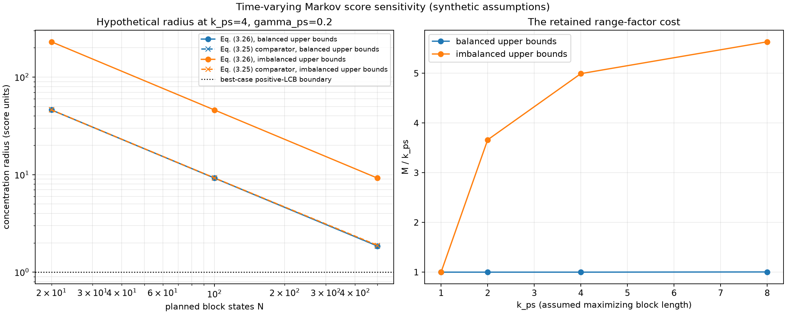

# Pion time-varying Markov score sensitivity

**ANALYTIC/SOFTWARE DIAGNOSTIC ONLY. `physical_score=null`; no measurements or sealed inputs were read.**

## Theorem and implemented route

Paulin's corrected arXiv v5 Theorem 3.11, Eq. (3.26), covers a predeclared sequence `f_i(X_i)` of time-varying functions on a stationary Markov chain and the finite-plan estimand `theta_N=N^-1 sum_i E_pi[f_i(X_i)]`. This is not automatically the same target as the fixed-score route; a human must review that the schedule preserves the accepted target. It uses `V_sum=sum_i Var_pi(f_i)` and, for residue classes modulo the smallest maximizing `k_ps`, `V_r=sum_j Var_pi(f_{r+j k_ps})`; `M=(sum_r sqrt(V_r))/min_r sqrt(V_r)`. The exponent denominator is `8 V_sum + 20 t C M/k_ps`. The paper explicitly says it is unknown whether `M/k_ps` can be replaced by 1, so this implementation retains it.

The helper takes positive reviewed upper bounds `V'_r >= V_r` for each residue class and computes `V'_sum=sum_r V'_r`, `M'=(sum_r sqrt(V'_r))/min_r sqrt(V'_r)`. As allowed by the paper's Remark 3.12, the same inflated class bounds are used in both terms. Zero bounds fail closed; an explicitly justified positive conservative bound is needed for every class. `k_ps` must be at most N so no empty residue class is silently accepted.

For `L=log(2F/alpha_stationary)`, the radius solves `gamma_ps t^2 - 20 C (M/k_ps) L t - 8 V_sum L = 0`, and is `t/N`. A post-burn-in TV bound spends `F*delta` from `alpha_score`; the operational mean also subtracts `2*delta`. An externally justified anchor-induced score shift is separately subtracted. The code cannot verify any receipt or establish that `k_ps` truly maximizes the pseudo-gap.

Primary source: [Paulin, Concentration inequalities for Markov chains, corrected arXiv v5](https://arxiv.org/html/1212.2015v5), Theorem 3.11 / Eqs. (3.25)-(3.26), Remark 3.12, Proposition 3.15 / Eq. (3.29). The author says at the start of the paper that the previous general-state Bernstein proof, including the published version, was incomplete and presents a correction.

## Synthetic analytic grid

The grid has 72 planned formula-only cells over `N=(20, 100, 500)`, `k_ps=(1, 2, 4, 8)`, `gamma_ps_lower=(0.05, 0.2, 0.8)`, and two explicitly hypothetical variance-upper profiles. The balanced profile assigns per-score upper bound 0.05; the imbalanced profile assigns 0.005 to the first residue and 0.2 to the others. These are not estimated from project data. `valid` means only that a zero-threshold LCB is reachable if every score equals 1; radii at least 1 count as abstentions. Grid denominators planned/valid/failed/abstained are `72/5/0/67`.

The dashed Eq. (3.25) comparator uses a common per-index variance upper bound equal to the largest profile value. It provides formula-only scale context and is not a valid theorem for the varying-score schedule. Where Eq. (3.26) is narrower, the change depends on its extra variance-upper and `k_ps` receipts; this plot is not evidence that learned or block-varying scores improve physical performance.



Left panel: radius versus planned N at assumed `k_ps=4` and `gamma_ps_lower=0.2`, with Eq. (3.25) shown as a formula comparator. The horizontal line is the maximum possible mean for scores in `[-1,1]`; radii above it preclude a positive zero-threshold LCB even in the best case. Right panel: the actual `M/k_ps` term under balanced and imbalanced variance upper bounds; the imbalanced profile illustrates why setting that term to 1 is not allowed.

## Initial-law sensitivity and deterministic fixtures

The separate TV table fixes `N=100`, `k_ps=4`, `gamma_ps_lower=0.2`; it shows `delta`, remaining stationary alpha, radius, and the best-case LCB before anchor correction. Scenarios are planned/valid/failed/abstained `6/0/0/6`. It is an analytic sensitivity, not an estimate of actual burn-in TV.

A deterministic partial-failure fixture uses 20 illustrative score values with two failed slots; block denominators are `{'planned': 20, 'valid': 18, 'failed': 2, 'abstained': 0}` and comparison-result denominators are `{'planned': 1, 'valid': 1, 'failed': 0, 'abstained': 0}`. The all-failed fixture has block denominators `{'planned': 4, 'valid': 0, 'failed': 4, 'abstained': 0}` and comparison-result denominators `{'planned': 1, 'valid': 0, 'failed': 0, 'abstained': 1}`; it emits no LCB. These fixtures validate data-flow and denominator behavior only, not finite-sample coverage.

## Decision flow

```text
freeze the entire time-varying f_i schedule and block map before observing scores
  -> obtain reviewed block-chain assumptions and gamma_ps lower bound
  -> provide a receipt that k_ps is the smallest maximizing pseudo-gap index
  -> provide positive upper bounds for every residue-class variance sum and their receipt
  -> retain M/k_ps; allocate F*delta from alpha_score when the scored chain is nonstationary
  -> subtract 2*delta and an externally justified anchor-score shift
  -> if any condition/receipt is absent or F*delta >= alpha_score: ABSTAIN
  -> keep physical_score=null until the separate target, anchor, and reference gates pass
```

## Boundaries and reproducibility

The schedule and variance bounds in the fixtures are synthetic. No coverage Monte Carlo was run because the project-specific chain, `k_ps`, variance receipts, anchor shift, target, and reference are unavailable. The current fixed-score path remains the default; using the time-varying helper defines a schedule-specific finite-plan mean and requires review that it is equivalent to the accepted estimand. This diagnostic does not change task status or produce a physical score. Pion remains `NOT_READY/UNCERTIFIED`, data remain sealed, and `physical_score=null`.

Rebuild with `python -B -m tasks.pion_projection.bounded_block_risk_markov_varying_diagnostic --output NEW_DIRECTORY`.
