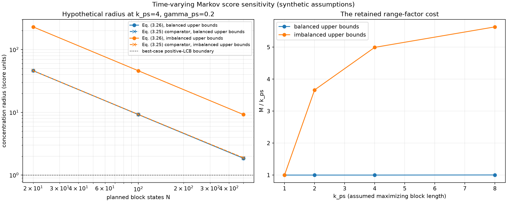

# Pion Eq. (3.26) sensitivity with shared receipt

**SAVED SYNTHETIC/ANALYTIC DIAGNOSTIC ONLY. `physical_score=null`. The verified report was copied; no formula grid, Monte Carlo, physical data, or sealed input was rerun/read.**

## Text data flow

```text
verify saved Eq. (3.26) report and nested SHA-256 manifest
  -> keep 72 hypothetical analytic cells and 6 TV what-if cells separate
  -> retain partial/all-failed fixture block slots and result statuses separately
  -> attach exact synthetic abstention/failure reasons and source/output hashes
  -> complete means accounting only, not theorem applicability or coverage
  -> physical_score remains null; dependence/anchor/reference/authorization gates stay open
```

## Denominators

|unit|planned|valid|failed|abstained|not_run|
|---|---:|---:|---:|---:|---:|
|hypothetical Eq. (3.26) analytic cell|72|5|0|67|0|
|hypothetical post-burn-in TV sensitivity cell|6|0|0|6|0|
|partial block slots|20|18|2|0|0|
|partial comparison result|1|1|0|0|0|
|all failed block slots|4|0|4|0|0|
|all failed comparison result|1|0|0|1|0|

The analytic grid has `72/5/0/67` planned/valid/failed/abstained cells. A cell is valid only if its synthetic best-case score could reach a positive zero-threshold LCB; this is not observed performance. The TV table has `6/0/0/6` cells; its abstentions are formula bounds under hypothetical TV values, not estimates of actual burn-in distance.

## Saved figure and limits



The left panel compares the Eq. (3.26) radius with a formula-only Eq. (3.25) scale comparator under assumed `k_ps=4`, `gamma_ps_lower=0.2`, and hypothetical variance bounds. The right panel shows the retained `M/k_ps` factor for balanced and imbalanced hypothetical variance profiles. No plotted input estimates the project chain, maximizing `k_ps`, residue-class variance, initial-law TV, anchor shift, or target equivalence.

The source report's 10-entry SHA-256 manifest is copied and rechecked. `run_receipt.json` retains separate analytic-grid, TV, fixture-slot and result denominators with reason counts. A complete receipt proves accounting of these saved diagnostic units only; it does not prove the theorem assumptions, finite-sample coverage, physical validity, or input independence.

## Rebuild the overlay

```text
python -B -m tasks.pion_projection.bounded_block_risk_markov_varying_receipt --source results/pion_projection/bounded_block_risk_markov_varying_20261124_v1 --output NEW_DIRECTORY
```
