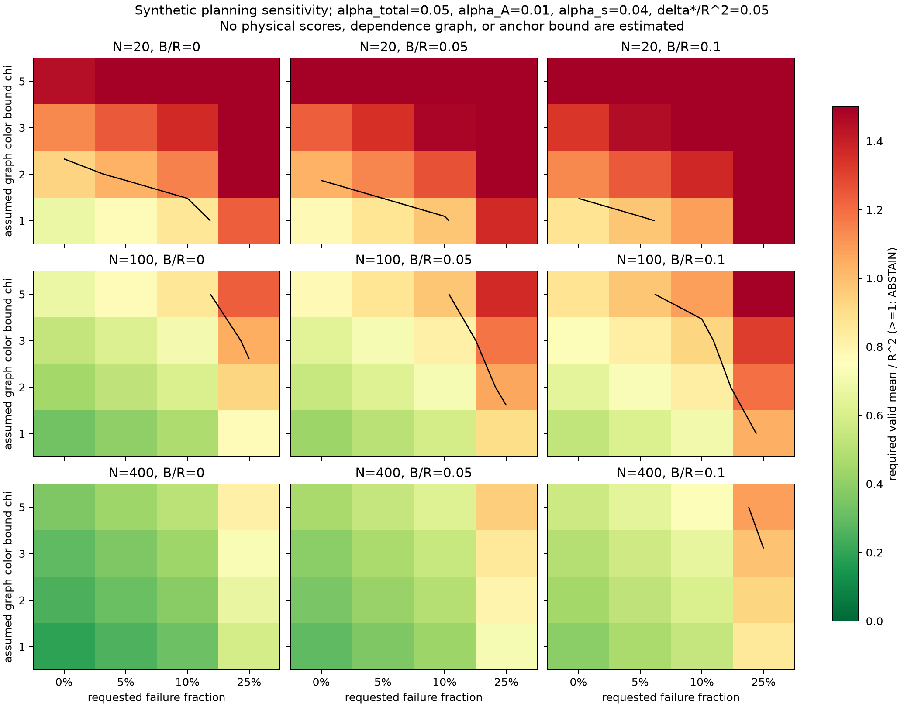
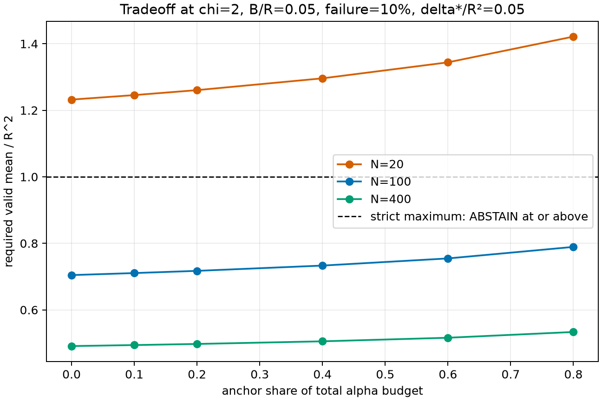

# Bounded block-risk synthetic calibration stress grid

**SYNTHETIC ANALYTIC SENSITIVITY ONLY. `physical_score=null`.** This report evaluates formulas on a fixed hypothetical parameter grid. It reads no physical score, correlator, anchor, sealed split, GPU, or QUDA input. It neither estimates the Pion effect nor certifies a dependence or anchor bound.

## Estimand and rule

The planning target remains the bounded finite-plan block-risk from the parent calibration report. For `N` planned blocks, `F=2`, a justified dependency-graph color bound `chi`, score error budget `alpha_s`, relative anchor bound `B/R`, normalized target `delta_star/R^2`, and planned failure fraction `phi`, the required valid-block mean boundary is

```text
m_required = (delta_star/R^2 + sqrt(2*chi*log(F/alpha_s)/N) + 2*B/R + phi)/(1-phi)
```

Each hypothetical failed block is retained in the planned denominator and coded as `-1`. The strict certificate requires the observed valid mean to exceed `m_required`; therefore `m_required >= 1` is `ABSTAIN`, including equality, because a score in `[-1,1]` cannot exceed one. `CONDITIONALLY_FEASIBLE` means only that the inequality is mathematically attainable if every stated assumption holds. It does not mean a result was observed, calibrated, or certified.

## Grid and denominator accounting

The 1,728 rows cross `N={20,100,400}`, `chi={1,2,3,5}`, `alpha_A={0,0.01,0.02}` with `alpha_s=0.05-alpha_A`, `B/R={0,0.025,0.05,0.1}`, requested failure fractions `{0,0.05,0.1,0.25}`, and `delta_star/R^2={0,0.05,0.1}`. Failed-block counts are rounded upward to whole blocks; the actual coded fraction is included per row. All values are illustrative, not frozen research choices.

`denominator_summary.csv` separates two units. The scenario row reports planned, mathematically feasible, computation-failed, and abstained grid configurations. The block row sums hypothetical planned/valid/failed blocks over scenarios and is scenario-weighted; it is not a measurement denominator or an independent-block count. Grid construction has zero computation failures, and no block is itself marked abstained because no experiment ran.

## Figures



Each panel fixes `alpha_total=0.05`, `alpha_A=0.01`, `alpha_s=0.04`, and `delta_star/R^2=0.05`, then varies planned `N`, assumed `chi`, requested failure fraction, and `B/R`. The black contour marks the strict feasibility boundary at one; cells at or above it are abstentions. `chi` is only an axis value and has not been inferred from receipts.



This panel holds `chi=2`, `B/R=0.05`, failure fraction `0.1`, and `delta_star/R^2=0.05` fixed while reallocating the illustrative total alpha budget. Increasing the anchor share reduces `alpha_s`, enlarging the concentration penalty. This is a planning tradeoff, not a recommendation for the physical budget.

## Denominators and interpretation

The grid has no observed sample outcomes: valid/failed block counts are only hypothetical consequences of each requested failure rate. `ABSTAIN` is counted at the scenario level when a requested mean is unattainable, while failed blocks remain in the formula as worst-case scores. These two distinct denominators are not interchangeable.
The underlying receipt audit still supports only 20 reproducible length-5 candidate blocks among 100 development records; it does not establish block independence. There is no inspected E-anchor correlator receipt or common-bias coverage bound. Thus no plotted cell is a Pion certificate and the project remains `NOT_READY/UNCERTIFIED`.

## Rebuild

Use a new output directory; the builder refuses to overwrite an existing path:

```text
python -B -m tasks.pion_projection.bounded_block_risk_stress --output NEW_DIRECTORY
```
