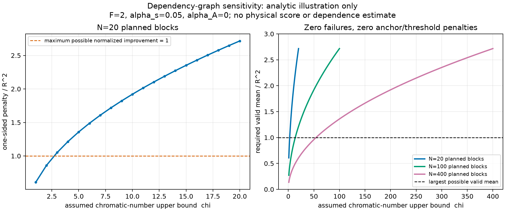

# Bounded block-MSE: dependence sensitivity

**ANALYTIC SENSITIVITY ONLY. `physical_score=null`.** This CPU-only calculation reads no correlator, E anchor, validation, gap, shared holdout, GPU or QUDA data. It does not estimate the actual Pion score dependence and does not certify independence.

## Why this check was added

The receipt audit documents 100 development configurations with trajectory spacing 5, grouped into 20 reproducible length-5 candidate blocks. It does not provide a score-specific autocorrelation or mixing bound. The earlier independent-block Hoeffding calibration is therefore conditional on a block-independence assumption that has not been established from the available receipts.

## Bound and assumptions

Let `Z_i=d_i/R^2` be a planned normalized paired block score in `[-1,1]`, `N` the planned blocks, `F` the fixed candidate family, and `chi` an upper bound on the chromatic number of a dependency graph for the scores. If each color class consists of jointly independent scores (conditional on the shared anchor and frozen protocol), coloring plus Holder's inequality gives the conservative one-sided penalty

```text
sqrt(2*chi*log(F/alpha_s)/N)
```

`alpha_s` is the score-concentration error budget. If the asserted anchor bound `|A-m*|<=B` itself holds only with probability at least `1-alpha_A`, combine the events by a union bound: total noncoverage is at most `alpha_s+alpha_A`. Allocate `alpha_s` from the total budget before using the formula. This illustration uses `alpha_A=0` (an exact/deterministic anchor-bound assumption); it does not calibrate an uncertain anchor.

For centered `X_i=Z_i-E[Z_i]` and color classes `C_r`, Holder gives `E exp(lambda sum_i X_i) <= product_r {E exp(chi*lambda sum_{i in C_r} X_i)}^(1/chi)`. Within each color class the variables are jointly independent; Hoeffding's lemma for a width-2 variable then bounds the right side by `exp(chi*lambda^2*N/2)`. Chernoff's inequality gives a one-sided tail `exp(-N*epsilon^2/(2*chi))`; a union bound over the fixed family `F` yields the displayed penalty at tail budget `alpha_s`.

With `phi` failures coded as the worst normalized improvement `-1`, relative anchor bias bound `B/R`, and normalized threshold `delta_star/R^2`, the planning inequality is

```text
L/R^2 = (1-phi)*mu_valid - phi - sqrt(2*chi*log(F/alpha_s)/N) - 2*B/R
mu_valid > (delta_star/R^2 + sqrt(2*chi*log(F/alpha_s)/N) + 2*B/R + phi)/(1-phi)
```

The dependency graph must describe the actual planned score variables, including whatever worst-case coding is used for failures. A finite trajectory gap alone does not establish such a graph. A finite-state Markov chain is not automatically finitely dependent; mixing, autocorrelation, or spectral-gap arguments need their own score-specific assumptions and bound. If no justified graph bound is available, the dependence-adjusted certificate is unavailable and the decision remains `ABSTAIN/NOT_READY`.

## Illustration



The plot uses only `F=2`, `alpha_s=0.05`, `alpha_A=0`, `B/R=0`, zero normalized threshold, and zero failures. In the `N=20` panel, chi=1 reproduces the independent-block penalty (about 0.607); chi=2 raises it to about 0.859; chi=3 exceeds the maximum possible normalized improvement of 1. Thus even this optimistic bound cannot certify a positive threshold at chi≥3 for N=20. In the second panel the same required-mean boundary is shown for N=20, 100 and 400. These curves are algebraic what-if values, not observed effects, chosen tolerances, or proof that a particular chi applies.

`effective_block_count_algebraic_only=N/chi` in the CSV is merely a rewrite of this bound's penalty. It is not an empirical effective sample size, integrated autocorrelation estimate, or evidence that the trajectory blocks are independent.

## Next steps and stop rule

1. Keep the current evidence status `NOT_READY/UNCERTIFIED`; retain sealed E/gap/validation/holdout data and `physical_score=null`.
2. Before claiming a dependence-adjusted bound, obtain an independently reviewable, score-specific justification for a dependency graph / chromatic-number upper bound, or propose a different concentration theorem with explicit mixing or spectral-gap inputs and finite-sample penalty.
3. If only a dependence diagnostic is available, report it as diagnostic and abstain from a calibrated physical certificate. Do not infer a graph color count from trajectory spacing, bootstrap resamples, RHS count, or this figure.
4. Any later calibration must keep planned/valid/failed/abstained denominators separate and include a dependence stress figure plus a plain-language interpretation of the actual bound and its assumptions.

Deterministic rebuild into a new directory: `python3 -B -m tasks.pion_projection.dependency_graph_bound --output NEW_DIRECTORY`.
