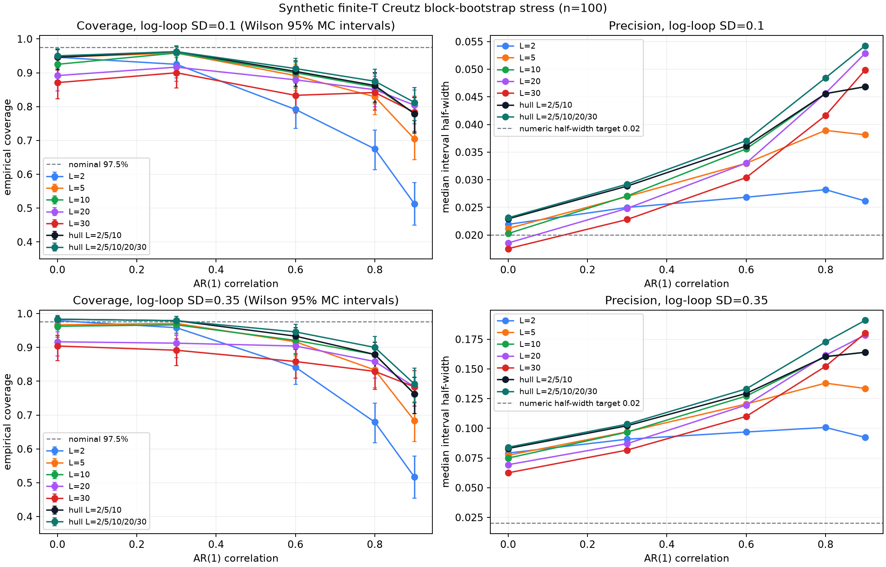

# Wilson C-lane synthetic block-bootstrap coverage stress

**Status: conditional synthetic-method diagnostic only.** `physical_score=null`; this run reads no Wilson measurements, development or sealed split, GPU, or QUDA input.

## Design

The estimand is the absolute finite-$T$ four-loop Creutz combination. Synthetic positive loop observations are generated by exponentiating a four-variate Gaussian AR(1) process with adjacent-configuration correlations `rho=[0.0, 0.3, 0.6, 0.8, 0.9]`, `n=100`, marginal log standard deviations `[0.1, 0.35]`, and cross-loop log correlation `0.75`. The arithmetic loop means and hence the true Creutz value are known analytically (`0.15415068`). Each of 240 independently generated datasets per `(rho, log-loop SD)` cell is analyzed with circular moving-block bootstrap lengths 2, 5 and 10, 800 draws per length, 97.5% equal-tail percentile intervals and their hull. Precision is separately summarized against half-width 0.02.

## Denominators and interpretation

There are 2400 planned synthetic datasets (`1200` per marginal log-loop SD), with `planned/valid/failed/abstained = 2400/2400/0/0`. Each row in `coverage_summary.csv` gives empirical coverage, a Wilson 95% Monte Carlo interval, median half-width and precision-pass count; `replicates.csv` retains every dataset/interval result and invalid-draw denominator.

This checks whether the selected L=2/5/10 interval hull has nominal coverage inside one explicit AR(1) lognormal family at the current n=100 scale, and whether adding L=20/30 is sufficient. Results do not identify the actual HMC dependence, calibrate physical coverage, or justify opening confirmation data. If even the extended hull undercovers, the C-lane rule needs a defensible dependence bound or abstention; simply increasing bootstrap draws cannot fix the missing dependence information.

Text flow: `known positive loop means + correlated lognormal AR(1) generator -> 240 independent datasets per (rho, log-loop SD) -> paired four-loop resamples at L=2/5/10/20/30 -> primary and extended interval hulls -> empirical coverage/precision plot + full planned denominator`.

Rebuild into a fresh directory with `python -m tasks.wilson_loop.c_lane_block_bootstrap_coverage_stress --output NEW_DIRECTORY`. The exact source is copied to `source_snapshot.py`; hashes are listed in `artifact_hashes.json`.
