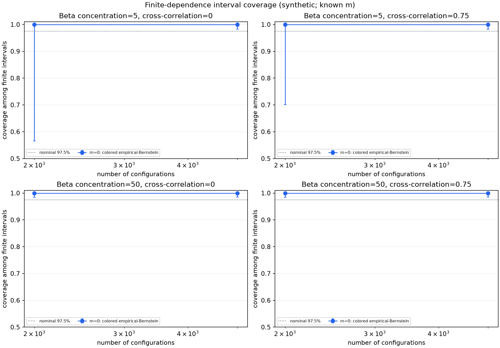
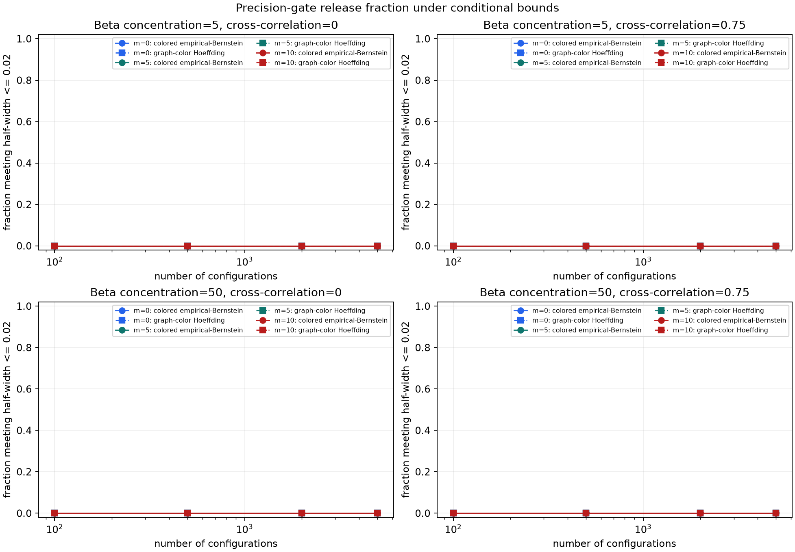
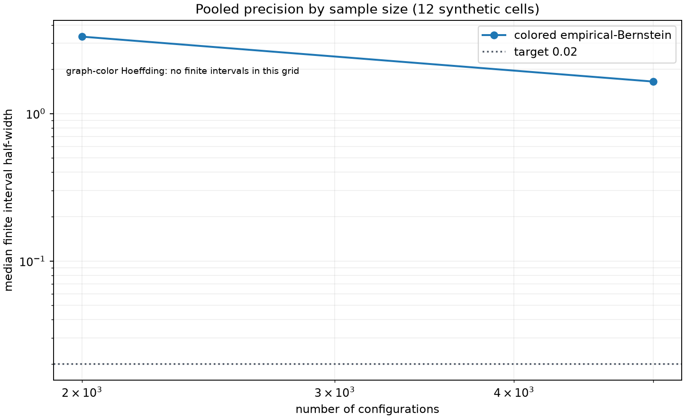

# Wilson C-lane colored empirical-Bernstein diagnostic

**Conditional synthetic method comparison only.** `physical_score=null`; no Wilson measurements, sealed data, GPU or QUDA were accessed.

## Method and assumptions

This study adds a color-class empirical-Bernstein interval and a sample-size sweep to the already declared finite-range moving-sum Gaussian-copula Beta generator. For a true synthetic dependence range `m`, indices modulo `m+1` form independent color classes for each fixed loop coordinate. Within each class, Maurer–Pontil Theorem 11 supplies a variance-adaptive one-sided bound for independent bounded variables, including non-identically distributed variables. We split the lane alpha over two tails, four loop means and `chi=m+1` color classes, then take a weighted union of the class intervals. Monotone propagation through the four logarithms yields the Creutz interval; any loop-mean interval touching zero makes it unbounded and therefore abstained.

The theorem is conditional on a valid predeclared coloring, class-wise independence and fixed supports. Here these are guaranteed by construction, because the generator uses an exact m-dependent moving sum. They are not known for a production HMC chain. The method receives the synthetic `m`; it does not estimate it. Source: [Maurer and Pontil, *Empirical Bernstein Bounds and Sample Variance Penalization*, Theorem 11](https://arxiv.org/abs/0907.3740).

The design has 12 parameter cells, four sample sizes `(100, 500, 2000, 5000)`, and 250 independent datasets per cell: **12000 planned datasets**. Random seeds are paired across sample sizes so each larger chain extends the same shorter prefix. Replicate-level interval status and coverage are in `replicates.csv`; cell summaries with Wilson Monte Carlo intervals are in `coverage_summary.csv`.

## Denominators

| method | planned | finite intervals | unbounded | failed | abstained | precision passes |
|---|---:|---:|---:|---:|---:|---:|
| colored_empirical_Bernstein | 12000 | 1426 | 10574 | 0 | 12000 | 0 |
| graph_color_Hoeffding | 12000 | 0 | 12000 | 0 | 12000 | 0 |

`valid` counts intervals that pass both finiteness and the precision threshold. `abstained` includes computed but unbounded intervals and finite intervals wider than the threshold; `failed` is zero unless numerical evaluation itself fails. These status counts refer to synthetic datasets, not physical configurations. Coverage is calculated only over finite intervals; unbounded intervals are reported separately and cannot pass the release gate.

Text flow: `bounded loop traces + exact synthetic m -> color classes -> per-color empirical-Bernstein intervals (or Hoeffding comparator) -> weighted loop-mean box -> monotone four-log Creutz interval -> coverage/precision/abstention plots`.

## Interpretation limits

In this grid, the variance-adaptive method produced some finite intervals in `m=0` cells where graph-color Hoeffding stayed unbounded, but all finite half-widths were far above `0.02`; it produced no finite intervals for `m=5` or `m=10`. Its finite-sample remainder still scales with the number of color classes and confidence allocation. The simulation only examines the specified Beta-copula moving-sum scenarios; it does not establish real HMC dependence range, coverage, a justified `m`, or usable production precision. If production dependence remains uncertified, the correct outcome is `ABSTAIN`.

Rebuild with `python -m tasks.wilson_loop.c_lane_colored_empirical_bernstein --output NEW_DIRECTORY`. Source snapshots and all output hashes are recorded in `artifact_hashes.json`.
