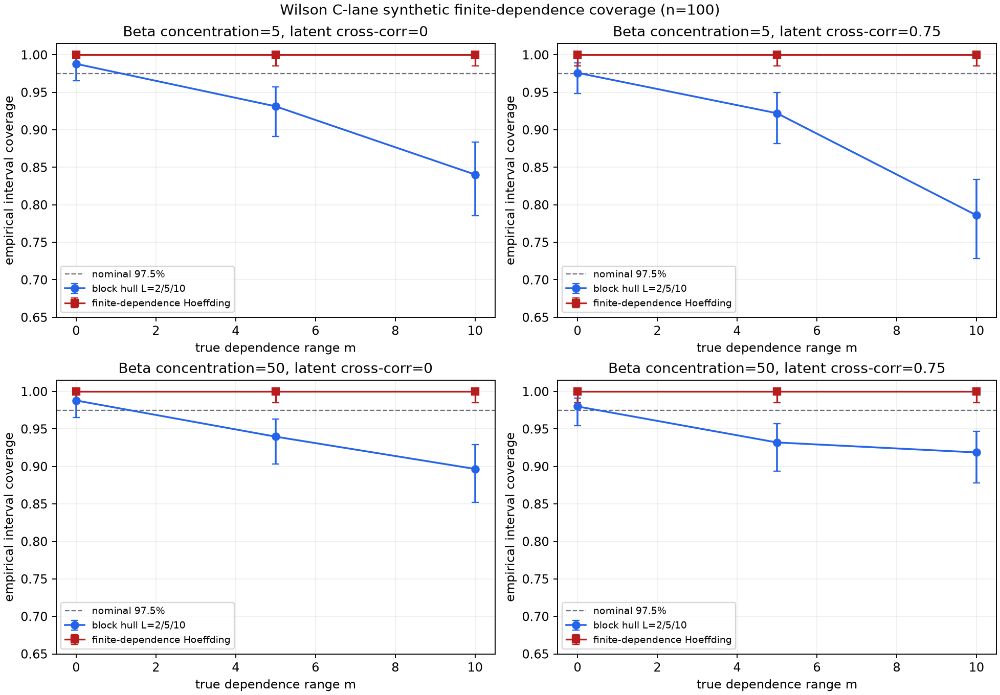
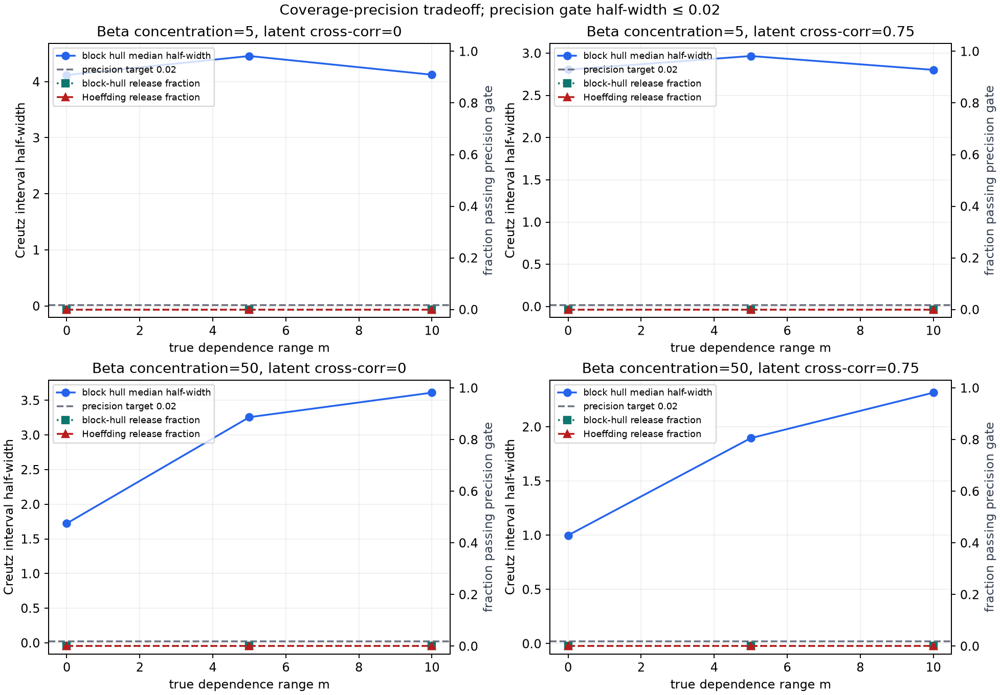
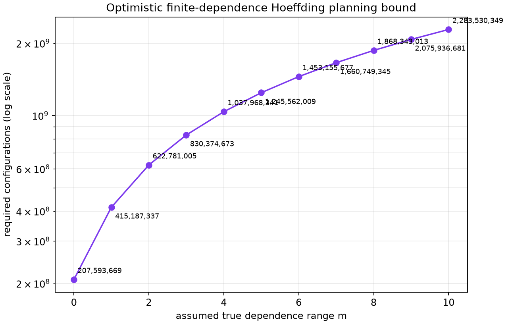

# Wilson C-lane finite-dependence interval stress

**Conditional synthetic-method comparison only.** No physical Wilson, development, sealed, GPU, or QUDA inputs were read. `physical_score` remains null.

## Design

The target is the absolute finite-T Creutz quantity with ordered loop means `['W(3,6)', 'W(2,5)', 'W(3,5)', 'W(2,6)']` and synthetic truth `0.15415068`. The measured observable averages real traces over three spatial orientations and volume, with division by `9*volume`; each normalized real SU(3) trace lies in `[-1/3,1]`, so the average has the same support. This normalization is verified in `measure.py` at Git revision `54f0e97` (SHA-256 `5fdee931db8a0b9bc74debb6f8c53e659ec6ccef7a42b0443788db4593e84ef6`). Marginals are affinely transformed Beta distributions with means `[0.02, 0.06, 0.035, 0.04]` and concentrations `[5.0, 50.0]`. Four-dimensional Gaussian innovations have latent equicorrelation `[0.0, 0.75]`. A moving sum of `m+1` innovation vectors, followed by the coordinatewise Gaussian-copula transform, produces a stationary process with exact temporal dependence range `m=[0, 5, 10]`. The crossed grid has 12 cells and 250 independent datasets per cell (`3000` planned datasets total).

The selected-proposal block-bootstrap method is the hull of circular moving-block percentile intervals at lengths `[2, 5, 10]`, with 500 draws per length. The comparison bound uses the known synthetic dependency graph, `chi=m+1`, a distribution-free graph-color Hoeffding radius for each loop mean with support width `4/3`, Bonferroni alpha `0.003125` per one-sided loop event, and monotone interval propagation through the four logarithms. Under the declared m-dependence and `[-1/3,1]` support, this is a conditional finite-sample coverage route; it is not deployable unless an external source establishes the dependence range.

## Results and limits

Coverage and Monte Carlo Wilson intervals, median widths, precision passes, invalid-draw gates, failures and abstentions appear by cell in `coverage_summary.csv`; every replicate-level interval and draw denominator is in `replicates.csv`. Planned data-generation denominator is `{'planned': 3000, 'valid': 3000, 'failed': 0, 'abstained': 0}`. For each method, `planned = valid_release + failed + abstained`; `valid_release` counts intervals that pass both the invalid-draw limit `0.01` and the proposed half-width target `0.02`. A computed interval that fails either gate is explicitly abstained. The coverage plot shows raw candidate-interval coverage before those release gates, which must be read together with the precision/abstention plot.

The graph-color bound has nominal coverage conditional on the exact assumed dependency graph, but its log-propagated interval can be unbounded when any lower confidence limit for a loop mean reaches zero. The sample-size table solves for the maximum mean radius that would give half-width `0.02` if sample means were exactly equal to the known population means. This is an optimistic planning calculation, not an achieved precision guarantee; it can reveal that the distribution-free route is statistically valid but unusable at the present budget. The bootstrap's empirical coverage is limited to the declared Beta-copula moving-average scenarios and does not establish a physical HMC coverage claim. Individual bootstrap resamples with nonpositive required loop means remain invalid in the denominator; a block-length invalid fraction above `0.01` forces abstention, as specified in the method proposal.

Text flow: `bounded loop means + known synthetic m-dependence -> block-hull vs graph-color Hoeffding intervals -> nonlinear log propagation -> coverage/width/release tables -> use theorem route only with independently justified m; otherwise abstain`.

Rebuild in a fresh directory with `python -m tasks.wilson_loop.c_lane_finite_dependence_stress --output NEW_DIRECTORY`. `source_snapshot.py`, the protocol, replicate CSV, summary and artifact hash manifest are included.
