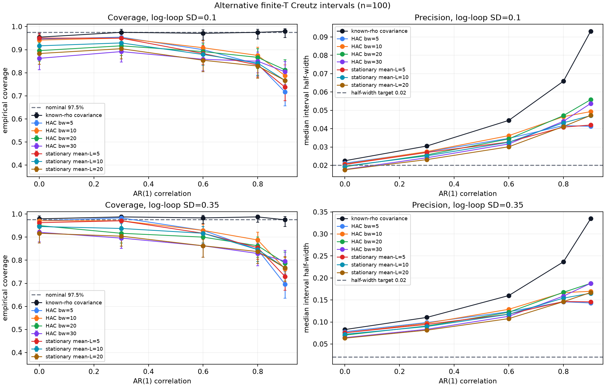

# Wilson C-lane alternative interval coverage comparison

**Conditional synthetic method comparison only.** physical_score is null. No Wilson, development or sealed data, GPU or QUDA input was read.

## Model and methods

This regenerates the same known-truth four-loop lognormal AR(1) datasets as the block-bootstrap stress report: n=100, 240 datasets per rho/log-loop-SD cell, rho=[0.0, 0.3, 0.6, 0.8, 0.9], log-loop SD=[0.1, 0.35], with true Creutz value 0.15415068. Shared outer seeds make results paired to the existing stress report.

The intervals are: a known-rho covariance benchmark using exact finite-n covariance and a normal delta interval; Newey-West/Bartlett HAC delta intervals at bandwidths [5, 10, 20, 30]; and stationary-bootstrap percentile intervals with mean block lengths [5, 10, 20] and 800 draws. All use the 97.5% lane interval. The benchmark receives the true synthetic dependence and scale, so it is not deployable; it is also a delta approximation for the nonlinear Creutz estimator, not an exact finite-sample confidence interval.

## Denominators and limits

There are 2,400 planned datasets per method. coverage_summary.csv reports empirical coverage, Wilson Monte Carlo intervals, precision-pass counts and median widths. replicates.csv contains every dataset/method row and abstention/invalid-draw counts. The figure shows coverage and width against the 0.02 precision target.

This comparison tests these methods only inside the declared synthetic family. It does not identify physical dependence or certify production coverage. A method whose Monte Carlo interval excludes nominal 97.5% coverage in a dependence scenario judged plausible cannot enter the confirmation protocol without an independent dependence restriction or fail-closed abstention.

Text flow: fixed outer seeds -> positive loop means with known correlated-lognormal law -> known-rho covariance benchmark, HAC and stationary-bootstrap intervals -> paired method coverage table -> plot with complete denominators.

Rebuild into a fresh directory with python -m tasks.wilson_loop.c_lane_interval_alternative_coverage --output NEW_DIRECTORY. Both source snapshots and the artifact hash manifest are included.
