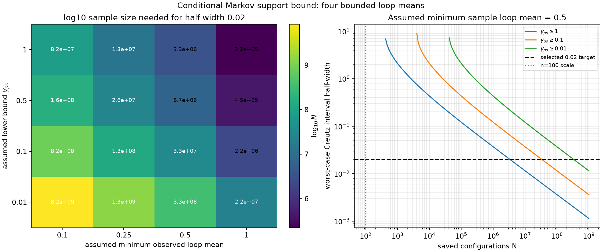

# Wilson C-lane conditional Markov support-bound sensitivity

**Method-only result.** No Wilson measurements, development split, sealed input, GPU or QUDA data were read. `physical_score=null`; the result is not a production interval or coverage certificate.

## Candidate route

For the selected finite-$T$ Creutz value, ordered loop means are `W(3,6), W(2,5), W(3,5), W(2,6)` and

```text
chi = log W(3,5) + log W(2,6) - log W(3,6) - log W(2,5).
```

Conditional on each per-configuration measurement being the real normalized SU(3) trace `ReTr(U_loop)/3`, each loop value is in `[-1/3,1]`. Map it to `f=(W-1/3)/(2/3) in [-1,1]`. For the fixed-score saved-configuration chain, Paulin's corrected arXiv v5 Theorem 3.11, Eq. (3.25), with `Var_pi(f)<=1`, centered bound `C=2`, family `F=4`, and lane alpha `0.025`, gives

```text
L = log(2 F / alpha)
r_N = [40 L + sqrt((40 L)^2 + 32 gamma_ps L (N + 1/gamma_ps))]
      / (2 gamma_ps N)
delta_W = (2/3) r_N
```

Four simultaneous two-sided mean intervals receive Bonferroni coverage `1-alpha`. Their rectangular box is mapped to a Creutz interval by monotonicity. Any nonpositive loop-mean lower endpoint produces `ABSTAIN`; no log is evaluated outside the positive domain. The rectangle is conservative because it ignores cross-loop covariance. The theorem is conditional on a valid fixed, homogeneous Markov chain and a justified lower bound for the pseudo-spectral gap of the *saved-configuration chain*. Trajectory spacing, an empirical autocorrelation time, or bootstrap draws do not supply that bound. The table uses stationary initialization, the most favorable case; a burn-in/TV correction would consume alpha and widen the interval.

Primary source: [Paulin, corrected arXiv v5](https://arxiv.org/html/1212.2015v5). The paper explicitly says the proof in earlier versions, including its published version, was incomplete and gives the correction in v5.

## Numerical sensitivity, not data

The 96 planned scenarios cross `N=[100, 1000, 10000, 100000, 1000000, 10000000]`, hypothetical `gamma_ps` lower bounds `[1.0, 0.5, 0.1, 0.01]`, and assumed *observed sample-mean floors* `[0.1, 0.25, 0.5, 1.0]`. The denominators are planned/valid/failed/abstained=`96/7/0/89`. Here `valid` means only that a hypothetical support interval remains positive and meets the 0.02 half-width target. It is not an observed sample or certificate. Abstention counts by reason: `{'conditional support and pseudo-gap assumptions meet precision': 7, 'simultaneous interval misses the 0.02 precision target': 56, 'support interval reaches zero; logarithm is not bounded': 33}`.



Even with the largest possible gap lower bound `gamma_ps=1` and the mathematically best possible observed mean floor `1`, the support-only route needs **222,616 saved configurations** to meet half-width 0.02. For smaller means, weaker gaps, or nonstationary initialization it needs more. Thus this method is a robust conditional reference and a useful stopping rule, but it does not make the current 100-configuration development preflight confirmatory and is unlikely to replace a calibrated, dependence-aware interval at practical sizes without tighter reviewed variance bounds.

Text flow: `saved configuration -> four normalized real loop traces -> four simultaneous Markov mean boxes -> positive-endpoint check -> monotone log propagation -> precision gate or ABSTAIN`. The current schema still lacks the production normalization receipt, saved-chain pseudo-gap receipt, stationary/burn-in receipt, and independent reviewer sign-off; lane status remains `NOT_READY`.
