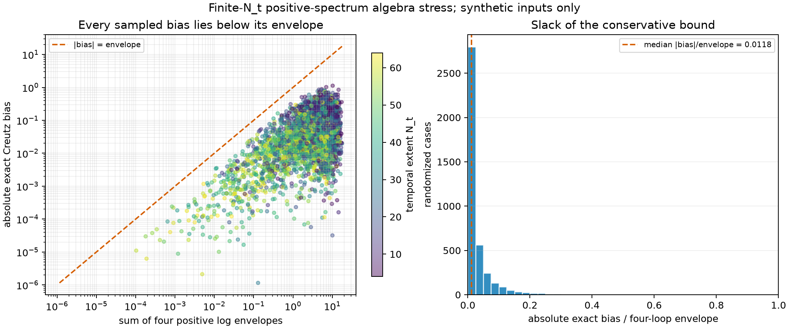

# Finite-N_t randomized positive-spectrum algebra stress

**SYNTHETIC ALGEBRA DIAGNOSTIC ONLY. `physical_score=null`.** Randomized inputs exercise the exact four-point formula and its positive-contamination envelope; they are not fitted spectra, measured Wilson loops, or physical contamination bounds.

## Prespecified stress domain

The run generated `4000` independent pseudo-random parameter cases with seed `2026112308`. `N_t` is uniform integer 4–64 and `t` is uniform integer 1–`N_t-1`. For each of `R` and `R+1`, `A0` is log-uniform `[0.1,10]`, `V0` uniform `[0,1.5]`, `Q/H/X` independently log-uniform `[1e-3,1e2]`, and `gap_q/gap_0` independently log-uniform `[0.01,1]`. All parameters are dimensionless lattice inputs and chosen only to stress a broad positive range.

For each case the code evaluates the four `log W` points, checks `bias = -Delta_R Delta_t delta`, and checks `|bias| <= sum_four_points log1p(q+h+x)`. This envelope follows by applying the triangle inequality to four nonnegative contamination logs. `randomized_cases.csv` retains the sampled inputs and each diagnostic outcome.

## Figure and result

Planned/valid/failed/abstained randomized cases: `4000/4000/0/0`; four-loop evaluations: `16000/16000/0/0`. The identity's maximum absolute discrepancy is `3.2e-14`. Envelope coverage is `4000/4000`; the median, 95th percentile, and maximum sampled `|bias|/envelope` ratios are `0.0118`, `0.117`, and `0.398`. These describe the arbitrary sampling box, not physical coverage or tightness.

## Limits and next physical evidence

This stress test verifies implementation algebra across randomized positive inputs. It does not show that Q/H/X or gaps in a simulation lie inside these ranges, establish positivity for a real operator basis, or make the envelope small enough to certify the ground-state static force. C-lane finite-T Creutz and F-lane ground-state force remain separate. F-lane certification still needs independent physical spectral, thermal, and mixed-sector bounds with a prospective tolerance.

Rebuild into a fresh directory: `python -B -m tasks.wilson_loop.finite_nt_randomized_stress --output NEW_DIRECTORY`.
