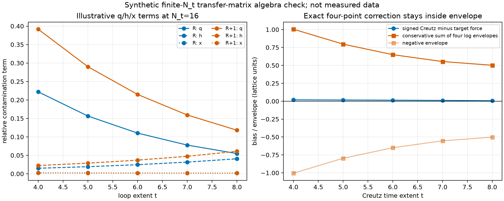

# Finite-N_t Creutz toy validation

**SYNTHETIC ALGEBRA VALIDATION ONLY. `physical_score=null`.** The inputs below are hand-set dimensionless toy values. No Wilson-loop measurement, sealed split, GPU, or QUDA input was read.

## Explicit toy model

```text
q(R,t) = Q(R) exp[-gap_q(R) t]
h(R,N_t-t) = H(R) exp[-gap_0(R) (N_t-t)]
x(R,t,N_t-t) = X(R) exp[-gap_q(R) t-gap_0(R) (N_t-t)]
log W(R,t;N_t) = log A0(R) - V0(R) t + log1p(q+h+x)
```

The toy uses `N_t=16` and loop times `[4, 5, 6, 7, 8]`. Parameters for `R` are `{'A0': 1.2, 'V0': 0.52, 'Q': 0.9, 'H': 0.3, 'X': 0.2, 'gap_q': 0.35, 'gap_0': 0.25}`; parameters for `R+1` are `{'A0': 0.9, 'V0': 0.65, 'Q': 1.3, 'H': 0.45, 'X': 0.15, 'gap_q': 0.3, 'gap_0': 0.25}`. `V0` and gaps are in dimensionless lattice units (`a_t V0`, `a_t Delta`). The toy values are not fitted, measured, or proposed physical bounds.

## Four-point identity and bound

The code computes all four `log W` values and then applies the task sign convention:

```text
chi = -[logW(R+1,t+1)+logW(R,t)-logW(R+1,t)-logW(R,t+1)]
chi - [V0(R+1)-V0(R)] = -Delta_R Delta_t delta
|chi - Delta_R V0| <= sum_four_points log1p(q+h+x)
```

Maximum direct-vs-identity bias discrepancy: `7.63e-16`. Four-point envelope covers every one of 5 toy time stencils: `True`. The bound is deliberately loose; this check validates indexing/sign and error propagation, not usefulness of a physical envelope.



The left panel shows the finite-extent tradeoff: `q` decreases with `t`, while the complementary-time `h` term can increase. The right panel overlays the signed exact bias and the conservative four-loop envelope.

## Denominators and scope

`denominator_summary.csv` reports planned/valid/failed/abstained separately for toy time points and for their four-loop evaluations. These are deterministic algebra checks, not statistical samples, acceptance tests, or physical certification. The code rejects negative contamination amplitudes/gaps, nonpositive `A0`, and a stencil that would require a loop beyond `N_t`.
Finite-`N_t` `q/h/x` terms can only be promoted to a ground-state force bound when independent physical envelopes and a prospective tolerance exist. Until then, retain `GROUND_STATE_FORCE_UNCERTIFIED`; finite-T Creutz remains its own observable lane.

Rebuild into a new directory: `python -B -m tasks.wilson_loop.finite_nt_toy --output NEW_DIRECTORY`.
