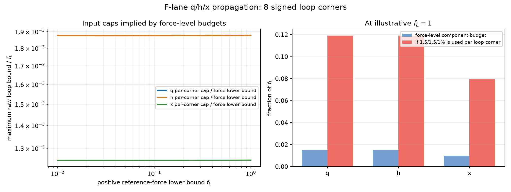

# Wilson F-lane q/h/x force-budget propagation

**Formula-only CPU diagnostic.** No Wilson loop data, sealed split, GPU or QUDA input was read. `physical_score=null`; the ground-state force remains `GROUND_STATE_FORCE_UNCERTIFIED`.

## Result

The F-lane candidate-minus-reference force contrast contains **8 signed loop corners**: two kernels (stout and identity), two separations (`R=2,3`), and two adjacent times (`t,t+1`) inside the effective-energy extraction. If each positive loop corner has `delta=log(1+q+h+x)`, then the conservative contrast bound is the sum of all 8 `delta` bounds. For separate component accounting, `log(1+q+h+x) <= log(1+q)+log(1+h)+log(1+x)` for nonnegative inputs, so the q/h/x force-unit envelopes are `sum_corner log(1+q)`, etc.

At the illustrative dimensionless reference-force lower bound `f_L=1`, interpreting the draft `1.5% / 1.5% / 1%` values as **raw per-loop-corner caps** gives q/h/x force-bound fractions `0.1191`, `0.1191`, `0.0796`. Each exceeds its corresponding force-level budget. The combined exact log envelope is `0.3138 f_L`; after the proposed model (`1%`) and statistical (`5%`) allowances, the total is `0.3778 f_L`, above the `10%` total tolerance. This demonstrates that the q/h/x percentages must be defined after full stencil propagation or translated into stricter raw loop caps.

For a uniform raw component cap `c` across all corners, requiring its propagated force contribution to be no larger than `epsilon*f_L` yields

```text
8 log(1+c) <= epsilon*f_L
c <= expm1(epsilon*f_L/8).
```

At `f_L=1`, the resulting raw loop caps are q=`0.0018768`, h=`0.0018768`, x=`0.0012508`. These are planning calculations, not measured q/h/x values or accepted production inputs. `cap_sensitivity.csv` and the figure show how the required raw caps change with the yet-unknown positive force lower bound.



## Denominators and flow

- Deterministic formula scenarios: planned/valid/failed/abstained = `50/50/0/0`.
- Physical evidence gate: `1/0/0/1`; independent loop envelopes, positive reference-force lower bound, propagated model bound and reviewer receipt are absent.

```text
independent positive force lower bound + q/h/x bounds at 8 corners
  -> log envelopes -> 8-term candidate-minus-reference force bound
  -> compare q/h/x component budgets in force units
  -> add model-truncation and statistical bounds
  -> <=10% total gate AND independent receipts/review
  -> otherwise ABSTAIN; physical_score remains null
```

The output is conditional algebra only. It neither verifies physical positivity nor establishes any q/h/x envelope, spectral-model error, statistical coverage, or reference-force lower bound. Source hashes and all output identities are in `protocol.json` and `artifact_hashes.json`.
