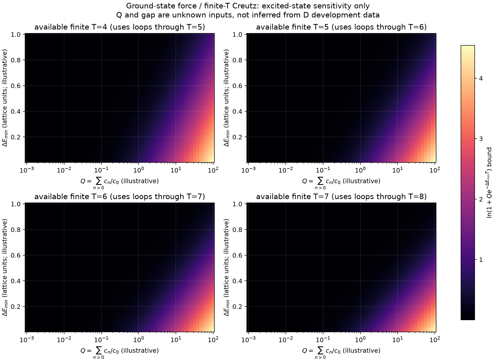

# Ground-state static-force contamination bound

**Analytic sensitivity report; no new fit or measurement.** The plotted `Q` and gap
axes are illustrative parameter ranges, not estimates from the D ensemble.
No Wilson-loop measurements or restricted splits were read.

## Derivation

Assume a positive forward transfer-matrix expansion $W_{k,R}(T)=A_{0,k,R}e^{-E_0(R)T}[1+\rho_{k,R}(T)]$, with $\rho=\sum_{n>0}(A_n/A_0)e^{-\Delta E_nT}\ge0$.
The effective energy is $V_{eff,k}(R,T)=-\log[W(R,T+1)/W(R,T)]=E_0(R)+g_{k,R}(T)$, where $g=\log[(1+\rho(T))/(1+\rho(T+1))]$.
For decaying positive contamination, $0\le g_{k,R}(T)\le\log[1+\rho_{k,R}(T)]$. The finite-$T$ Creutz ratio is the difference of neighboring effective energies, so $\chi_k(R,T)=f_0(R+1/2)+g_{k,R+1}(T)-g_{k,R}(T)$.
Thus $|\chi_k-f_0|\le\max_{R,R+1}\log[1+\rho_{k,R}(T)]$. If a defensible total-overlap bound $Q=\sum_{n>0}A_n/A_0$ and gap lower bound $\Delta E_{min}$ are available, then $|\chi_k-f_0|\le\log[1+Qe^{-\Delta E_{min}T}]$.

A candidate-minus-identity comparison needs both kernels' contamination controls; a
conservative absolute bias bound is their sum. Statistical paired block-bootstrap
uncertainty must be reported separately and combined with this systematic bound
under a rule frozen before confirmation.

## Physical limits and next contract

The formula assumes a positive zero-temperature forward spectrum. Thermal/winding
contributions and finite-extent effects need a separate model or upper bound.
APE/stout changes the
overlap ratios `Q` but should not change `E0` when the operators share the same
static-source action and have nonzero ground-state overlap. No such overlap bound
or lower gap bound is measured here, so the plot is a design aid only.

For the selected finite-T Creutz lane, report `chi_k(R,T)` as an observable with
its paired interval; do not apply this correction to relabel it as ground state.
For the selected ground-state-force lane, require a per-kernel/per-R `Q` and gap
bound (or an identifiable multi-T spectrum with validated truncation), add a
separate thermal bound, and budget `statistical + excited-state + thermal +
finite-a/volume` errors against the researcher-set tolerance. If the bounds cannot
be sourced, preserve `GROUND_STATE_FORCE_UNCERTIFIED` and do not open validation
or shared holdout data.
