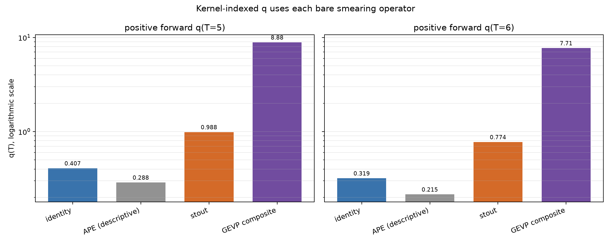

# F-lane q-cell object mapping diagnostic

**Decision proposed in the task contract:** each kernel-indexed q cell uses that kernel's bare smearing basis operator. For `C_ij(R,t)=Σ_n Z_ni(R) Z*_nj(R) exp[-E_n(R)t]`, the fit field `overlap_ratio_upper[n]` is a one-sided upper bound on `|Z_nk/Z_0k|²`, and

```text
q_k(R,T) = Σ_(n>0) |Z_nk(R)/Z_0k(R)|² exp[-(E_n(R)-E_0(R)) T].
```

The joint fit uses all measured 3×3 `C_ij` entries, while the q cell maps to the row/column for its fixed bare operator: `identity → identity`, `ape_alpha0.4_n5 → APE`, `spatial_stout_rho0.10_n5 → stout`. APE remains descriptive. The single GEVP vector at `td=2` creates a different composite operator; it is retained for state identification and sensitivity checks, never copied into each kernel's q cell. This keeps the object aligned with the selected kernel-specific correlators. The GEVP framework explicitly constructs linear combinations of the input fields, so the composite and bare-basis overlaps are distinct objects ([Blossier et al., 2009](https://arxiv.org/abs/0902.1265)).



The logarithmic y scale makes clear that the exact toy's composite q can be much larger than every bare-basis q. This is a method-mapping example only; it does not imply that either object is the production contamination bound. The kernel-indexed choice is a project-level proposal requiring independent physics review, and production must fit the basis overlaps from raw cross-correlators under the reviewed finite-`N_t` model.

Text flow: `raw 3×3 matrix per R → joint spectral fit → per-basis squared overlap ratios + gap bounds → map kernel ID to its bare operator → q envelope over fit variants and T=(5, 6); GEVP composite remains separate → independent review and production receipts still required`.

Denominators (planned/valid/failed/abstained): selected bare operator×T cells `4/4/0/0`; descriptive APE cells `2/2/0/0`; separate GEVP composite×T cells `2/2/0/0`; physical measurement files `0/0/0/0`; certification gate `1/0/0/1`. `physical_score=null`, `GROUND_STATE_FORCE_UNCERTIFIED`, and `NOT_READY/UNCERTIFIED` remain.

`q_objects.csv`, `protocol.json`, and `summary.json` contain the exact toy values and source hashes. All scientific inputs are deterministic synthetic data; no sealed split or GPU was accessed.
