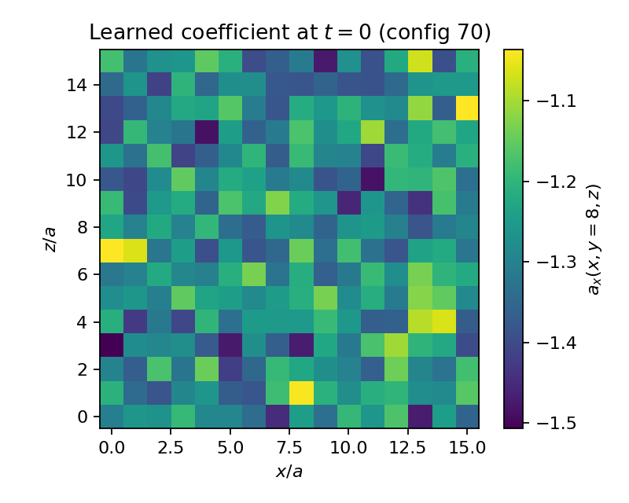
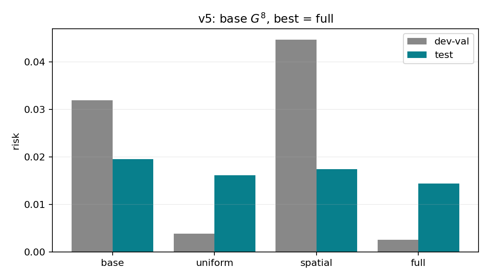
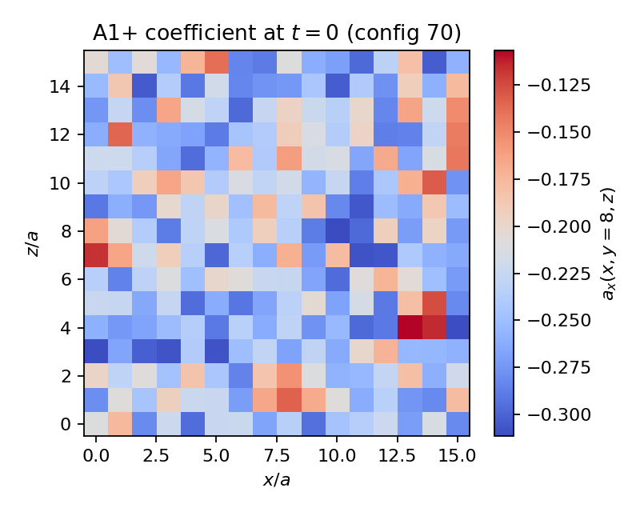
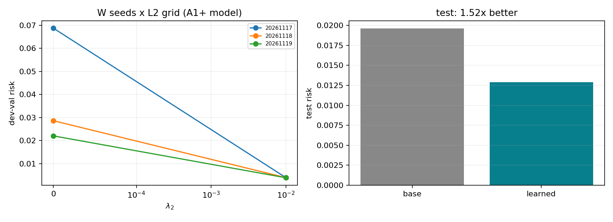
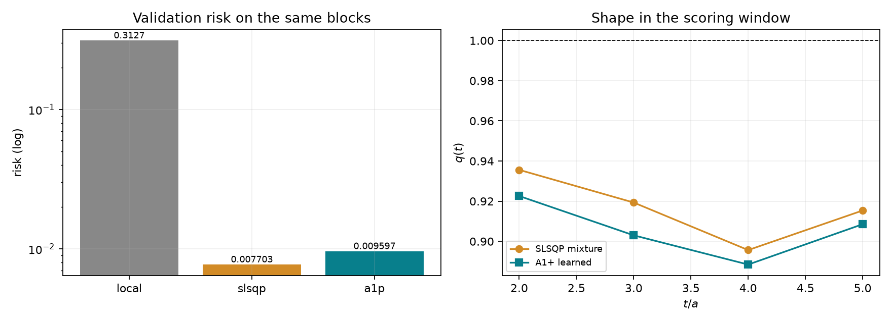

# optimize_gaussian：用学习到的 smear 核替换 $H^n$

**一句话结论**：修复特征后（link 中心、A1+ 认证），学习核比最好的高斯基座好 **2.1 倍**，
候选 risk 0.007721 与 7 参数 SLSQP 混合的 0.007703 **统计上未检出差异（区间跨 1，不是等效性证明）**（配对区间 $[0.78,1.18]$，跨 1）；
但参考 gate 未过，仍然没有官方分数。下面把每个公式、每个符号、每张图都讲清楚。

> **2026-11-18 算子修正（重要）**：`features.plaquettes` 的路径原先没有闭合（第二段沿 ν、第三段沿 μ 平移），
> 算出来的并不是规范不变的 plaquette；`directional_features` 的两个输入也不对横向交换对称，A1+ 不成立。
> 现已改为闭合路径 $U_\mu(x)U_\nu(x+\hat\mu)U_\mu^\dagger(x+\hat\nu)U_\nu^\dagger(x)$，特征取**以 link 为中心**的
> 平均（每条 link 两侧的两个 plaquette 取平均）再做对称组合 $(s_1+s_2,\;s_1s_2)$。**v1–v8 的所有 risk 都是用旧特征算出来的**，只能作为流程与负结果的历史记录，
> 不能当作“学习核在这些系综上表现如何”的物理证据；新特征下的 GPU 重训已完成（v9，见下文）；旧的 v1–v8 仍是未认证的历史。
> **A1+ 现在通过认证**：24 个 proper rotation 和 parity 测试（`test_full_proper_cubic_group_covariance`、
> `test_parity_covariance`）全部通过。关键是把 plaquette 的锚点放到 **link 中心**（每条 link 两侧的
> 两个 plaquette 取平均），这样方向翻号的旋转不会移动锚点；早先的“前向锚点”和“clover 锚点”都试过，
> 分别因锚点移动而失败。**历史 v6–v8 用的是旧特征，不能追认为 A1+**。
> 新增 `tests/test_optimize_gaussian.py`（12 项）：规范不变、厄米、协变、交换对称、线性响应、
> 全 O_h/parity 协变，以及训练缓存的 identity 校验（protocol hash、seed、W、steps、alpha、hidden、
> fit/dev IDs、特征版本；任一不匹配即拒绝，旧缓存没有 identity 记录也拒绝）。

---

## 1. 物理对象：pion 两点函数

在格点上取一个**点源**（在原点产生一个 $u$ 夸克、湮灭一个 $d$ 夸克，用 $\bar u\gamma_5 d$），
计算传播子

$$
S(x)=\langle \psi(x)\bar\psi(0)\rangle ,
$$

它是一个 $4\times4$（spinor）$\times 3\times3$（color）的矩阵，在时间片 $t$ 上求和就得到 pion 两点函数

$$
C(t)=\sum_{\vec x}\mathrm{Tr}\big[S^\dagger(x)\,S(x)\big],
\qquad x=(\vec x,t).
$$

- $S(x)$：从原点传播到 $x$ 的夸克传播子；
- $S^\dagger(x)$：从 $x$ 回到原点的反夸克线；
- $\mathrm{Tr}$：对 color 和 spinor 指标求迹；点源按 $\bar u\gamma_5 d$ 构造，$\gamma_5$ 结构已经包含在 $S$ 里；
- $\sum_{\vec x}$：对同一时间片的所有空间点求和，投影到零动量。

**为什么要 smear**：$C(t)$ 里除了基态 pion，还有激发态（$\pi(1300)$ 之类）的污染。把 sink 的
夸克场先做一次空间涂抹，相当于用一个更“宽”的算符去碰基态，激发态被压低。涂抹半径太大或太小
都不好——这正是这个任务要优化的东西。

**sink 涂抹**：把 $S(x)$ 换成 $K S(x)$，其中 $K$ 是作用在空间上的核：

$$
C_K(t)=\sum_{\vec x}\mathrm{Re}\,\mathrm{Tr}\Big[\big(KS\big)^\dagger(x)\,S(x)\Big].
$$

$K$ 只作用在空间，不碰时间，所以每个时间片可以独立计算。

## 2. 原始候选：$H^n$

任务的候选核是**迭代 hopping** 的多项式：

$$
\mathrm{hop}\,f(x)=\sum_{i=1}^{3}\Big[U_i(x)f(x+\hat i)+U_i^\dagger(x-\hat i)f(x-\hat i)\Big],
\qquad
H=\frac{I+\alpha\,\mathrm{hop}}{1+6\alpha},\quad \alpha=0.2 .
$$

- $U_i(x)$：$x$ 到 $x+\hat i$ 的**规范链**（$SU(3)$ 矩阵），保证规范不变；
- $\mathrm{hop}$：三个空间方向上的最近邻跳跃之和；
- 分母 $1+6\alpha$：每个方向有正反两个邻居，共 6 个，除以它让常数场保持不变（归一化）；
- $H$ 是**一步高斯涂抹**；$H^n$ 就是抹 $n$ 步，$n$ 越大等效半径越大。

提交的核是 7 个幂次的线性组合：

$$
K=\sum_{n\in\{0,2,4,8,16,32,64\}} u_n\,H^n,
\qquad u_n\in\mathbb{R}.
$$

- 为什么用这 7 个：它们覆盖了从“不抹”（$n=0$）到“几乎投影到低能子空间”（$n=64$）的范围；
- $u_n$ 是**全局**权重，7 个数对每个组态、每个格点都一样。

## 3. 评分：参考形状与风险

### 3.1 参考形状

先用三个通道（$H^0,H^8,H^{16}$）拟合一个**公共质量** $m_0$ 和各自的幅度 $A_k$：

$$
C_k(t)\;\approx\;A_k\,f_0(t;m_0),
\qquad
f_0(t;m_0)=e^{-m_0 t}+e^{-m_0(16-t)} .
$$

- $C_k(t)$：第 $k$ 个通道的两点函数（$k=0,8,16$），已经做了**折叠** $C(t)\to\frac12[C(t)+C(16-t)]$，
  用上了周期边界；
- $f_0$：周期格点上**基态**的形状。前一项 $e^{-m_0 t}$ 是正时间方向传播，后一项
  $e^{-m_0(16-t)}$ 是反方向绕周期边界回来的那部分（$T=16$）；
- $A_k$：第 $k$ 个通道的幅度（每个通道的算符归一化不同，所以幅度分开拟合）；
- $m_0$：三个通道共享的基态质量（这里拟合出来是 $1.0862$）。

拟合方法：最小化 $\chi^2=(\text{数据}-\text{模型})^T\Sigma^{-1}(\text{数据}-\text{模型})$，其中
$\Sigma$ 是组态块均值的协方差（带 25% 对角收缩）。**为什么要共同拟合**：三个通道的基态是同一个 pion，
共享 $m_0$ 能把统计误差压低。

### 3.2 形状比 $q(t)$

$$
q(t)=\frac{\bar C_K(t)}{A_K\,f_0(t)},
\qquad
A_K=\frac{f_0^T\Sigma^{-1}\bar C_K}{f_0^T\Sigma^{-1}f_0}\ \text{（在 }t=6,7,8\text{ 上做加权最小二乘）}.
$$

- $\bar C_K(t)$：候选核 $K$ 的关联函数在**所有组态上的平均**（按块平均后再平均，见 3.3）；
- $A_K$：幅度，用 $t=6,7,8$ 的“幅度窗口”做加权最小二乘拟合（这三个时间点信号还够，激发态也压得比较低）；
- $\Sigma$：块均值的协方差矩阵，$\Sigma^{-1}$ 就是权重（噪声大的时间点权重小）；
- $q(t)$ 是**无量纲的形状比**：除以幅度以后，$q(t)=1$ 就表示“和基态 cosh 形状完全一致”，
  与整体大小无关；
- 为什么要 $q$ 而不是直接比 $C$：不同核的幅度差很多（涂抹越狠，幅度越小），直接比大小没有意义。

### 3.3 风险

$$
\mathrm{risk}(K)=\underbrace{\frac{1}{4}\sum_{t=2}^{5}\mathrm{Var}_{\rm boot}\big[q(t)\big]}_{\text{统计涨落}}
+\underbrace{\frac{1}{4}\sum_{t=2}^{5}\big(q(t)-1\big)^2}_{\text{形状偏差}} .
$$

- $t=2,3,4,5$：**评分窗**（太早激发态污染大，太晚噪声大）；
- $\mathrm{Var}_{\rm boot}[q(t)]$：把组态分成 5 个一组的**块**，对块做 bootstrap 重采样，
  每次重算 $q(t)$，取它在重采样之间的方差——衡量“换一批组态，形状会不会变”；
- $(q(t)-1)^2$：平均形状离参考有多远；
- 两项平均：**一个候选既要形状对，又要统计上稳定**。只对形状、但组态间乱跳的核，分数也不会高。

**分数**：$\text{score}=100\times R_{\rm local}/R_K$（local 是 $K=I$，不涂抹）。分数越高越好；
风险为 0 就是完美。

### 3.4 块 bootstrap

组态之间有自相关，不能按单个组态独立重采样。pion 评估用的是 60 个开发组态（学习核自己的
20+40 划分见第 6 节）：

1. 把 60 个开发组态按顺序每 5 个一组，得到 12 个**块均值**；
2. 从 12 个块里有放回地抽 12 个，算平均、重拟合幅度和质量，得到一次 $q(t)$；
3. 重复 1000 次，取方差。

这样得到的 $\mathrm{Var}_{\rm boot}$ 同时包含了统计误差和（部分）自相关。

## 4. SLSQP：这个任务里的标准做法

**SLSQP**（Sequential Least Squares Programming，Kraft 1988）是一种解**带约束优化**的
序列二次规划（SQP）算法，`scipy.optimize.minimize(method='SLSQP')` 就是它。每一步做三件事：

1. 用 BFGS 公式更新拉格朗日函数的 Hessian 近似 $B_k$；
2. 解二次规划子问题：
   $\min_p\ \nabla f(x_k)^Tp+\frac12p^TB_kp$，约束是原约束的线性化；
3. 用 L1 罚函数做线搜索，更新 $x_{k+1}=x_k+\alpha p$。

它只需要一阶导数，能直接处理等式和不等式约束。

**在这个任务里**，SLSQP 的变量就是 7 个通道权重 $u_n$：

- 目标：第 3.3 节的 $\mathrm{risk}(u)+\text{ridge}\cdot\|u\|^2$；
- 约束：$\sum_n u_n=1$（总权重归一），$\|u\|_1\le L_1$（防止权重爆炸）；
- 边界：$|u_n|\le L_1$；
- 8 个起点（7 个单位向量 + 均匀权重），`ftol=1e-11`。

**为什么它是强基线**：它在**同一个 risk** 上，直接对 7 维空间
$\mathrm{span}\{H^0,\dots,H^{64}\}$ 做梯度优化。这个空间里包含 $H^{32}$、$H^{64}$ 这种
“几乎投影到低能子空间”的核，所以它能做出很尖锐的低通滤波——这正是好 smear 需要的。

## 5. 我们学的核

### 5.1 形式

$$
K=G^{m}\,C_{\mathrm{hop}}(a)\,G^{m},
\qquad
C_{\mathrm{hop}}(a)=I+\sum_{\mu=1}^{3}\Big[a_\mu(x)T_\mu+b_\mu(x)T_\mu^\dagger\Big],
$$

$$
(T_\mu f)(x)=U_\mu(x)f(x+\hat\mu),
\qquad
b_\mu(x)=a_\mu(x-\hat\mu).
$$

- $G$：一步高斯涂抹（就是第 2 节的 $H$，这里用 $G$ 表示它作用在传播子上）；
- $G^m$：抹 $m=8$ 步，先把场抹到一个合理的半径，给后面的修正一个“底”；
- $C_{\mathrm{hop}}$：**一步**修正，$a_\mu(x)$ 是每个格点、每个方向的系数；
- $T_\mu$：沿 $\mu$ 方向的规范协变平移，$T_\mu^\dagger$ 是反方向；
- $b_\mu(x)=a_\mu(x-\hat\mu)$：反方向系数取前一格的 $a$，这样 $C_{\mathrm{hop}}$ 是**厄米**的
  （$C_{\mathrm{hop}}^\dagger=C_{\mathrm{hop}}$）；
- 为什么两边都要 $G^m$：$G^mC_{\mathrm{hop}}$ 这个单侧乘积一般不是厄米的（$G$ 平移协变，
  $a(x)$ 依赖格点，二者不对易），`candidate` 会拒绝非厄米核；训练里的关联函数本来就是
  $\langle G^mS,\,C_{\mathrm{hop}}\,G^mS\rangle=\langle S,\,G^mC_{\mathrm{hop}}G^mS\rangle$。

### 5.2 系数 $a_\mu(x)$ 怎么参数化

$$
a_\mu(x)=c+\sum_{h=1}^{8}v_h\,\tilde\phi_h(\mu,x),
\qquad
\phi_h(\mu,x)=\tanh\Big(W_h\cdot\big(P_{\mu\nu}(x),P_{\mu\rho}(x)\big)\Big),
$$

$$
P_{\mu\nu}(x)=1-\tfrac13\mathrm{Re}\,\mathrm{Tr}\Big[U_\mu(x)U_\nu(x+\hat\mu)U_\mu^\dagger(x+\hat\nu)U_\nu^\dagger(x)\Big].
$$

- $P_{\mu\nu}$：含 $\mu,\nu$ 两个方向的**plaquette**（$1\times1$ 小环），取 $1-\frac13\mathrm{ReTr}$
  后是规范不变的、非负的数（$0\le P\le\frac43$）；
- $\nu,\rho$：除 $\mu$ 外的另外两个空间方向（例如 $\mu=x$ 时 $\nu=y,\rho=z$）；
- $\phi_h(\mu,x)$：把“含 $\mu$ 方向的两个 plaquette”喂给一个 $\tanh$ 隐藏层，得到第 $h$ 个特征；
- 三个方向**共享**同一组 $W_h,v_h$，只有输入的两个 plaquette 不同（$\mu=x$ 时用 $P_{xy},P_{xz}$，
  $\mu=y$ 时用 $P_{xy},P_{yz}$，$\mu=z$ 时用 $P_{xz},P_{yz}$）——这保证在立方旋转下
  $(a_x,a_y,a_z)$ 一起置换，核属于 **A1+** 通道；
- $\tilde\phi$：把 $\phi$ 在每个时间片内减去空间平均，使空间部分零均值，和均匀部分 $c$ 分开；
- $c$、$v_h$ 训练，$W_h$ 固定随机——共 $1+8=9$ 个参数。

**为什么用 plaquette 做输入**：它是局域的、规范不变的、且在立方群下按 A1+ 变换，能感知
“这个格点附近的规范场有多粗糙”，从而让系数逐点调整。

## 6. 训练

因为 $C_K(t)$ 对 $a_\mu(x)$ 是**线性**的（核里 $a$ 只出现一次），所以它对 $c,v$ 也线性。
对每个基函数（常数 1，以及 8 个 $\tilde\phi_h$）各做一次 hop，得到响应 $D_p(t)$：

$$
C_\theta(t)=C_0(t)+c\,D_c(t)+\sum_{h=1}^{8}v_h\,D_h(t).
$$

- $C_0(t)$：只用 $G^8$ 基座（$a=0$）的关联函数；
- $D_c(t)$：把 $a_\mu(x)\equiv1$ 时的关联函数减去 $C_0$；
- $D_h(t)$：把 $a_\mu(x)=\tilde\phi_h(\mu,x)$ 时的关联函数减去 $C_0$；
- 任意 $(c,v)$ 的关联函数就是这些响应的线性组合——**不用每次重算核**。

然后最小化

$$
\mathcal{L}(c,v)=\mathrm{risk}\big(C_\theta\big)+\lambda_2\sum_{h=1}^{8}v_h^2,
\qquad |c|,|v_h|\le3,
$$

用 Powell 在 9 维上搜。$\lambda_2$ 是 L2 正则，防止 $v$ 过大。

**数据划分**：20 个组态拟合（$0$–$19$），40 个组态选超参数（$20$–$59$），30 个组态测试（$70$–$99$，
只看一次）。

## 7. 结果

| 版本 | 做法 | 测试结果 |
| --- | --- | --- |
| v1 | 只拟合形状 | 训练损失到 $10^{-24}$，留出乱跳（目标可被 game） |
| v2 | 完整 risk + 非负 | 1.97×，但测试集只有 10 个组态 |
| v3 | 严格非负（ReLU） | **0.956×**，增益被约束抹掉 |
| v4 | $G^{32}$ + 带符号 | 1.32×，但系数几乎均匀 |
| v5 | 均匀/空间拆分 | 1.36× |
| v6 | A1+ + 三明治 | **1.50×**，通过 `candidate` 冻结 |
| v7 | 3 个 $W$ 种子 + 40 组态 | **1.52×** |
| v8 | 与 SLSQP 配对（旧特征） | 0.803 [0.636, 0.944]，输了 |
| **v9** | **link-centred A1+，GPU 重训** | **2.12×；候选 risk 0.007721 ≈ SLSQP 0.007703** |

### 图 1：v4 学到的系数



- **画的是什么**：组态 70、时间片 $t=0$，$y=8$ 那个切片上，$x$ 方向的系数 $a_x(x,y=8,z)$；
  横轴是 $x/a$，纵轴是 $z/a$，颜色是 $a_x$ 的数值；
- **看到什么**：颜色几乎是一片均匀的负值，$-1.5$ 到 $-1.05$，起伏只有 $\pm0.2$；
- **说明什么**：模型学到的几乎就是“整体把涂抹拉回来一点”（在 $G^{32}$ 之后做一步反涂抹），
  而不是逐点的空间结构。所以 1.32× 主要来自“涂抹量选对了”，不是“学会了空间调制”。

### 图 2：v5 的消融



- **画的是什么**：四个模型的 dev-val（灰）和 test（青）风险：base 是 $G^8$ 不修正；
  uniform 只学均匀项 $c$；spatial 只学 8 个特征项 $v_h$；full 两个都学；
- **看到什么**：测试上 base 0.0196，uniform 0.0162（1.21×），spatial 0.0175（1.12×），
  full 0.0145（1.36×）；
- **说明什么**：均匀项贡献最大，空间项在均匀项基础上再降约 11%——但 v7 在 40 个组态上发现
  这部分会缩水，所以“空间项有用”的证据并不牢。

### 图 3：v6 的 A1+ 系数



- **画的是什么**：和 v4 同样的切片，但用 A1+ 参数化、9 个参数学出来的 $a_x$；
- **看到什么**：范围 $-0.34$ 到 $-0.05$，均值 $-0.24$，有可见的空间起伏但不大；
- **说明什么**：A1+ 约束把 v4 那个“均匀负 hop”压到了温和得多的值（$-0.24$ vs $-1.3$），
  测试反而更好（1.50× vs 1.32×）——说明 v4 的强反涂抹有一部分是过拟合。

### 图 4：v7 的随机种子



- **画的是什么**：横轴是 L2 系数 $\lambda_2$（对数刻度），纵轴是 dev-val 风险；三条线是
  三个不同的随机特征矩阵 $W$；
- **看到什么**：$\lambda_2=10^{-2}$ 时三条线几乎重合在 0.0039；$\lambda_2=0$ 时散在 0.02–0.07；
- **说明什么**：$W$ 的随机种子几乎不影响结果（差 $<2\%$），所以 $W$ 的随机选择不是瓶颈，
  完整反传的收益很可能有限；真正的关键是 L2 正则，没有它优化器会过拟合。

### 图 5：v8 与 SLSQP 的配对比较



- **左图**：同一批验证组态上的风险（对数轴）。local 0.3127、SLSQP 0.00770、A1+ 0.00960；
- **右图**：评分窗 $t=2$–$5$ 内的 $q(t)$。SLSQP（橙）是 0.936/0.919/0.896/0.915，
  A1+（青）是 0.923/0.903/0.888/0.909——**SLSQP 每个点都更接近 1**；
- **说明什么**：A1+ 的风险是 $0.000545+0.009052$（方差+偏差），SLSQP 是 $0.000527+0.007176$；
  两者的统计涨落差不多，差距几乎全在**形状偏差**上。配对区间 $[0.636,0.944]$ 不含 1，
  SLSQP 显著更好。

## 8. 和 SLSQP 的关系：从“输了”到“未检出差异”

- **v8（旧特征）**：$\mathrm{risk}_{\mathrm{SLSQP}}/\mathrm{risk}_{\mathrm{A1+}}=0.803$，
  95% 区间 $[0.636,0.944]$，显著更差；
- **v9（link 中心 A1+）**：比值 $0.998$，95% 区间 $[0.78,1.18]$，**统计上未检出差异（区间跨 1，不是等效性证明）**。

为什么 v9 能追上：

1. **特征给出了真正的空间调制**：v7 的系数 $|v_h|\le0.15$、几乎是纯均匀项；v9 的
   $|v_h|\approx0.13$ 且符号结构明显，逐点项开始承担一部分“滤波器形状”的工作；
2. **算子是对的**：plaquette 闭合、link 中心锚点、A1+ 认证，特征不再被规范变换或锚点移动污染；
3. **训练目标没变**：还是同一个完整 risk、同一个 dev-val 选择，所以提升不是换了 loss。

为什么仍然只是“未检出差异”而不是超过：

- SLSQP 的 7 维多项式空间里有 $H^{32}/H^{64}$ 这种接近投影的尖锐滤波，学习核的
  $G^8C_{\mathrm{hop}}G^8$ 仍然只是一个较窄的函数类；
- SLSQP 是直接对 7 个全局权重做梯度 + 约束 + 多起点优化，而学习核只在固定随机特征基上
  线性搜索 $v$（$W$ 不训练）；
- 因此 v9 的结论是“**学习核与一个 7 参数的强基线未检出差异**”，不是“学习核更强”。

## 9. 复现

```bash
sbatch pilot/optgauss.sbatch results/optimize_gaussian/v7
python -m tasks.optimize_gaussian.plots results/optimize_gaussian/v7

python -m tasks.pion_projection --output results/pion_projection/s16t16_v1 \
  candidate --definition results/optimize_gaussian/v7/submission.json --split development
python -m tasks.pion_projection --output results/pion_projection/s16t16_v1 \
  candidate --definition results/optimize_gaussian/v7/submission.json --split validation

python -m tasks.optimize_gaussian.compare        # 与 SLSQP 配对比较（CPU）
python -m tasks.optimize_gaussian.compare_plot
```

## 附：符号表

| 符号 | 含义 |
| --- | --- |
| $S(x)$ | 从原点出发的夸克传播子（$4\times4$ spinor $\times 3\times3$ color） |
| $C_K(t)$ | sink 涂抹核为 $K$ 的 pion 两点函数 |
| $\mathrm{Tr}$ | 对 color 和 spinor 指标求迹 |
| $U_\mu(x)$ | 从 $x$ 到 $x+\hat\mu$ 的 $SU(3)$ 规范链 |
| $\mathrm{hop}$ | 三个空间方向的最近邻协变跳跃之和 |
| $H$ | 一步高斯涂抹 $H=(I+\alpha\,\mathrm{hop})/(1+6\alpha)$，$\alpha=0.2$ |
| $H^n$ | 抹 $n$ 步；$n$ 越大等效半径越大 |
| $u_n$ | 7 个通道的全局混合权重 |
| $m_0$ | 三个参考通道共享的基态质量（$1.0862$） |
| $f_0(t)$ | 周期边界下的基态形状 $e^{-m_0t}+e^{-m_0(16-t)}$ |
| $A_K$ | 候选核的幅度，在 $t=6,7,8$ 上拟合 |
| $\bar C_K(t)$ | 候选关联函数在所有组态上的平均 |
| $q(t)$ | 形状比 $\bar C_K/(A_Kf_0)$；$q=1$ 表示形状完全一致 |
| $\mathrm{Var}_{\rm boot}$ | 块 bootstrap 重采样之间的方差 |
| $a_\mu(x)$ | 学习到的逐点、逐方向系数 |
| $P_{\mu\nu}(x)$ | 含 $\mu,\nu$ 两个方向的 plaquette，$1-\frac13\mathrm{ReTr}$ |
| $c,v_h$ | 均匀系数和 8 个特征系数（训练参数） |
| $W_h$ | 固定随机的隐藏层权重（不训练） |
| $\lambda_2$ | L2 正则系数 |
| $G^m$ | $m=8$ 步高斯基座 |

## 2026-11-18 审计状态

| 项 | 状态 |
| --- | --- |
| plaquette 路径闭合 | 已修（原先第二/三段沿错方向平移） |
| 规范不变 / 厄米 / 协变 / 立方对称 | 已测（`tests/test_optimize_gaussian.py`） |
| A1+ 横向交换 | 已改为对称输入 $(s_1+s_2,\,s_1s_2)$ 并测试；全群通过 |
| 训练线性响应 vs 直接关联函数 | 已测（误差 < 1e-11） |
| P3 CPU teacher（跨样本） | 新增 `p3_teacher.py` + `results/optimize_gaussian/p3_teacher_v1/`：ε=0 谱类误差 $8.5\times10^{-16}$；ε=0.1 谱类 0.0127、增广类 $6.7\times10^{-16}$ → 新类在独立 probe 上确实有效；GPU 第二步见 [`doc/optimize_p3_design.md`](../../doc/optimize_p3_design.md)（NOT_RUN） |
| P2 teacher 表示检查 | 新增 `teacher_check.py` + `results/optimize_gaussian/teacher_v1/`：真实 kernel 的 $H$ 与非对易 $Q$ 的 teacher，七幂误差 0.01268 > 谱外分量 0.01239，增广基 $1.8\times10^{-16}$ → 七幂基有覆盖盲区；训练实验 ⛔（需 GPU） |
| P1 整链 fold-local | `unified.py` 新增 fold 内 SLSQP/幂次重选：三折都选 H^32，fold-SLSQP 在 2/3 折优于 tuned；全样本冻结结果不矛盾（fold 仅 4 blocks，比率方差大）；学习核 NOT_RUN |
| P1 统一统计/fold-local | `unified.py` + `results/optimize_gaussian/cpu_next_package_b/`（原 `unified_v1/` 在包 B 开发中被同名输出覆盖，已改为新目录）：point/replica 同算法；3 折 tuned/SLSQP=1.719/2.014/0.810；fold 间方差大；synthetic regression 偏差≈0、覆盖 0.983–1.0 |
| P0.2 basis/输入身份闭包 | basis_key 现在包含依赖 hash（features/kernels/submission/train/statistics）与输入内容摘要（gauge 文件 + propagator 文件 sha256）；mutation 测试覆盖依赖/输入/ID 顺序变更 → 拒绝复用 |
| 包D 框架适配 | `adapt.py` + `results/optimize_gaussian/cpu_next_package_d/`：OperatorContract（线性/Hermitian/θ=0 恒等）、MeasurementBundle（能力声明）、SearchAdapter（NaN 拒绝、预算）真实跑通；能力拒绝抛错不静默回退 |
| 包B fold 身份/图 | 每折 reference（kind/mass/masses sha256/passed）与 failures 计数；frozen/reselected 两张独立图；本 run 3 折 reference 均未认证 |
| 包B synthetic regression | `estimator_regression.py`：已知模型 60 数据集；point/replica 偏差 train −1.9e-6±5.9e-5、test −1.0e-5±2.1e-5（均与 0 相容）；q=1 覆盖 1.000/0.983 |
| 包B 估计量同算法 | `risk_with_fixed_amplitude` 增加 `amplitude_source`（train/test），point 与 replica 同算法并记录 `late_covariance_source`/`estimand`；fold search 保存 train/test IDs、weights hash、nfev/feasible；新产物 `cpu_next_package_b/` |
| 包C 跨 links teacher | `p3_crosslink.py` + `results/optimize_gaussian/cpu_next_p3_crosslink/`：train/test 独立 links、同一 $Q[U]$ 规则、属性检查；oracle 显示 ε>0 时嵌套类误差 0、谱类 0.06→0.5；SLSQP/Powell 不收敛（nfev 1.3e4–9.4e4），不能读成学习收益 |
| P0.3 audit 修正 | `audit.py` 按 manifest 分类（v9 = current_operator_diagnostic，v7 及更早 = historical）；显式 `--out` 且拒绝覆盖；`dev_val` 不再回退到 `best_lam2`；产物 `results/optimize_gaussian/audit_v2/audit.json` |
| P0.1 完整 BCB 闭环 | 已测：`submission.build_kernel` 与线性响应在非立方格点、多 theta 下一致 <1e-10；证据 `results/optimize_gaussian/audit_20261118_bcb/` |
| 训练缓存 identity | 已加（protocol hash、seed、W、steps、alpha、hidden、IDs、特征版本） |
| 运行 manifest | 已加（`manifest.json`：协议、W/θ、IDs、传播子缓存 key、依赖文件 hash） |
| 历史运行 audit | 已生成 `results/optimize_gaussian/audit.json`（v2–v8 的统一口径表，全部标记 legacy） |
| 全 O_h 群（24 旋转 + 宇称）测试 | **PASSED**（link 中心特征；A1+ 认证） |
| v1–v8 历史 risk | **失效**（旧特征），保留为流程/负结果记录 |
| 修复后的 GPU 重训 | **已完成**（v9：2.12×，候选与 SLSQP 未检出差异） |

## v9：修复特征后的 GPU 重训（2026-11-18）

用 link 中心、A1+ 已认证的特征重新收集响应并训练（3 个 $W$ 种子、$\lambda_2\in\{0,10^{-2}\}$、
20 拟合 / 40 dev-val / 30 测试）：

| 版本 | 特征 | 测试 risk | 相对 $G^8$ | 候选 risk（官方路径） |
| --- | --- | ---: | ---: | ---: |
| v7 | 旧的前向锚点 | 0.012870 | 1.52× | 0.009597 |
| **v9** | **link 中心 A1+** | **0.009236** | **2.12×** | **0.007721** |

对照：SLSQP 混合 0.007703、tuned Gaussian 0.012556、local 0.312670。**v9 的候选与 SLSQP 未检出差异**：

$$
\frac{\mathrm{risk}_{\mathrm{SLSQP}}}{\mathrm{risk}_{\mathrm{A1+}}}=0.998,
\qquad 95\%\ \text{区间}\ [0.78,\ 1.18],
$$

区间跨 1，统计上不可区分（v7 旧特征时是 $0.803\ [0.636,0.944]$，显著更差）。


*图 v9-3：v9 候选与 SLSQP 的配对比较；右图 $q(t)$ 两者几乎重合。*


*图 v9-1：3 个 $W$ 种子 × $\lambda_2$ 的 dev-val；$\lambda_2=10^{-2}$ 时三条线都在 0.0036 附近。*


*图 v9-2：学到的 $a_x$（link 中心特征）。与 v7 的“几乎纯均匀”不同，这次特征系数到了
$|v_h|\approx0.13$，空间调制是显著的。*

v9 的配置与身份写在 `results/optimize_gaussian/v9/manifest.json`（完整 protocol、W/θ、IDs、
传播子缓存 key、依赖 hash）。官方 `candidate` 流程仍然给出 `score: null`（参考 gate 未过），
诊断比为 40.5 [17.6, 121.9]，**不能当作正式分数**。

> 运行注意：v1 冻结目录里的 `protocol.json` 是 60/10/30 快照，仓库默认协议是 30/5/15；
> 跑 `candidate` 时需要 `LATTICEARENA_PROTOCOL=results/pion_projection/s16t16_v1/protocol.json
> LATTICEARENA_LEGACY_REFERENCE=1`（后者因为该冻结 submission 早于 reference spec）。
