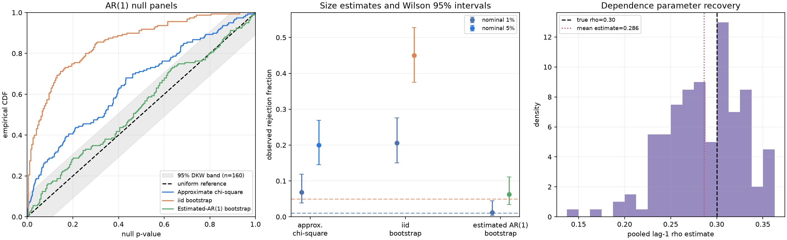

# D04 AR(1) dependence-aware bootstrap stress test

**Status:** synthetic CPU validation only; it does not create a physical E-chain reference or change `D04 NOT_READY/UNCERTIFIED`.

## Frozen design

- Generate `160` independent held-out null panels with `128` ordered configurations each from a stationary 27-feature Gaussian AR(1), true `rho=0.30`. The exact finite-N variance inflation for a sample mean is `1.8476`.
- On each same outer panel, compare the current approximate chi-square p-value, an iid plug-in bootstrap, and an estimated-AR(1) plug-in bootstrap. Both bootstrap methods use the same panel-specific fitted null mean and raw feature covariance; only the serial-dependence parameter differs.
- The dependence estimate is pooled lag-1 OLS over all 27 raw feature series after subtracting each series' panel mean, clipped to `[-0.95, 0.95]`. Bootstrap samples use that estimate for AR(1), or zero for the iid comparator. Each replicate refolds, re-estimates/shrinks covariance by `25%`, and refits with three starts.
- Each method plans `199` inner refits per outer panel. P-values use `(1 + exceedances)/(valid draws + 1)`; fewer than `180` valid draws abstain. Failures remain in the draw denominator.

The left panel compares the three null p-value empirical CDFs with the uniform reference. The center panel shows 1% and 5% rejection rates with Wilson 95% intervals. The right panel shows how well the pooled rho estimator recovers the known synthetic value.

## Results

- Denominators: `{"bootstrap_outer_total": {"abstained": 0, "failed": 0, "planned": 320, "valid": 320}, "estimated_ar1_bootstrap_draws": {"abstained": 0, "failed": 0, "planned": 31840, "valid": 31840}, "estimated_ar1_bootstrap_outer": {"abstained": 0, "failed": 0, "planned": 160, "valid": 160}, "iid_bootstrap_draws": {"abstained": 0, "failed": 0, "planned": 31840, "valid": 31840}, "iid_bootstrap_outer": {"abstained": 0, "failed": 0, "planned": 160, "valid": 160}, "outer_fit": {"abstained": 0, "failed": 0, "planned": 160, "valid": 160}, "rho_estimate": {"abstained": 0, "failed": 0, "planned": 160, "valid": 160}}`.
- P-value summaries: `{"chi_square_approx": {"count": 160, "ks_distance_to_uniform": 0.24602376917804814, "mean": 0.34911737048106295, "median": 0.33777740337623563, "rejection": {"0.01": {"count": 11, "mcse": 0.007866066361276137, "nominal_rate": 0.01, "rate": 0.06875, "wilson_95": [0.03881942091091279, 0.11890292242451045]}, "0.05": {"count": 32, "mcse": 0.017230060940112778, "nominal_rate": 0.05, "rate": 0.2, "wilson_95": [0.14538269154252415, 0.268685025560379]}}}, "estimated_ar1_bootstrap": {"count": 160, "ks_distance_to_uniform": 0.09312500000000001, "mean": 0.46315624999999994, "median": 0.465, "rejection": {"0.01": {"count": 2, "mcse": 0.007866066361276137, "nominal_rate": 0.01, "rate": 0.0125, "wilson_95": [0.0034346711081265323, 0.044425369184091026]}, "0.05": {"count": 10, "mcse": 0.017230060940112778, "nominal_rate": 0.05, "rate": 0.0625, "wilson_95": [0.034299666746119624, 0.11121575402894743]}}}, "iid_bootstrap": {"count": 160, "ks_distance_to_uniform": 0.564375, "mean": 0.1464375, "median": 0.065, "rejection": {"0.01": {"count": 33, "mcse": 0.007866066361276137, "nominal_rate": 0.01, "rate": 0.20625, "wilson_95": [0.15080086366994006, 0.27547377599331924]}, "0.05": {"count": 72, "mcse": 0.017230060940112778, "nominal_rate": 0.05, "rate": 0.45, "wilson_95": [0.3749863030702235, 0.5273583164469271]}}}}`.
- Estimated rho summary: `{"bias": -0.013770472006152723, "count": 160, "mean": 0.28622952799384727, "median": 0.2880293519813011, "q05_q95": [0.22546253892914975, 0.3510093299153133], "sd": 0.040790737827464355}`.
- Paired contrasts: `{"estimated_ar1_bootstrap_minus_approx": {"fraction_bootstrap_lower": 0.03125, "mean": 0.1140388795189371, "valid": 160}, "estimated_ar1_bootstrap_minus_iid_bootstrap": {"fraction_ar1_pvalue_lower": 0.0, "mean": 0.31671875, "valid": 160}, "iid_bootstrap_minus_approx": {"fraction_bootstrap_lower": 0.95, "mean": -0.2026798704810629, "valid": 160}}`.

## Interpretation and next work

This design isolates one failure mode already visible in the earlier stress report: treating correlated configurations as iid can make the nominal GOF test over-reject. A better result for the estimated-AR(1) bootstrap would support only this synthetic stationary Gaussian mechanism. It would not validate an HMC chain, select a production dependence model, or establish calibration after fit-window/model selection. The plug-in covariance, pooled rho estimator, and fitted-mean reconstruction still need independent statistical review. The next software comparison should freeze a wider rho/tail grid and compare AR(1), circular block, and HAC-based bootstrap under an untouched outer set. Before a physical D04 reference can be made, obtain an authorized candidate-blind E-chain snapshot with provenance/dependence receipts and production source/sink conventions. Keep `physical_score=null`; do not open sealed data or infer GPU/QUDA evidence from this CPU run.

## Reproduction and integrity

Run from the repository root: `python -m tasks.optimize_gaussian.d04_ar1_bootstrap_diagnostic`. The report refuses to overwrite an existing output directory. Full panel and per-draw tables, the frozen protocol, source snapshots/hashes, and artifact hashes are saved alongside the figure.
- SHA-256 manifests are written after the README, tables, figure, protocol, and source snapshots are complete.
