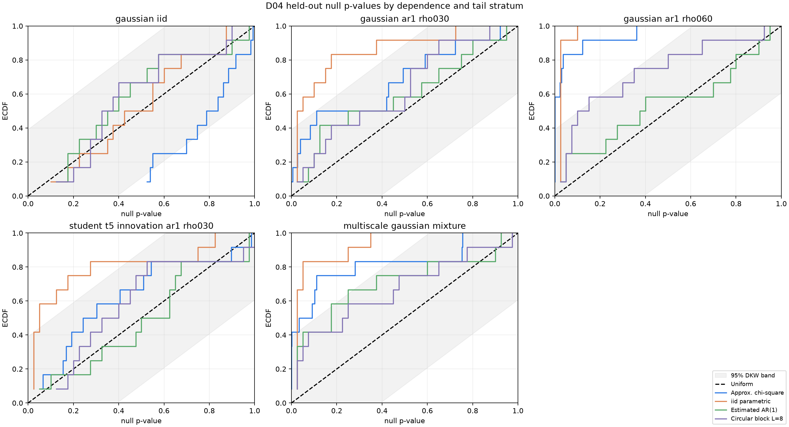
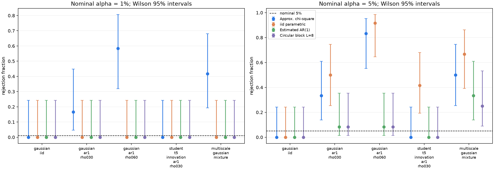
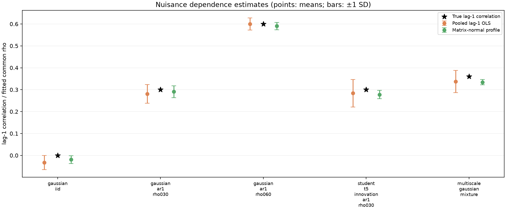

# D04 independent dependence stress

**Status:** SYNTHETIC_SCREENING_ONLY_NOT_CALIBRATION. D04 stays `NOT_READY/UNCERTIFIED`; `physical_score=null`.

## Frozen design

- Five null strata × 12 independently seeded panels per stratum; each panel has 128 ordered configurations and the frozen joint PP-even/A4P-odd two-state `tmin=3` fit.
- DGPs: iid Gaussian; Gaussian AR(1) with rho 0.30 and 0.60; AR(1) with multivariate Student-t(5) innovations at rho 0.30; and a two-timescale Gaussian mixture with rho_fast=0.15, rho_slow=0.75, fast weight=0.65.
- Paired p-value methods: approximate chi-square; iid plug-in parametric bootstrap; panel-specific pooled-OLS estimated-AR(1) bootstrap; circular moving-block residual bootstrap with pre-fixed `L=8`. Every bootstrap plans 39 refits; failures count as upper-tail exceedances and fewer than 36 valid refits abstain.
- Methods and block length were fixed before this disjoint seed set; dataset role is `screening_only`. No method or threshold is selected from these outputs. All p-value distributions and rejection rates are descriptive.

## Figures

## Text flow and interpretation

`fresh null DGP + disjoint per-cell seeds -> 12 ordered raw panels/stratum (60 total) -> common PP/A4P fit -> approximate / iid / estimated-AR(1) / fixed-L circular-block p-values -> failed refits counted conservatively -> panel-level P/V/F/A + Wilson intervals + rho recovery -> diagnostic only`.

The gray ECDF band in this frozen screening snapshot is a pointwise 95% DKW band for each plotted curve; it is **not** simultaneous across the 20 stratum/method curves. The current runner source has since been updated to use a Bonferroni simultaneous DKW band for future reports. This screening dataset and its source snapshot are retained as generated; no calibration claim depends on the band.

The multiscale process has no single AR(1) parameter: the reported reference is its known lag-1 correlation, not a claim that the process is AR(1). The Student-t case uses t(5) innovations in a stationary-initialized AR recursion; it is not an iid Student-t panel. The fixed L=8 bootstrap is only one declared comparator. Screening runs have especially coarse outer and inner Monte Carlo precision; even the full 200-panel design does not meet the earlier high-precision 1% tail target. Use reported Wilson intervals rather than binary pass labels.

This is new synthetic validation evidence, not a production chain receipt. It cannot establish HMC stationarity, candidate blindness, source/sink convention, physical reference coverage, or permission to inspect sealed data. A third-party reviewer and an authorized candidate-blind E-chain package remain necessary before D04 can become gate-ready.

## Reproduction and provenance

Run from repository root: `python -m tasks.optimize_gaussian.d04_heldout_dependence_diagnostic --outer-panels 12 --bootstrap-replicates 39 --base-seed 2026112837 --output NEW_DIRECTORY`. The script refuses to overwrite a report directory; it stores panel rows, seed records, input source snapshots/hashes, plots and artifact hashes together.
- Outer panels: `60/60/0/0` planned/valid/failed/abstained generators; fit validity is reported separately by stratum.
- Total bootstrap draws planned: `2340` per method; per-cell/per-method failed and abstained draws are in `summary.json`.
- The smallest bootstrap p-value representable with this inner plan is `0.02500`; when it exceeds 0.01, the 1% rejection count is structurally zero and cannot be interpreted as size control.
- `physical_score=null`; no measurement or sealed split was read; no GPU/QUDA was started.
