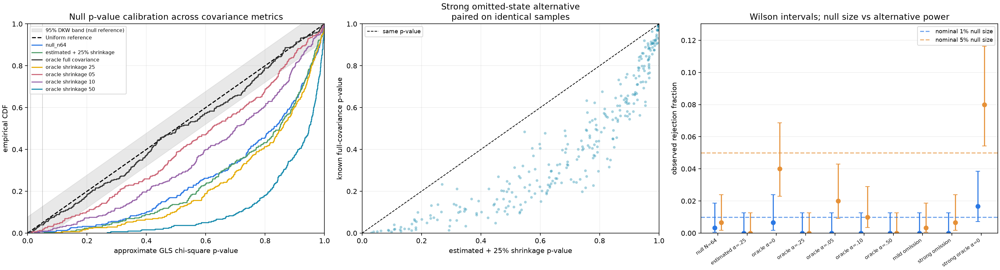
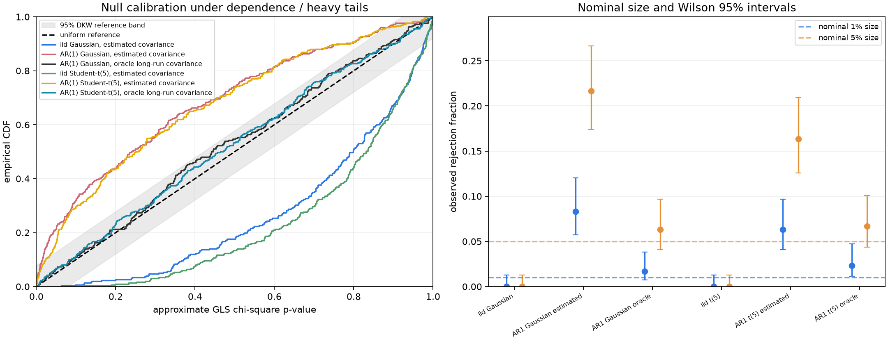

# D04 approximate chi-square GOF calibration pilot

**Status:** synthetic CPU diagnostic. It measures null rejection size and an omitted-state alternative for the current `gof_p_approx`; it is not a candidate-blind E-chain reference or a physical GO decision.

## Frozen procedure

- Sixteen cells, `300` planned fits per cell: the first ten cover Gaussian-null covariance calibration and omitted-state alternatives; six additional cells stress iid Gaussian, AR(1) Gaussian, iid Student-t(5), and AR(1) Student-t(5), all at `Ncfg=128`.
- The covariance-alpha sweep reuses the same `Ncfg=128` null samples. Across all cells there are `2400` unique generated panels and `4800` planned fits; paired covariance fits are not independent samples.
- The mild omitted-state truth uses third-state PP overlaps 0.11–0.18 and A4P overlap 0.022; the strong stress uses PP overlaps 0.45–0.75 and A4P overlap 0.085. Both are distinct from the two-state null.
- Covariance-oracle cells reuse exact sample panels of their comparison cells; sample SHA-256 values are checked before paired summaries are calculated. The full oracle removes covariance estimation and shrinkage; the alpha sweep isolates the metric under known covariance. For dependent cells, the oracle uses exact finite-N stationary AR(1) `Var(mean)` inflation; it is a simulation truth, not a deployable estimator.
- Each configuration is a 27-component vector around folded PP-even/A4P-odd correlator means; feature covariance is fixed from 0.65 within-vector temporal correlation and 0.2 cross-channel correlation, with relative noise `0.03`. Chain-stress sequences use stationary-variance AR(1) `rho=0.30`, 200 burn-in configurations, and either Gaussian or Student-t(5) innovations scaled to finite covariance.
- Each panel uses the existing D04 fit path (`tmin=3`, two states, three starts); the default covariance is estimated from the same panel with 25% diagonal shrinkage and relative eigenvalue floor `1e-10`. Independent-null oracle cells use known covariance or diagonal-shrunk versions at alpha 0%, 5%, 10%, 25% and 50%. AR(1) oracle cells use the exact finite-N long-run covariance of the synthetic process. All p-values use the approximate chi-square survival probability with 13 nominal degrees of freedom.
- All panel fits remain in the planned denominator. The null cells estimate the false rejection frequency at p<0.01 and p<0.05; the omitted-state cell is a misspecification power diagnostic.
- The strong omitted-state cell was added after the initial mild-alternative pilot showed weak separation. It is an exploratory power stress, not a preregistered confirmatory test; null thresholds and seeds were not changed.

In the first figure, the left panel shows the seven iid Gaussian null covariance cells' empirical p-value CDFs against the uniform reference; the gray band is a 95% Dvoretzky–Kiefer–Wolfowitz band for a 300-panel sample. The middle panel compares strong-alternative p-values for identical samples under estimated/shrunk and known full covariance. The right panel gives the first ten cells' observed rejection fractions and Wilson intervals at 1% and 5%. For null cells, a well-calibrated p-value should track the diagonal and rejection rates should be compatible with nominal sizes; omitted-state rejection is power, not type-I error.
In the dependence-stress figure, iid Gaussian and iid Student-t(5) estimated-covariance p-values are conservative in this realization, while rho=0.30 AR(1) panels with iid-style covariance-of-mean are anti-conservative: `p<0.05` rates are `0.217` for Gaussian and `0.163` for Student-t(5). The paired exact finite-N long-run covariance oracle lowers them to `0.063` and `0.067`. This demonstrates sensitivity to dependence under the chosen synthetic process; it does not identify a production HAC/block estimator or certify an HMC chain.

## Interpretation limits and next step

The chain-stress panel adds only one synthetic `rho=0.30` AR(1) process and finite-variance Student-t(5) innovations; it does not model actual HMC dependence, channel/source convention errors, fit-window or optimizer-start selection, or a real E-chain. The 300-panel size gives MCSE about 0.0056 at a 1% event and 0.0126 at 5%, so tail estimates remain coarse. The DKW band is descriptive per 300-panel cell, not multiplicity control. Results must not be used to tune and validate a replacement threshold on the same panels. Next, preregister a larger independent grid over dependence strength and tail weight, then compare the approximate chi-square reference with a parametric bootstrap that refits covariance and spectra on each simulated panel. Keep `D04 NOT_READY/UNCERTIFIED` and `physical_score=null` until an authorized independent E-chain package and review exist.

## Run denominators

- `null_n64`: P/V/F/A = `300/300/0/0`; rejection summaries `{'median': 0.8280833727382348, 'mean': 0.7461778016217486, 'ks_distance_to_uniform': 0.3700562584955978, 'rejection': {'0.01': {'count': 1, 'rate': 0.0033333333333333335, 'wilson_95': [0.0005886577218511581, 0.018636693694531237], 'nominal_rate': 0.01, 'mcse': 0.005744562646538029}, '0.05': {'count': 2, 'rate': 0.006666666666666667, 'wilson_95': [0.0018301483579117855, 0.023977583250306973], 'nominal_rate': 0.05, 'mcse': 0.012583057392117916}}}`.
- `null_n128`: P/V/F/A = `300/300/0/0`; rejection summaries `{'median': 0.8482653130421038, 'mean': 0.7607195763508298, 'ks_distance_to_uniform': 0.38788308505898883, 'rejection': {'0.01': {'count': 0, 'rate': 0.0, 'wilson_95': [0.0, 0.012642971224546034], 'nominal_rate': 0.01, 'mcse': 0.005744562646538029}, '0.05': {'count': 0, 'rate': 0.0, 'wilson_95': [0.0, 0.012642971224546034], 'nominal_rate': 0.05, 'mcse': 0.012583057392117916}}}`.
- `null_n128_oracle_full`: P/V/F/A = `300/300/0/0`; rejection summaries `{'median': 0.5065795016894917, 'mean': 0.5191591288543819, 'ks_distance_to_uniform': 0.057418606090310575, 'rejection': {'0.01': {'count': 2, 'rate': 0.006666666666666667, 'wilson_95': [0.0018301483579117855, 0.023977583250306973], 'nominal_rate': 0.01, 'mcse': 0.005744562646538029}, '0.05': {'count': 12, 'rate': 0.04, 'wilson_95': [0.023027321487942308, 0.06860421203864003], 'nominal_rate': 0.05, 'mcse': 0.012583057392117916}}}`.
- `null_n128_oracle_shrunk_a25`: P/V/F/A = `300/300/0/0`; rejection summaries `{'median': 0.8562912764839317, 'mean': 0.7829186816327453, 'ks_distance_to_uniform': 0.4267998434070631, 'rejection': {'0.01': {'count': 0, 'rate': 0.0, 'wilson_95': [0.0, 0.012642971224546034], 'nominal_rate': 0.01, 'mcse': 0.005744562646538029}, '0.05': {'count': 0, 'rate': 0.0, 'wilson_95': [0.0, 0.012642971224546034], 'nominal_rate': 0.05, 'mcse': 0.012583057392117916}}}`.
- `null_n128_oracle_shrunk_a05`: P/V/F/A = `300/300/0/0`; rejection summaries `{'median': 0.6198432665993248, 'mean': 0.59459590647255, 'ks_distance_to_uniform': 0.15205752394823546, 'rejection': {'0.01': {'count': 0, 'rate': 0.0, 'wilson_95': [0.0, 0.012642971224546034], 'nominal_rate': 0.01, 'mcse': 0.005744562646538029}, '0.05': {'count': 6, 'rate': 0.02, 'wilson_95': [0.009197631557703617, 0.042939620817860576], 'nominal_rate': 0.05, 'mcse': 0.012583057392117916}}}`.
- `null_n128_oracle_shrunk_a10`: P/V/F/A = `300/300/0/0`; rejection summaries `{'median': 0.699419959841471, 'mean': 0.6561911185623112, 'ks_distance_to_uniform': 0.24034446267226783, 'rejection': {'0.01': {'count': 0, 'rate': 0.0, 'wilson_95': [0.0, 0.012642971224546034], 'nominal_rate': 0.01, 'mcse': 0.005744562646538029}, '0.05': {'count': 3, 'rate': 0.01, 'wilson_95': [0.003406618437715286, 0.02898349336233983], 'nominal_rate': 0.05, 'mcse': 0.012583057392117916}}}`.
- `null_n128_oracle_shrunk_a50`: P/V/F/A = `300/300/0/0`; rejection summaries `{'median': 0.9468835597658024, 'mean': 0.888632134926025, 'ks_distance_to_uniform': 0.6275737669526658, 'rejection': {'0.01': {'count': 0, 'rate': 0.0, 'wilson_95': [0.0, 0.012642971224546034], 'nominal_rate': 0.01, 'mcse': 0.005744562646538029}, '0.05': {'count': 0, 'rate': 0.0, 'wilson_95': [0.0, 0.012642971224546034], 'nominal_rate': 0.05, 'mcse': 0.012583057392117916}}}`.
- `omitted_state_mild_n128`: P/V/F/A = `300/300/0/0`; rejection summaries `{'median': 0.828622469759848, 'mean': 0.7430301620966113, 'ks_distance_to_uniform': 0.3636025226803681, 'rejection': {'0.01': {'count': 0, 'rate': 0.0, 'wilson_95': [0.0, 0.012642971224546034], 'nominal_rate': 0.01, 'mcse': 0.005744562646538029}, '0.05': {'count': 1, 'rate': 0.0033333333333333335, 'wilson_95': [0.0005886577218511581, 0.018636693694531237], 'nominal_rate': 0.05, 'mcse': 0.012583057392117916}}}`.
- `omitted_state_strong_n128`: P/V/F/A = `300/300/0/0`; rejection summaries `{'median': 0.759881752990113, 'mean': 0.6891620831800491, 'ks_distance_to_uniform': 0.27970849815281285, 'rejection': {'0.01': {'count': 0, 'rate': 0.0, 'wilson_95': [0.0, 0.012642971224546034], 'nominal_rate': 0.01, 'mcse': 0.005744562646538029}, '0.05': {'count': 2, 'rate': 0.006666666666666667, 'wilson_95': [0.0018301483579117855, 0.023977583250306973], 'nominal_rate': 0.05, 'mcse': 0.012583057392117916}}}`.
- `omitted_state_strong_oracle_full_n128`: P/V/F/A = `300/300/0/0`; rejection summaries `{'median': 0.4112221560333851, 'mean': 0.4478588274596556, 'ks_distance_to_uniform': 0.10344982546295739, 'rejection': {'0.01': {'count': 5, 'rate': 0.016666666666666666, 'wilson_95': [0.00713947735063333, 0.0384153948330945], 'nominal_rate': 0.01, 'mcse': 0.005744562646538029}, '0.05': {'count': 24, 'rate': 0.08, 'wilson_95': [0.054346855395144764, 0.11627324043347391], 'nominal_rate': 0.05, 'mcse': 0.012583057392117916}}}`.
- `chain_iid_gaussian_n128`: P/V/F/A = `300/300/0/0`; rejection summaries `{'median': 0.7981993742098226, 'mean': 0.7376836514596574, 'ks_distance_to_uniform': 0.35709300578279196, 'rejection': {'0.01': {'count': 0, 'rate': 0.0, 'wilson_95': [0.0, 0.012642971224546034], 'nominal_rate': 0.01, 'mcse': 0.005744562646538029}, '0.05': {'count': 0, 'rate': 0.0, 'wilson_95': [0.0, 0.012642971224546034], 'nominal_rate': 0.05, 'mcse': 0.012583057392117916}}}`.
- `chain_ar1_gaussian_est_n128`: P/V/F/A = `300/300/0/0`; rejection summaries `{'median': 0.24036417888564798, 'mean': 0.31408174800337746, 'ks_distance_to_uniform': 0.2823720651857157, 'rejection': {'0.01': {'count': 25, 'rate': 0.08333333333333333, 'wilson_95': [0.057080874056394275, 0.12012160196406074], 'nominal_rate': 0.01, 'mcse': 0.005744562646538029}, '0.05': {'count': 65, 'rate': 0.21666666666666667, 'wilson_95': [0.1737878350698321, 0.2667098486240773], 'nominal_rate': 0.05, 'mcse': 0.012583057392117916}}}`.
- `chain_ar1_gaussian_oracle_lrv_n128`: P/V/F/A = `300/300/0/0`; rejection summaries `{'median': 0.4432604589931145, 'mean': 0.4732896411989793, 'ks_distance_to_uniform': 0.0710992765694583, 'rejection': {'0.01': {'count': 5, 'rate': 0.016666666666666666, 'wilson_95': [0.00713947735063333, 0.0384153948330945], 'nominal_rate': 0.01, 'mcse': 0.005744562646538029}, '0.05': {'count': 19, 'rate': 0.06333333333333334, 'wilson_95': [0.040916882383915276, 0.09679131248552161], 'nominal_rate': 0.05, 'mcse': 0.012583057392117916}}}`.
- `chain_iid_student_t5_n128`: P/V/F/A = `300/300/0/0`; rejection summaries `{'median': 0.8315869419462707, 'mean': 0.7688970232689534, 'ks_distance_to_uniform': 0.40594768358216077, 'rejection': {'0.01': {'count': 0, 'rate': 0.0, 'wilson_95': [0.0, 0.012642971224546034], 'nominal_rate': 0.01, 'mcse': 0.005744562646538029}, '0.05': {'count': 0, 'rate': 0.0, 'wilson_95': [0.0, 0.012642971224546034], 'nominal_rate': 0.05, 'mcse': 0.012583057392117916}}}`.
- `chain_ar1_student_t5_est_n128`: P/V/F/A = `300/300/0/0`; rejection summaries `{'median': 0.2535691381592587, 'mean': 0.3228748201320046, 'ks_distance_to_uniform': 0.2695496842604311, 'rejection': {'0.01': {'count': 19, 'rate': 0.06333333333333334, 'wilson_95': [0.040916882383915276, 0.09679131248552161], 'nominal_rate': 0.01, 'mcse': 0.005744562646538029}, '0.05': {'count': 49, 'rate': 0.16333333333333333, 'wilson_95': [0.1258064331944026, 0.20937316743012502], 'nominal_rate': 0.05, 'mcse': 0.012583057392117916}}}`.
- `chain_ar1_student_t5_oracle_lrv_n128`: P/V/F/A = `300/300/0/0`; rejection summaries `{'median': 0.46724404893731397, 'mean': 0.47441586282172493, 'ks_distance_to_uniform': 0.05680456675334755, 'rejection': {'0.01': {'count': 7, 'rate': 0.023333333333333334, 'wilson_95': [0.011347660299125234, 0.04737197226827532], 'nominal_rate': 0.01, 'mcse': 0.005744562646538029}, '0.05': {'count': 20, 'rate': 0.06666666666666667, 'wilson_95': [0.043567515545158274, 0.10072305951611496], 'nominal_rate': 0.05, 'mcse': 0.012583057392117916}}}`.

## Paired fit-metric contrasts

- `null_n128` → `null_n128_oracle_full`: `{'left_cell': 'null_n128', 'right_cell': 'null_n128_oracle_full', 'interpretation': 'right minus left; identical simulated panel samples verified by SHA-256', 'planned_pairs': 300, 'valid_pairs': 300, 'failed_or_missing_pairs': 0, 'mean_delta_gof_p_approx': -0.24156044749644784, 'median_delta_gof_p_approx': -0.24699695121374737, 'fraction_right_pvalue_lower': 1.0, 'mean_delta_chi2': 3.9637149905647235}`.
- `null_n128` → `null_n128_oracle_shrunk_a25`: `{'left_cell': 'null_n128', 'right_cell': 'null_n128_oracle_shrunk_a25', 'interpretation': 'right minus left; identical simulated panel samples verified by SHA-256', 'planned_pairs': 300, 'valid_pairs': 300, 'failed_or_missing_pairs': 0, 'mean_delta_gof_p_approx': 0.022199105281915498, 'median_delta_gof_p_approx': 0.009689154452503068, 'fraction_right_pvalue_lower': 0.29, 'mean_delta_chi2': -0.3411077919741489}`.
- `null_n128_oracle_shrunk_a05` → `null_n128_oracle_shrunk_a10`: `{'left_cell': 'null_n128_oracle_shrunk_a05', 'right_cell': 'null_n128_oracle_shrunk_a10', 'interpretation': 'right minus left; identical simulated panel samples verified by SHA-256', 'planned_pairs': 300, 'valid_pairs': 300, 'failed_or_missing_pairs': 0, 'mean_delta_gof_p_approx': 0.06159521208976126, 'median_delta_gof_p_approx': 0.06469396889263807, 'fraction_right_pvalue_lower': 0.0, 'mean_delta_chi2': -0.9963649056472473}`.
- `null_n128_oracle_shrunk_a25` → `null_n128_oracle_shrunk_a50`: `{'left_cell': 'null_n128_oracle_shrunk_a25', 'right_cell': 'null_n128_oracle_shrunk_a50', 'interpretation': 'right minus left; identical simulated panel samples verified by SHA-256', 'planned_pairs': 300, 'valid_pairs': 300, 'failed_or_missing_pairs': 0, 'mean_delta_gof_p_approx': 0.10571345329328004, 'median_delta_gof_p_approx': 0.09390856979830547, 'fraction_right_pvalue_lower': 0.0, 'mean_delta_chi2': -1.874378946444658}`.
- `omitted_state_strong_n128` → `omitted_state_strong_oracle_full_n128`: `{'left_cell': 'omitted_state_strong_n128', 'right_cell': 'omitted_state_strong_oracle_full_n128', 'interpretation': 'right minus left; identical simulated panel samples verified by SHA-256', 'planned_pairs': 300, 'valid_pairs': 300, 'failed_or_missing_pairs': 0, 'mean_delta_gof_p_approx': -0.2413032557203935, 'median_delta_gof_p_approx': -0.2504660404197006, 'fraction_right_pvalue_lower': 1.0, 'mean_delta_chi2': 4.213698219913875}`.
- `chain_ar1_gaussian_est_n128` → `chain_ar1_gaussian_oracle_lrv_n128`: `{'left_cell': 'chain_ar1_gaussian_est_n128', 'right_cell': 'chain_ar1_gaussian_oracle_lrv_n128', 'interpretation': 'right minus left; identical simulated panel samples verified by SHA-256', 'planned_pairs': 300, 'valid_pairs': 300, 'failed_or_missing_pairs': 0, 'mean_delta_gof_p_approx': 0.1592078931956019, 'median_delta_gof_p_approx': 0.1446747102435393, 'fraction_right_pvalue_lower': 0.006666666666666667, 'mean_delta_chi2': -3.768562421649344}`.
- `chain_ar1_student_t5_est_n128` → `chain_ar1_student_t5_oracle_lrv_n128`: `{'left_cell': 'chain_ar1_student_t5_est_n128', 'right_cell': 'chain_ar1_student_t5_oracle_lrv_n128', 'interpretation': 'right minus left; identical simulated panel samples verified by SHA-256', 'planned_pairs': 300, 'valid_pairs': 300, 'failed_or_missing_pairs': 0, 'mean_delta_gof_p_approx': 0.15154104268972035, 'median_delta_gof_p_approx': 0.14288247551915262, 'fraction_right_pvalue_lower': 0.08666666666666667, 'mean_delta_chi2': -3.3264637265219035}`.
