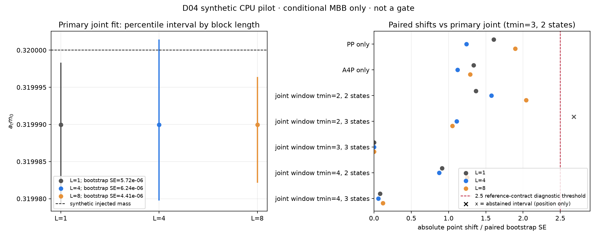

# D04 circular moving-block bootstrap pilot

**Status:** synthetic CPU method diagnostic only. No physical E-chain bytes, sealed data, GPU/QUDA, reference receipt, or certification were used.

## Frozen setup

- Synthetic configurations: 240; two-state truth `a_t m=(0.32, 0.91)`. Ground/excited amplitude fluctuations use a stationary AR(1) generator with `rho=0.65`; additive noise is independent.
- Circular moving-block bootstrap lengths: `[1, 4, 8]`; `24` replicates per length; seed base `2026112715`, per-length seed = base + L.
- `L=1` is the IID bootstrap baseline; `L=4,8` are declared sensitivity choices, not estimated decorrelation lengths. Each resample is applied once and shared by joint, PP-only, A4P-only, window, and state-count fits.
- The 95% intervals are empirical percentile summaries from a small pilot. They carry no finite-sample coverage guarantee; L selection is not tuned to these results.

## Diagnostic flow

```text
synthetic ordered PP/A4P bytes -> immutable source snapshot -> fold + shared covariance ->
circular block resample (same indices for all fits) -> fit every variant -> retain failed draws ->
primary mass interval + paired channel/window/model shifts -> diagnostic only / physical gate abstains
```

## Results and denominators

See `summary.csv` for each block length and contrast. Every fit records `planned/valid/failed/abstained`; each paired shift requires both fits from the same resample. The `tmin=2`, three-state contrast has 21/24 valid paired draws at `L=1`, so its interval abstains under the frozen 90% reporting rule; other lengths retain 23/24 valid draws. The 2.5 paired-SE line is shown only as a reference-contract diagnostic, not a pass/fail decision. A plotted `x` marks an abstained interval at a visual placeholder x-position; it is not a ratio value.



## Interpretation and limits

This pilot makes dependence sensitivity visible: the same synthetic input is analyzed with three fixed block sizes, while PP/A4P ablations and window/model changes are paired within each draw. A narrow interval at one L does not identify true dependence; the generator has a known AR(1) amplitude process, but production chain order, stationarity, gap, and dependence scale are not evidenced. An A4P-only shift is a diagnostic ablation and is not a replacement for the contract's joint PP/A4P reference.

The MBB percentiles do not establish 95% coverage, and the toy data do not validate the production source/sink or sign conventions. D04 remains `NOT_READY/UNCERTIFIED`; the source/reference/authorization gates remain open, sealed data stay closed, and `physical_score=null`.

`summary.csv` and the figure can be rebuilt from the saved `summary.json` with `--refresh-derived`; that operation verifies the existing artifact hashes first and does not refit or reread inputs.

## Source identity

The report's `source_hashes.json` binds the reader, report generator, test, and selected contract used at generation time. Hashes identify bytes only; they do not validate scientific correctness or authority.

| source | SHA-256 |
|---|---|
| `reader` | `2901d0e4c317e23136c8102807cbd59145b9340a29d5a51fd6a64ba294189651` |
| `diagnostic` | `d35404c35312d88581ac27672ba51d1726f7ff5ae9a6851063aa91994bae8b33` |
| `test` | `da88884e8471a3e5e2eff60a8ae0664a85d271eda03090af505db24962a00f4d` |
| `contract` | `2a272cffb0c49f0a87756f5a2d97fb2b80eaf53173e37e91a4e302e3d327a50e` |
