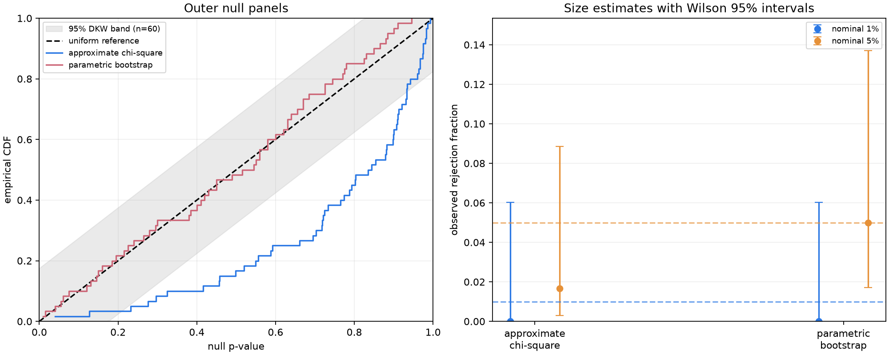

# D04 nested parametric-bootstrap pilot

**Status:** synthetic CPU diagnostic only. This does not provide a candidate-blind E-chain reference or change `D04 NOT_READY/UNCERTIFIED`.

## Frozen procedure

- Generate `60` independent exact two-state Gaussian null panels with `128` configurations each; fit the current D04 joint PP-even/A4P-odd two-state model (`tmin=3`, 13 nominal dof, three deterministic starts).
- For every valid outer fit, estimate the plug-in raw feature covariance from that panel, reconstruct the fitted null mean by solving GLS amplitudes at fitted masses, and draw `199` parametric panels. Every bootstrap panel is folded, its covariance is re-estimated with the current `25%` shrinkage and eigenvalue floor, and the spectrum is refit with all three starts.
- The bootstrap p-value is `(1 + exceedances)/(valid draws + 1)`. A panel needs at least `180` valid bootstrap fits (`90%`) or its bootstrap p-value abstains; failed draws stay in their planned denominator.
- Bootstrap covariance uses the unshrunk within-panel sample covariance, with only an eigenvalue floor `1e-12` of its largest eigenvalue to draw from a positive-definite plug-in model. This covariance is not the fit covariance; the latter is re-estimated and shrunk in every replicate.

The left panel compares the empirical p-value CDFs from the same outer null panels; the right panel shows nominal 1%/5% rejection rates and Wilson intervals. The bootstrap and chi-square p-values are paired panel-by-panel.

## Observed results

- Approximate chi-square: denominator `{'planned': 60, 'valid': 60, 'failed': 0, 'abstained': 0}`; p-value summary `{'count': 60, 'mean': 0.7522840393854023, 'median': 0.8391344873160577, 'ks_distance_to_uniform': 0.4193852585019485, 'rejection': {'0.01': {'count': 0, 'rate': 0.0, 'wilson_95': [0.0, 0.06017185214208986], 'nominal_rate': 0.01, 'mcse': 0.01284523257866513}, '0.05': {'count': 1, 'rate': 0.016666666666666666, 'wilson_95': [0.0029481597947862495, 0.08855129727590061], 'nominal_rate': 0.05, 'mcse': 0.028136571693556888}}}`.
- Parametric bootstrap: denominator `{'planned': 60, 'valid': 60, 'failed': 0, 'abstained': 0}`; p-value summary `{'count': 60, 'mean': 0.48458333333333337, 'median': 0.53, 'ks_distance_to_uniform': 0.06499999999999995, 'rejection': {'0.01': {'count': 0, 'rate': 0.0, 'wilson_95': [0.0, 0.06017185214208986], 'nominal_rate': 0.01, 'mcse': 0.01284523257866513}, '0.05': {'count': 3, 'rate': 0.05, 'wilson_95': [0.01714950216439568, 0.1370051647634852], 'nominal_rate': 0.05, 'mcse': 0.028136571693556888}}}`.
- Paired bootstrap minus chi-square comparison: `{'planned': 60, 'valid': 60, 'failed': 0, 'abstained': 0, 'mean_delta_bootstrap_minus_chi_square': -0.26770070605206886, 'median_delta_bootstrap_minus_chi_square': -0.2844143565184659, 'fraction_bootstrap_pvalue_lower': 1.0}`.

## Interpretation limits and next step

At 60 outer panels, the rejection-rate Monte Carlo standard error is about `0.0128` at 1% and `0.0281` at 5%. The B=199 bootstrap resolution is 0.005 before accounting for within-bootstrap Monte Carlo noise. This pilot can expose major miscalibration and exercise failure accounting, but cannot certify size or coverage. It assumes an iid Gaussian configuration generator, uses one plug-in covariance per outer panel, and has no AR(1), Student-t, HMC dependence, fit-window selection, or production source/sink conventions. The next calibration must use larger, independent outer/inner panels; compare iid and dependence-aware resampling under a wider rho/tail grid; and keep a separate untouched validation set. Keep `physical_score=null` until an authorized, candidate-blind E-chain snapshot and independent review close the D04 gate.

## Run denominators

- Outer panels: P/V/F/A = `60/60/0/0` for the approximate statistic; bootstrap outer p-values retain `{'planned': 60, 'valid': 60, 'failed': 0, 'abstained': 0}`.
- Nested bootstrap fits: P/V/F/A = `11940/11940/0/0`.
