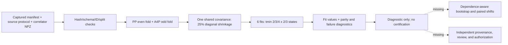

# D04 raw E-chain snapshot reader: CPU diagnostic v1

**Status:** software-path diagnostic only. It does not validate a physical
reference, produce an evidence envelope, or set `physical_score`.

## What this closes

The current checkout previously accepted a D04 JSON fit summary but had no
reader that began with raw PP/A4P correlator bytes. This diagnostic adds a
strict immutable-snapshot reader and executes the six contract-selected joint
fit variants. It uses only synthetic data in the regression fixture.



The reader requires exact manifest, source-protocol JSON and NPZ schemas, the `S16T16` quenched
Wilson `kappa=0.14` metadata, periodic meson correlator boundary, ordered
configuration and trajectory IDs, and the declared channel/dimension ordering.
It reads bytes only through `SourceByteSnapshot`; it never reopens a path. Raw
complex data are rejected rather than projected onto the real part.

For `T=16`, the implementation applies

```text
PP_even(t) = [PP(t) + PP(T-t)] / 2
A4P_odd(t) = [A4P(t) - A4P(T-t)] / 2
```

with `t=0,T/2` retained once and the A4P midpoint omitted from the fit. The
joint model uses shared ordered energies and separate amplitudes for the
three PP smearings and local A4P. One covariance over all `t=2..8` support is
used by every window/model variant, with the contract's 25% diagonal shrinkage
and relative eigenvalue floor `1e-10`. Three deterministic starts are tried
per variant; all attempts remain in the report.

## Synthetic result

The fixture contains 240 artificial configurations generated from shared
`a_t m_0=0.32`, `a_t m_1=0.91` two-state kernels, with small random per-row
amplitude variation and additive noise. It is a code-path fixture, not an
estimate from the E-chain.

| `tmin` | states | fitted `a_t m_0` | `chi2/dof` | approximate p | successful starts | smallest fitted gap |
|---:|---:|---:|---:|---:|---:|---:|
| 2 | 2 | 0.320004 | 0.00116 / 17 | 1.000 | 3/3 | 0.5901 |
| 2 | 3 | 0.320011 | 0.00072 / 12 | 1.000 | 2/3 | 0.0096 |
| 3 | 2 | 0.320006 | 0.00091 / 13 | 1.000 | 3/3 | 0.5902 |
| 3 | 3 | 0.320016 | 0.00062 / 8 | 1.000 | 3/3 | 0.0003 |
| 4 | 2 | 0.320007 | 0.00062 / 9 | 1.000 | 3/3 | 0.5904 |
| 4 | 3 | 0.320119 | 0.00036 / 4 | 1.000 | 3/3 | 0.0063 |

Fit-variant denominator is `6/6/0/0` (planned/valid/failed/abstained).
Multi-start attempts are `18/17/1`: one of the three starts in the `tmin=2`,
three-state fit did not converge, while two starts did. The small fitted
three-state gaps flag a non-identifiability warning even though the selected
best fits return finite values. The ensemble-mean reflection diagnostics are
`3.83e-6` relative RMS for PP-even and `1.07e-5` for A4P-odd; the reader reports
these descriptively and does not impose per-configuration symmetry.

The main two-state `tmin=3` fit recovers the fixture's injected ground-state
mass to about `5.6e-6`. The near-unit approximate p-values only show that the
synthetic fixture is easy for its own model; they do not calibrate the p-value
on noisy, dependent lattice data.

## Validation and remaining boundary

`tests/test_optimize_d04_raw_reference.py` checks the folding formulas,
snapshot immutability after the source path changes, all six fit variants,
closed-split rejection, increasing ID requirements, stale bytes, explicit
rejection of complex values, and protocol-byte/manifest-hash consistency.
Result: **7 passed**.

The implementation still does not compute dependence-aware bootstrap mass
uncertainty or paired PP/A4P/window/model shifts. It does not parse the D04
dependence receipt, establish chain provenance, verify independent review or
authorization, nor produce the D04 adapter's gate-ready `reference_summary`.
Its fit covariance is formed from configuration rows and the reported GLS
goodness-of-fit is approximate; without a validated dependence model, neither
is certification evidence. Production E-chain inputs, independent review and
authorization remain absent. D04 stays `NOT_READY/UNCERTIFIED`, sealed splits
remain closed, and `physical_score=null`.
