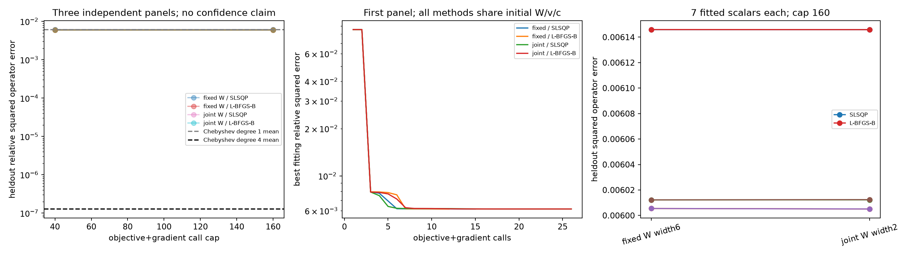

# Trainable W operator objective CPU bridge

Status: **COMPLETED CPU DIAGNOSTIC; production and physical comparison NOT_RUN**. `physical_score=null`.

**Provenance review added 2026-11-23:** the archived protocol's `trainable_w.py` source hash does not match the source version bundled beside this report, and the original hash list omitted the imported `trainable_w_diagnostic.py` SU(3) fixture helper. Retain this report as the historical result, not as a fully source-closed receipt. A fixed-seed replay with all direct Python sources bound is recorded in [`trainable_w_operator_cpu_replay_20261123_v1`](../trainable_w_operator_cpu_replay_20261123_v1/README.md); it does not add independent panels or physical data.

The target is a trace-normalized gauge-covariant heat kernel G=exp(0.18 H)/(tr exp(0.18 H)/dim), independent of the learned parameterization. H is the actual periodic SU(3) nearest-neighbor hopping operator. Each link is fresh synthetic Haar-like SU(3), with shape (directions x/y/z, z/y/x, color/color), L=3. Full color/site identity probes give an exact Frobenius loss. No temporal/gamma/source/sink or real gauge ensemble is modeled. Trace normalization is a fixture convention, not physical smearing normalization.

## Design and what this resolves

Each of 3 independent panels uses 3 fitting and 3 heldout links. All four solver/model arms share their initial W/v/c and box [-3,3], and SLSQP/L-BFGS-B receive the same analytic gradient and 40/160 objective+gradient call caps. Fixed W changes v/c only; joint W changes all 7 variables. The selected point minimizes observed fitting loss inside the cap. Final loss/KKT and heldout evaluations are diagnostic overhead outside that cap and are not used for selection. Time shown is optimizer time only, excluding link/target preparation and postchecks. This is a call-budget comparison, not matched total walltime or training amortization.

Parameter-budget control: an additional fixed-W width6 arm fits 7 v/c scalars, matching the 7 optimized W/v/c scalars of joint width2. It shares the first 2 random W rows and v entries, but its four additional random features change the function class and initialization. This is an equal fitted-parameter count sensitivity, not a perfect identical-class ablation. The fixed width2 arm has 3 fitted scalars and isolates W freezing; do not treat its comparison as equal capacity. All caps apply per complete fit, without uncounted restarts.

Chebyshev degree 1/4 coefficients are fit by unconstrained real least squares on the same fitting targets, then evaluated without refitting heldout. They are strong comparator families with independently adjustable identity term, different parameter domains, and direct linear algebra rather than matched calls. The target is a spectral function by definition, so these comparisons probe whether one-hop learned coefficients offer any reason to pursue this target; they cannot establish universal spectral superiority.

|panel|cap|W|solver|calls|budget stop|solver success|fit loss|heldout loss|projected grad|W update|optimizer seconds|
|---|---|---|---|---|---|---|---|---|---|---|---|
|2026112201|40|fixed2|SLSQP|15|False|True|0.00616421|0.0061459|6.5e-07|0|0.00138|
|2026112201|40|fixed2|L-BFGS-B|12|False|True|0.00616421|0.0061459|3.7e-10|0|0.000797|
|2026112201|40|joint2|SLSQP|26|False|True|0.00616421|0.0061459|8.21e-09|0.231|0.001427|
|2026112201|40|joint2|L-BFGS-B|26|False|True|0.00616421|0.0061459|1.34e-08|0.328|0.001322|
|2026112201|160|fixed2|SLSQP|15|False|True|0.00616421|0.0061459|6.5e-07|0|0.0008885|
|2026112201|160|fixed2|L-BFGS-B|12|False|True|0.00616421|0.0061459|3.7e-10|0|0.0006788|
|2026112201|160|joint2|SLSQP|26|False|True|0.00616421|0.0061459|8.21e-09|0.231|0.001341|
|2026112201|160|joint2|L-BFGS-B|26|False|True|0.00616421|0.0061459|1.34e-08|0.328|0.001451|
|2026112201|40|fixed6|SLSQP|12|False|True|0.0061642|0.00614592|2.84e-08|0|0.000804|
|2026112201|40|fixed6|L-BFGS-B|38|False|True|0.00616413|0.00614596|3.22e-07|0|0.002208|
|2026112201|160|fixed6|SLSQP|12|False|True|0.0061642|0.00614592|2.84e-08|0|0.0008104|
|2026112201|160|fixed6|L-BFGS-B|38|False|True|0.00616413|0.00614596|3.22e-07|0|0.002297|
|2026112202|40|fixed2|SLSQP|12|False|True|0.00607482|0.00600511|3.72e-07|0|0.0007108|
|2026112202|40|fixed2|L-BFGS-B|14|False|True|0.00607482|0.00600511|2.66e-11|0|0.0007589|
|2026112202|40|joint2|SLSQP|40|True|False|0.00607484|0.0060051|5.93e-06|0.359|0.001986|
|2026112202|40|joint2|L-BFGS-B|40|True|False|0.00607485|0.00600511|4.73e-05|0.318|0.001932|
|2026112202|160|fixed2|SLSQP|12|False|True|0.00607482|0.00600511|3.72e-07|0|0.000653|
|2026112202|160|fixed2|L-BFGS-B|14|False|True|0.00607482|0.00600511|2.66e-11|0|0.0006871|
|2026112202|160|joint2|SLSQP|69|False|True|0.00607482|0.00600509|2.61e-08|0.51|0.003513|
|2026112202|160|joint2|L-BFGS-B|82|False|True|0.00607482|0.00600509|6.71e-08|0.511|0.00392|
|2026112202|40|fixed6|SLSQP|28|False|True|0.0060747|0.00600547|1.4e-08|0|0.001732|
|2026112202|40|fixed6|L-BFGS-B|24|False|True|0.0060747|0.00600547|1.71e-07|0|0.001403|
|2026112202|160|fixed6|SLSQP|28|False|True|0.0060747|0.00600547|1.4e-08|0|0.001768|
|2026112202|160|fixed6|L-BFGS-B|24|False|True|0.0060747|0.00600547|1.71e-07|0|0.001437|
|2026112203|40|fixed2|SLSQP|20|False|True|0.00594761|0.00601227|3.16e-07|0|0.001045|
|2026112203|40|fixed2|L-BFGS-B|15|False|True|0.00594761|0.00601227|2.89e-11|0|0.00075|
|2026112203|40|joint2|SLSQP|20|False|True|0.00594761|0.00601227|6.36e-07|0.00887|0.001038|
|2026112203|40|joint2|L-BFGS-B|40|True|False|0.00594758|0.00601229|4.49e-05|0.293|0.001934|
|2026112203|160|fixed2|SLSQP|20|False|True|0.00594761|0.00601227|3.16e-07|0|0.001052|
|2026112203|160|fixed2|L-BFGS-B|15|False|True|0.00594761|0.00601227|2.89e-11|0|0.0007958|
|2026112203|160|joint2|SLSQP|20|False|True|0.00594761|0.00601227|6.36e-07|0.00887|0.00101|
|2026112203|160|joint2|L-BFGS-B|77|False|True|0.00594756|0.00601241|1.99e-07|0.564|0.003567|
|2026112203|40|fixed6|SLSQP|40|True|False|0.00594741|0.00601222|1.81e-05|0|0.002348|
|2026112203|40|fixed6|L-BFGS-B|33|False|True|0.00594739|0.00601223|5.88e-09|0|0.00189|
|2026112203|160|fixed6|SLSQP|44|False|True|0.00594739|0.00601223|7.99e-09|0|0.002519|
|2026112203|160|fixed6|L-BFGS-B|33|False|True|0.00594739|0.00601223|5.88e-09|0|0.001937|

|panel|Chebyshev degree|fit loss|heldout loss|setup+fit seconds|
|---|---|---|---|---|
|2026112201|1|0.00616451|0.0061465|0.00174|
|2026112201|4|8.55334e-08|2.40151e-07|0.001749|
|2026112202|1|0.00607608|0.00600645|0.0006495|
|2026112202|4|2.45045e-08|3.33756e-08|0.001609|
|2026112203|1|0.00594793|0.00601305|0.0006213|
|2026112203|4|1.54395e-08|1.10806e-07|0.001479|

## Diagnostics and interpretation

The compressed quadratic in edge coefficients was checked against dense apply_kernel Frobenius loss at each panel initial point on both fitting and independent heldout links (absolute discrepancy below 1e-12). All 7 joint-W analytic parameter derivatives were checked on fitting and independent heldout links by centered finite differences (max error below 1e-8). Raw JSON retains values, gradients, all traces, selected parameters, solver non-success and cap stops; NPZ retains all actual links and targets. `protocol.json` was written before data generation and binds source hashes and seeds. All 36 planned solver runs returned; no samples were excluded. Budget stops are valid finite-budget observations and are not convergence claims. Projected-gradient residuals are continuous diagnostics with no production acceptance threshold.

Observed result: at cap160, joint-W heldout squared error is 0.00600509–0.00614590 for SLSQP and 0.00600509–0.00614590 for L-BFGS-B (one L-BFGS-B panel is 0.00601241). Fixed-width2 differs only at roughly 1e-7 absolute or below. Equal-count fixed-width6 is slightly better in one panel and slightly worse in two; no stable learned-W advantage is established. Degree4 spectral heldout error is 3.34e-8–2.40e-7; degree1 is approximately 0.0060. Thus improving the one-hop parameterization/optimizer has very little headroom on this target, whereas changing operator range has a large effect. This is a structural negative diagnostic conditional on this spectral target.

Target checks for all18 links retain Hermiticity, trace-minus-dimension and positive minimum eigenvalue in raw.json. Candidate K has trace dim exactly at L3 because hopping has no diagonal. Candidate Hermiticity follows from real paired-edge coefficients, but positivity is not imposed. These trace/spatial/boundary conventions match for this objective; production normalization is still open.

This bridge establishes that trainable W can optimize a target defined at the operator-action level, beyond coefficient-label recovery. More calls to this same heat-kernel fixture cannot determine the physical learned-smear question. Read paired solver differences and family differences separately; three panels provide no calibrated population interval. Positivity, Gaussian sandwich, physical risk, independent-ensemble generalization, GPU time, production integration, and superiority to SLSQP remain unproven. Next production work still requires a justified physical reference/objective, frozen comparison/normalization and budgets, then an authorized GPU development run before sealed evaluation.

## Verification

`python3 -B -m pytest -q -p no:cacheprovider tests/test_optimize_trainable_w.py`: **9 passed in 0.26s**. The new diagnostic itself checks analytic gradients against finite differences and compressed objective against dense matrices on fitting and heldout links, independently of these pre-existing coefficient-model tests. Static receipt audit verifies 36 runs, 7 optimized scalars in both capacity-control arms, all caps respected, source snapshot hash, and all18 target trace/Hermiticity/positive-eigenvalue checks.

Reproduce with `OPENBLAS_NUM_THREADS=1 OMP_NUM_THREADS=1 PYTHONDONTWRITEBYTECODE=1 python3 -B -m tasks.optimize_gaussian.trainable_w_operator_diagnostic --out <fresh-directory>`. The final output refuses an existing directory; source_snapshot.py preserves the exact executed diagnostic bytes. Walltime is host-dependent and no speed ranking is inferred.
