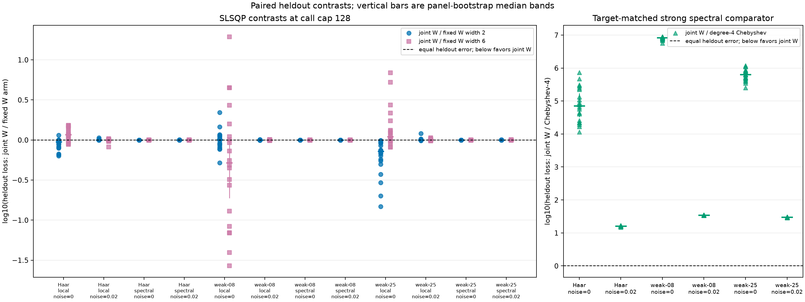

# Trainable-W replication and strong-baseline comparison

**Classification:** synthetic CPU operator-objective diagnostic. `physical_score=null`; no production gauge input, sealed split, GPU, or QUDA was accessed.



## Design

This follow-up expands the existing gauge-covariant operator stress grid from 3 to 20 independent synthetic panels in each of 12 generator × target × noise cells. Each panel uses two fit links and two separately generated heldout links. Four optimization arms receive the same panel-specific initialization and the same 32/128 objective-gradient call caps: trainable-W + SLSQP, trainable-W + L-BFGS-B, fixed-W width 2 + SLSQP, and fixed-W width 6 + SLSQP. The width-6 fixed-W arm matches the seven fitted scalar count of trainable width 2, while using extra seeded features. On spectral-heat targets, a degree-4 Chebyshev linear least-squares baseline is also fit on the same fit links and evaluated on heldout links; it does not share optimizer-call cost.

The paired table uses `log10(heldout loss of trainable-W SLSQP / comparator loss)` at the 128-call cap. Negative values favor trainable-W. `paired_summary.csv` gives cell medians, panel win fractions, and seeded 10,000-resample percentile bands for the cell median. Those bands quantify Monte Carlo uncertainty for these synthetic cell medians only; they are not coverage-calibrated confidence intervals for future physical performance.

## Findings

There were 240/240 valid panels, 480/480 fit links, 480/480 heldout links, and 1,920/1,920 returned solver fits. No panel or fit was excluded. The 566 budget-stop/non-success solver fits remain recorded; they are finite-budget outcomes, not silently dropped failures.

Across local-environment cells, the per-cell fraction of panels where trainable-W beat fixed-W width 2 ranged from 0.30 to 1.00 (cell average 0.63). Against the equal-parameter-count fixed-W width 6 arm it ranged from 0.30 to 0.65 (cell average 0.45); this does not show a stable learned-W advantage. Across spectral-heat cells, trainable-W beat width 2 in 0.35–0.50 of panels and equal-count fixed-W width 6 in 0.50–0.75. The paired loss ratios are mostly close to one for these SLSQP controls.

For the spectral-heat target, the degree-4 Chebyshev heldout loss was lower in every cell. The median trainable-W/Chebyshev loss ratio ranged from about 16 to 8.3 million across the six cells; the geometric average of the six cell median ratios was about 4.3 thousand. The much larger gaps occur in noiseless panels where the target is generated by a spectral function. With 2% operator noise, the per-cell median ratios were about 16–35. This is a target-family-specific result, and the direct least-squares Chebyshev baseline is not a matched-cost comparison.

The plot separates the near-unity SLSQP contrasts from the much larger Chebyshev ratios so both remain legible. The complete full-run `raw.json` and synthetic input arrays are retained locally under the path recorded in `summary.json`; this compact review bundle retains all 240 paired panel outcome rows and the reproducible seed plan.

## Limits and next gate

These operator Frobenius losses are not D04 correlator risk, do not use the bounded block-risk estimand, and do not test `r_star=10/9`, the production Gaussian sandwich, or SU(3) production receipts. Optimizer time excludes target/link setup and postchecks. The results support continued testing against the same-budget SLSQP control, but do not support a physical claim that learned smearing is superior. The observed strong-baseline result is conditional on a target deliberately generated from a heat-kernel family.

Reproduce the full raw run with:

```bash
PYTHONPATH=. python -B -m tasks.optimize_gaussian.trainable_w_stress_diagnostic \
  --output results/optimize_gaussian/trainable_w_stress_20261126_v7 \
  --replicates 20 --bootstrap-draws 10000
```

The source SHA-256 values and exact panel seeds are in `protocol.json`; `paired_panels.csv` preserves each panel's paired losses, solver status, and call-budget outcome.
