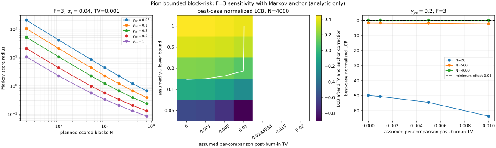

# Pion F=3 block-risk sensitivity

**Analytic planning only. No score blocks, correlators, anchor observations, receipts, sealed splits, GPU, or QUDA inputs were read. `physical_score=null`.**

## Selected design and formula

The selected three-comparison family (`F=3`), `alpha_score=0.04`, `alpha_anchor=0.01`, and normalized effect threshold `0.05` are combined with the chosen conditional Markov-anchor plan (`n_A=4000`, `gamma_A>=0.20`, 8 burn-in states, post-burn-in TV `<=0.001`, support `[0.1,3.0]`, `C/R=0.01`). The anchor interval uses family size 1; TV consumes `0.001` of `alpha_anchor`. The fixed scalar map and its target-bias bridge remain unresolved, so this is formula planning only and the evaluator must abstain.

For each assumed `N`, pseudo-gap lower bound and per-comparison TV bound, the existing corrected fixed-score Markov helper evaluates the stationary Bernstein radius using remaining score alpha `0.04 - F*TV`. The optimistic best-case LCB is `1 - epsilon - 2*TV - 2B/R`, with score mean fixed at its mathematical maximum 1. A parameter combination is abstained if `F*TV >= alpha_score`; an LCB that is defined but below 0.05 is reported as unreachable even under this best-case mean.



Panel 1 varies `N` and `gamma_ps` at assumed `TV=0.001`. Panel 2 shows the best-case normalized LCB at `N=4000` over `gamma_ps` and TV; blank cells are alpha-budget abstentions. Panel 3 isolates TV sensitivity for `gamma_ps=0.2` at three block counts. None of these values estimates the project chain's gap, TV, anchor bias, or coverage.

## Flow and denominators

```text
frozen E-chain reference and score map -> reviewed length-5 block-chain conditions
  -> gamma_ps lower bound + burn-in/TV receipt -> reserve F*TV and compute Markov radius
  -> conditional Markov anchor scalar map + gamma/TV/support/C receipts -> subtract 2B/R
  -> evaluate full N planned blocks (failed blocks stay -1) -> LCB > 0.05 or ABSTAIN
  -> separate confirmation authorization and physical review; score remains null until then
```

Formula-scenario denominators: planned/valid/failed/abstained = 245/140/0/105. These count formula combinations only. New physical measurement denominators are 0/0/0/0. At the selected planning point `N=4000`, assumed `gamma_ps=0.20`, assumed `TV=0.001`, score radius is `0.386316` and best-case normalized LCB is `0.187605`. These are conditional arithmetic outputs, not evidence that the assumed values hold.

## Still required before a certificate

- Independent candidate-blind E-chain correlator receipt and successful reference/model gate.
- Reviewed score-specific block-chain and `gamma_ps >= 0.20` lower-bound evidence; block spacing alone is insufficient.
- Burn-in 8 / post-burn-in TV `<=0.001` receipt for every comparison.
- Fixed bounded anchor scalar map with target-bias bridge, 4000 post-burn-in anchor states, anchor-chain gap/TV/support receipts, common-bias `C/R<=0.01` evidence, and conditional-independence review. The 1000-unit IID Hoeffding route is only a separately receipted fallback.
- Authorized unsealed confirmation data and independent review. Production data and GPU/QUDA remain unauthorized.
