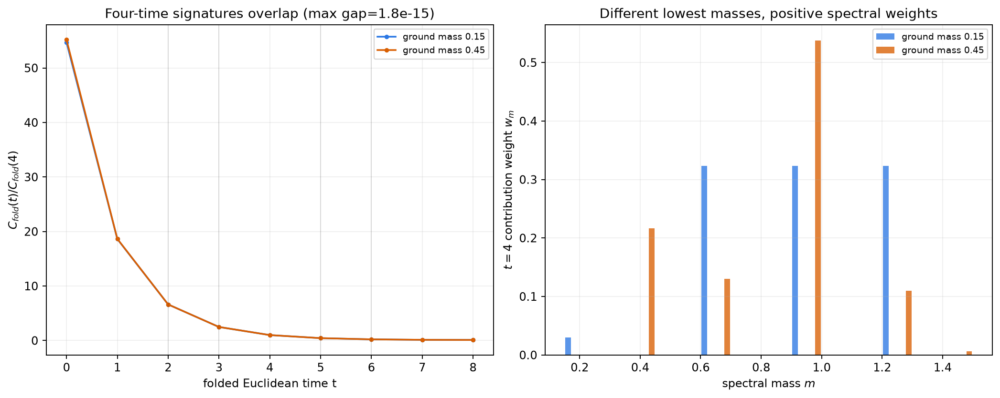

# Pion anchor: a positive-spectrum alias survives the four-time feature

**Classification:** constructive noiseless periodic-spectrum counterexample only. It uses finite positive spectral amplitudes and checks the frozen scalar reader; it does not use gauge configurations, an anchor/reference chain, sealed inputs, GPU or QUDA. `physical_score=null`.

## Construction and result

The first spectrum has masses `[0.15, 0.60, 0.90, 1.20]`; its positive contributions to `C_fold(4)` are `[0.03, 0.97/3, 0.97/3, 0.97/3]`. A second spectrum with masses `[0.45, 0.70, 1.00, 1.30, 1.50]` is obtained by solving for its five positive `t=4` weights so that normalization and all four distinct ratios match. The actual positive amplitudes are `A_i=w_i/K(m_i,4)`.

The lowest masses differ by `0.30`. Both spectra match all four listed ratios within `1.78e-15`, and the production `anchor_scalar` reader returns the same `m_eff(4)` within `3.33e-16`.



## Interpretation and limits

This is a direct no-go for treating this particular finite-time feature vector plus positivity and the `[0.1,3.0]` mass support as a globally identifying ground-state map. It does not show that the physical ensemble contains either constructed spectrum. It also does not rule out a useful anchor method under an independently justified finite-state, gap, overlap or amplitude-ratio restriction; such a restriction and a uniform bridge to the candidate-blind PP/A4P `m*` would need evidence and independent review.

Data flow: `positive periodic spectra -> t=4 contribution weights -> solve finite feature-matching constraints -> verify positive amplitudes -> production scalar and four-time feature agree -> physical gate abstains`. Planned/valid/failed/abstained denominators are in `summary.json`.

Reproduce from the repository root:

```bash
python -m tasks.pion_projection.anchor_multitime_alias_diagnostic \
  --output tasks/pion_projection/anchor_multitime_alias_replay_v1
```
