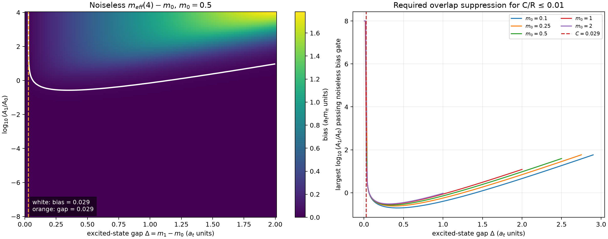

# Pion anchor scalar-map bias sensitivity

**Data-free analytic sensitivity only.** No correlator, anchor chain, reference chain, validation/holdout split, propagator cache, GPU or QUDA input was read. This report does not certify `C<=0.029 a_t m_pi` or Markov coverage and keeps `physical_score=null`.

## Candidate map

For each predeclared anchor block, form the zero-momentum folded pseudoscalar correlator and calculate

```text
m_eff(4) = acosh((C_fold(3) + C_fold(5)) / (2 C_fold(4)))
```

The candidate support is `[0.1, 3.0]` in `a_t m_pi`. A nonpositive denominator, argument below one beyond roundoff, nonfinite value, or mapped value outside support is an abstention; values are never clipped or silently dropped. This choice follows the fixed `T=16` folded-PP convention. It is only a candidate map for independent review.

## Two-state diagnostic

The analytic scan uses

```text
C_fold(t) = A0 [e^(-m0 t) + e^(-m0 (16-t))]
          + A1 [e^(-m1 t) + e^(-m1 (16-t))]
m1 = m0 + Delta,  A0 > 0, A1 >= 0
```

The proposed common-bias cap is `C=0.01 R=0.029 a_t m_pi`. The left panel shows the noiseless spectral shift `m_eff(4)-m0` at `m0=0.5`; the white contour marks the cap. The right panel gives the largest excited/ground amplitude ratio `A1/A0` that passes this **noiseless two-state** cap at each gap and selected `m0` values.



The reproducible grid is in [`bias_grid.csv`](bias_grid.csv), with threshold curves in [`overlap_thresholds.csv`](overlap_thresholds.csv). Exact grid sizes, passing fraction, formulas and limitations are in [`summary.json`](summary.json). Rebuild in a new directory with:

```bash
python -m tasks.pion_projection.anchor_scalar_map_bias_diagnostic --output NEW_DIRECTORY
```

Selected noiseless thresholds are shown below. They are required upper limits on `A1/A0` for the two-state mean correlator to pass the proposed `C=0.029` cap; they are not measured overlap ratios.

| `m0` | `Delta` | maximum `A1/A0` |
|---:|---:|---:|
| 0.25 | 0.05 | 1.600 |
| 0.25 | 0.10 | 0.546 |
| 0.25 | 0.25 | 0.266 |
| 0.25 | 0.50 | 0.254 |
| 0.25 | 1.00 | 0.566 |
| 0.50 | 0.05 | 1.611 |
| 0.50 | 0.10 | 0.556 |
| 0.50 | 0.25 | 0.284 |
| 0.50 | 0.50 | 0.293 |
| 0.50 | 1.00 | 0.717 |
| 1.00 | 0.05 | 1.633 |
| 1.00 | 0.10 | 0.571 |
| 1.00 | 0.25 | 0.304 |
| 1.00 | 0.50 | 0.331 |
| 1.00 | 1.00 | 0.868 |

## Interpretation and gate

When `Delta > 0.029`, the map needs a sufficiently small `A1/A0`; the allowed ratio depends on both the gap and `m0`. The support interval by itself only gives a possible discrepancy as large as `2.9`, so it cannot establish the proposed cap. Even a passing point on this diagram is not a real receipt: random blockwise effective-mass nonlinearity, thermal/model mismatch, and the difference between this PP map and the candidate-blind joint PP/A4P reference remain outside this calculation. A reviewer must require an independent overlap/gap envelope and demonstrate that the **expectation of the fixed block map** differs from the joint-fit target by at most `0.029`; otherwise the anchor map remains rejected and the Pion gate abstains.

Text flow: `freeze folded-PP block map -> positive two-state T=16 scan -> plot bias and required A1/A0 envelope -> check missing stochastic/model terms -> no receipt => ABSTAIN`. Formula grid planned/valid/failed/abstained is `27945/27945/0/0`; physical anchor receipts are `0/0/0/1` and physical scoring remains withheld.
